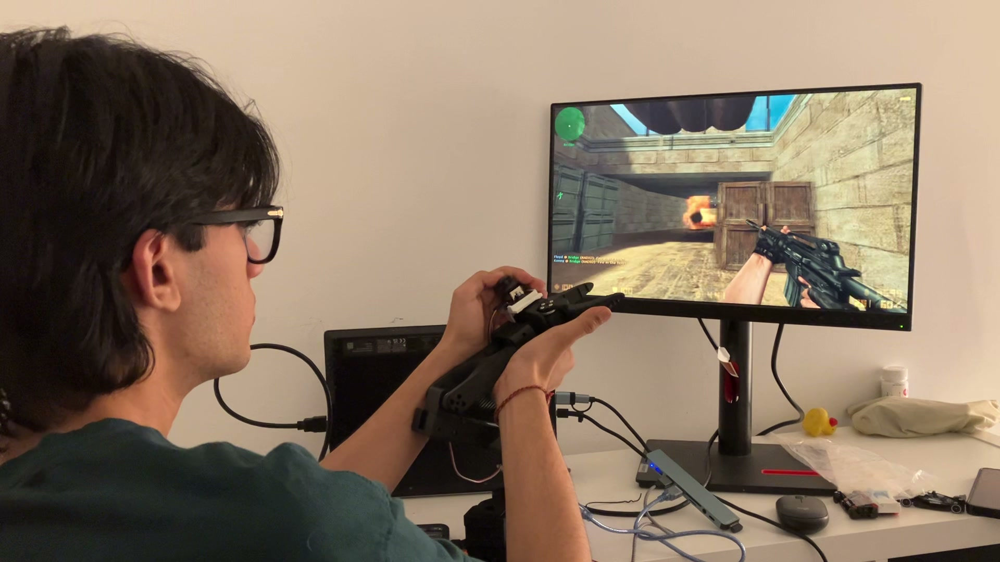
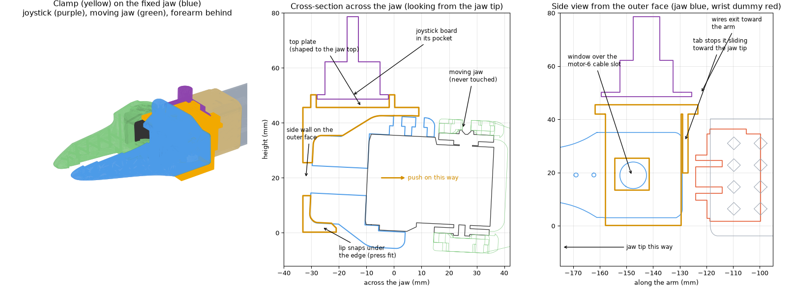

*Figure 1. Mid-burst against bots. Both hands are on the arm, the thumb on the joystick.*

## Summary

I turned an SO-101 follower arm into a controller for Counter-Strike: Condition Zero. The arm is input and output at once. Moving it aims, a thumb joystick clipped to the gripper walks and fires, squeezing the gripper gives right click and use, and on every shot the shoulder and elbow kick the arm up into the hand. I was short of the servo connectors needed to daisy-chain all six motors, so the wrist came off and a printed block took its place. Three design problems took most of the iteration. Absolute (rate) aiming drifted, so aim became relative, like a mouse. Recoil sent as position targets was barely felt, so the two recoil joints run in PWM mode and each shot is a 40 ms force pulse. Relative aim runs out of range, so the arm drives itself back to centre, and the first version did that while I was still holding it. The fix needed no extra sensor: a held arm always trembles, so the return waits until every joint has moved at most one encoder step (0.088°) for 0.38 s. Recoil force, input latency and the detector's error rates were not measured.

| Item | Detail |
| --- | --- |
| Period | 2026-11-14 to 2026-11-16, personal project |
| Role | Everything: CAD, wiring, firmware, control software, tuning |
| Hardware | SO-101 follower with four Feetech STS3215 servos (base, shoulder, elbow, gripper), printed wrist block, KY-023-style thumb joystick on an Arduino Uno |
| Software | Python 3.12 at 125 Hz: reads the bus, writes Windows SendInput keys and relative mouse moves, runs the haptics; trimesh for the CAD |
| Deliverables | `arm_cs.py`, `haptics.py`, `calibrate_nowrist.py`, the wrist block and joystick clamp STLs, a recorded session against bots |

## 1. Hardware

The stock arm daisy-chains six servos from the driver board. Without enough connectors I dropped the two wrist motors (IDs 4 and 5) and ran the chain board, base (1), shoulder (2), elbow (3), gripper (6). The base kept its factory ID; the shoulder was re-addressed alone on the bus.

The gap where the wrist was is filled by a printed block generated from the official SO-ARM100 URDF meshes. Its fit zone is the STS3215 case envelope with the under-arm and wrist holder carved out, so it keeps the stock press-fit interference and takes the holder's four M2 screws in 1.6 mm pilot holes. Its front face is a copy of the servo horn, a 9.6 mm radius boss with four M3 holes, so the gripper's fixed jaw bolts on as it did to motor 5. The neck between them is the shortest one that clears the gripper by 1 mm, which keeps slack in the gripper cable.

The joystick sits on a press-fit C-clip around the fixed jaw, under the thumb while the palm rests on the jaw and the fingers close the moving jaw. The clip's bottom lip is undersized, so the clip flexes open and grips; it slides on from the outer face, a tab at the back stops it creeping toward the jaw tips, and a window leaves the motor 6 cable free. The joystick board snaps into a pocket on top. It reports to an Arduino Uno over serial at 115200 baud, and because the board is mounted turned, its axes are rotated 90° in software.

*Figure 2. The joystick clamp (yellow) on the fixed jaw (blue), from the generating script. Middle: the cross-section, with the lip that snaps under the jaw's edge. Right: the side view, with the window over the motor 6 cable slot and the tab that stops the clip sliding toward the tips.*

## 2. Mapping

A calibration script records the neutral pose and the direction and full deflection of each joint while I hold neutral, base right, shoulder up, elbow up and a full squeeze. It writes only a file, nothing to the motors.

| Input | Game action |
| --- | --- |
| Base swing | Turn (mouse X) |
| Shoulder and elbow, summed | Look up and down (mouse Y): where the forearm points |
| Joystick | W, A, S, D, on at 45 % of throw and off at 30 % |
| Joystick click | Fire, held |
| Quick gripper squeeze | Right click (scope, secondary fire) |
| Gripper closed and held | Use (E) |
| Weapon slot keys 1 and 2 | Select the rifle or pistol recoil profile |

Input reaches the game through Windows SendInput as scancodes and relative mouse moves. GoldSrc reads those with raw input on or off, so nothing depends on the game's controller support.

## 3. Aim: from rate to relative

The first mapping was rate control: deflection from neutral set the turn speed, like a joystick. On a stiff arm it overshot, and any time the arm rested off centre the view kept turning. Aim is now relative: the crosshair moves by how far the joints move, not by where they are. Moving a joint across its whole calibrated range sends 6000 mouse counts in yaw and 2700 in pitch, about a full turn and a half turn at in-game sensitivity 3.

<video controls autoplay muted loop playsinline width="1280" height="720" style="display:block;width:100%" src="/projects/armcontroller/armcontroller_aim.mp4" aria-label="Both hands move the arm and the view on the monitor turns with it."></video>

*Video 1. Aiming. The view follows the arm's motion, the way a mouse works.*

## 4. Recoil

The first recoil sent each joint a position target past where it stood. The STS3215 eases toward a position target, so a short kick ended before the servo built up force: in the hand it was barely there, at about 10 % load. The shoulder and elbow now run in PWM mode (operating mode 2) while the controller is active, so a kick is a commanded force rather than a target. Each shot is one 40 ms pulse with torque off in between, so my hand does the recovery, and pulses stack into a climb during a burst. The rifle fires a pulse every 0.10 s (600 rounds per minute) at a duty of 520 of 1000 on the first shot and 420 after; the pistol gives one pulse of 460 per click. The shoulder takes 80 % of the duty and the elbow all of it. A bench test showed that positive PWM lowers the reported position on both joints, so the direction bit is set from that. Position mode is restored on every exit, and at the next start if a crash left PWM behind.

<video controls autoplay muted loop playsinline width="1280" height="720" style="display:block;width:100%" src="/projects/armcontroller/armcontroller_recoil.mp4" aria-label="Over the shoulder: a burst down a corridor, then the kill notice in the top right corner of the screen."></video>

*Video 2. A burst and a kill. The burst runs from about 0.2 s to 3 s; the kill notice appears top right at 5 s.*

## 5. Recentring and the hand detector

Relative aim has the same problem as a mouse at the edge of its pad: turn the same way twice and the joint runs out of range. A mouse is lifted and put back. The arm drives itself back to its calibrated neutral, and the controller ignores that motion so the view stays where it was.

The first version returned whenever the arm was off centre, including while I held it, and it felt like the arm was squirming in my hand. There is no touch sensor. A held arm, though, is never perfectly still: the hand trembles and the encoders see it. A released arm is dead still, because the gearbox friction holds it. So the return starts only when every one of the three centre joints has moved at most one encoder step in the last 0.38 s, is moving slower than 4°/s, and sits more than 5° from neutral, so small aiming moves never trigger it. Allowing two steps let a steady grip read as free now and then.

The joints then return together, the base in position mode with a torque limit of 180 and the shoulder and elbow in PWM with a duty of 90 plus 28 per degree of error, capped at 350. If any joint makes no progress for 0.1 s, or is pushed 0.4° back, all of them let go at once and wait 0.6 s, doubling up to 3 s per resisted try; moving the arm faster than 10°/s resets the wait. A joint within 1.5° of neutral counts as home and its torque goes off. A quick full squeeze of the gripper recentres on demand and taps the game's level-view key.

<video controls autoplay muted loop playsinline width="1280" height="720" style="display:block;width:100%" src="/projects/armcontroller/armcontroller_handsoff.mp4" aria-label="Explaining the arm with it in view: hands come off the arm and go back on, and the view on the monitor holds still."></video>

*Video 3. Hands on and off while explaining the controls. With no hand on it the arm is left alone, and the view on screen does not move.*

## 6. The gripper as buttons

The jaw has no spring, so it stays wherever it is left. A squeeze is measured from a baseline that follows where the jaw rests, settling in about 0.4 s. A quick squeeze that stops short of closed, at least 18 % of travel and then slower than 15 %/s for 0.05 s, sends a 50 ms right click; waiting for a release would not work, because the jaw does not come back on its own. Closing past 90 % for 0.3 s holds use until the jaw opens below 70 %. The first threshold was 65 %, which felt like half a squeeze. With the haptics on, the gripper also returns: once the jaw has sat still for 0.2 s it is driven gently back to neutral, and if it does not move, because a hand is still on it, the torque drops and it tries again 0.6 s later.

## 7. What came out

Two effects worked in code and were removed because of how they felt. A light drag on all three arm joints, meant to give the gun mass, felt sticky in position mode even at a torque limit of 1 %. Gravity compensation in PWM mode needed a steady holding force, and a steady force keeps the driver braking the motor, so the arm went stiff in both directions. Both are off.

## 8. Safety and edge cases

The force caps are written only to the Torque_Limit register in RAM, which resets at power-up; no EEPROM setting is written. Torque is on only while the controller is active and goes off on pause, quit, Ctrl-C, any crash, any motor alarm, or a motor above 60 °C. A fault has to show on three consecutive checks before it trips, after one garbled read reported 150 °C. Below 4.5 V or above 13 V torque does not come on.

Some joints swept through their encoder's wrap point, the jump from 4095 back to 0. I shifted their homing offsets so no joint crosses it in use, torque is cut within 30 counts of the wrap, and no goal ever crosses it. In PWM mode the STS3215 reports position without the homing offset, so the controller adds it back to keep the readings consistent between modes.

## 9. Results and limitations

The arm played full rounds against bots in Counter-Strike: Condition Zero, filmed on 2026-11-16. Video 2 is one of the bursts that ended in a kill. Nothing was measured beyond play: not the force of a kick, the delay from arm to crosshair, or how often the hand detector reads a held arm as free or a free one as held. Those are the next tests: log the joints and the input stream together, and put a load cell under the gripper.

I iterated by playing: each change came from how the last version felt in the hand, and the most useful sensor turned out to be the encoders the arm already had.
