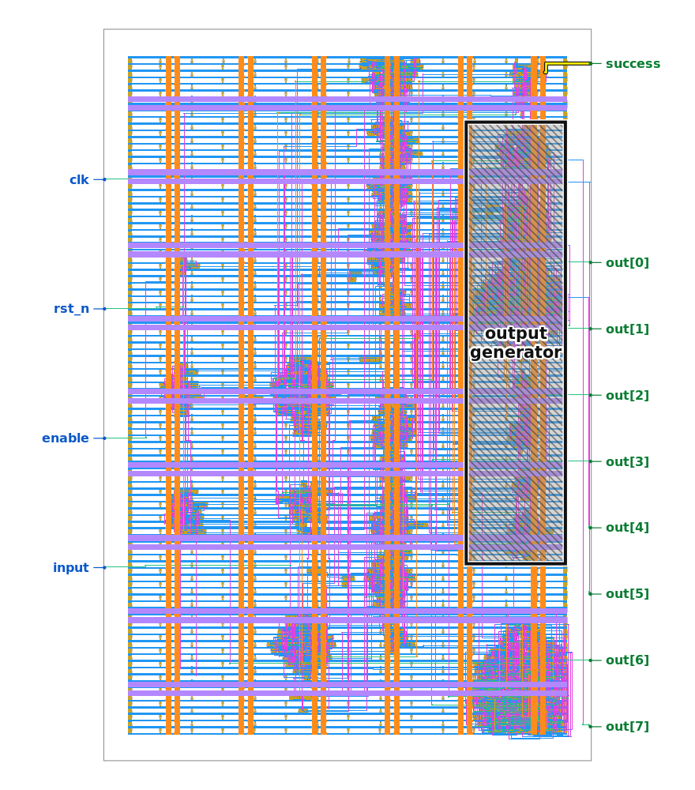
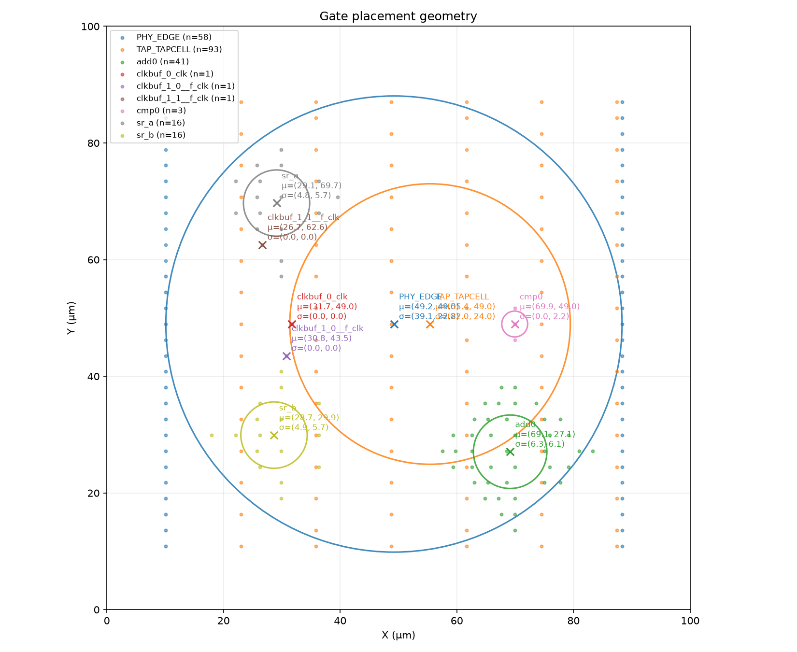
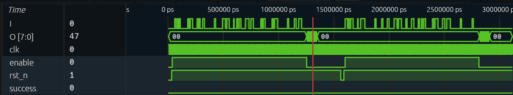

# Why

## Origin

Jane Street published a chip's layout and asked what it prints for the right input. I am a mechanical engineering student and this was my first chip.

# What

## Puzzle

Polygons on layers, nothing labelled. One input bit per clock, eight output bits, one success pin. Find the input that raises success and read the output.

# Problem

## Scale

728 cells and a 121-bit key. Too many to guess, and no answer to check against.

# Work

## Warmup

The puzzle ships a small chip at every stage from source to layout. I built each tool there, where the answer is known.

## Extraction

Overlapping metal is one wire, a via joins layers, each cell is a named black box. Checked by showing my circuit and the true one are the same graph.

## Waveform

Reading the circuit by hand was out of reach. The sample recording was not: the output is text, each attempt is 121 bits, and it ends in TRY AGAIN. That gave the protocol and a test.

## Simulator

A Python model of the extracted circuit. Replaying the recording, it prints TRY AGAIN on the same clock edges.

## Solver

The same circuit as constraints, with success required high. Z3 returns one key and proves it is the only one.

## Answer

(* TWO STARS *). The chip checks an 11 by 11 Star Battle grid, and the key is the solved puzzle.

## Questions

- Trusting the extraction
- Finding Star Battle
- The hints
- What I would do first next time
