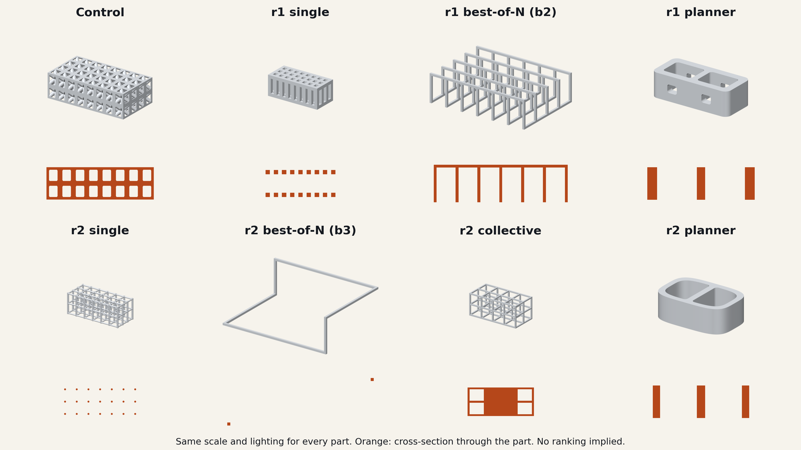
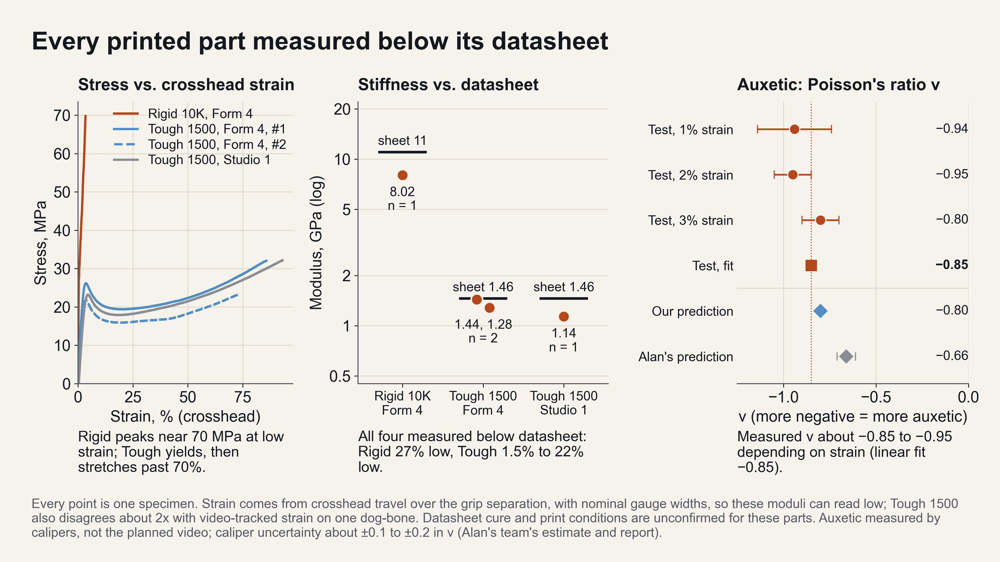
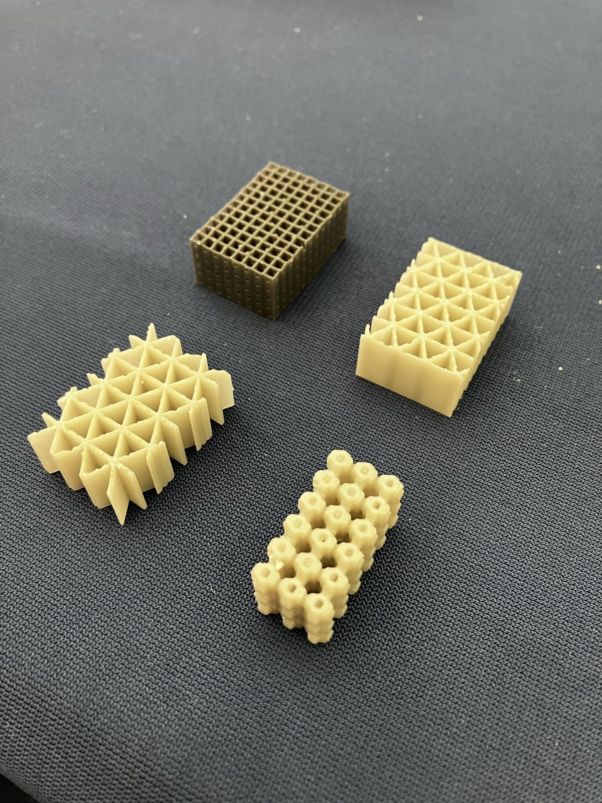
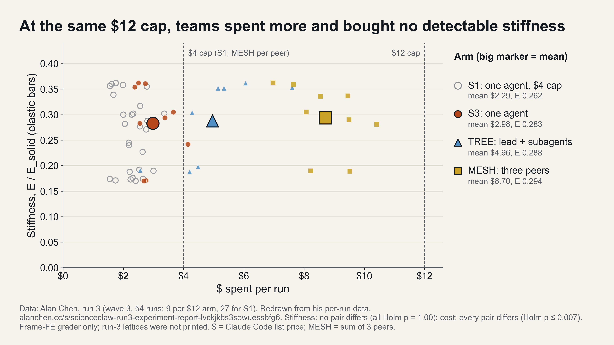

# Why

## Origin

ScienceClaw at the MIT Media Lab, 36 hours, with Alan Chen. One task, given word for word to every agent: make an implant as mechanically homogeneous with bone as possible without losing integrity.

# What

## Experiment

Thirty-eight Claude agents designing a spinal fusion cage, arranged from one agent alone to a leaderless group of six. A frozen physics judge scored what they handed in.

# Problem

## Metric

A cage stiffer than bone starves the bone beside it. "Homogeneous with bone" is the cure, and no measurable number equals it. Any stand-in becomes the target once agents optimise against it.

# Work

## Coupons

Real parts printed and pulled on an Instron before any agent ran. Every resin read below its datasheet, one by 27%, and the judge used the measured values.

## Proxy

Round 1 scored every void as fused bone, so less implant read as more bone-like. Every arm found this within minutes.

## Loop

The winner was a 1 mm wire loop: 1132 MPa against an allowable of 17 when loaded alone. The arrangement of the agents did not decide this. The construction of the judge did.

## Judge

Round 2 changed only the test: a metric written blind, the implant carrying twice the load alone, one load state withheld, and independent re-scoring.

## Collective

Six agents with no roles scored fourteen designs in 75 minutes and discarded their two best-scoring ones for thin margins. They predicted 14 to 15 MPa. The judge measured 14.1 of 17.

## Result

Best of nine on the withheld state, and a tie with the textbook lattice on the goal metric.

## Decentralisation

It bought variety and removed a single point of failure. It did not buy speed: Alan's controlled run shows teams at two to three times the cost with no difference in stiffness.

## Questions

- The judge
- Replicates and what can be claimed
- How the agents used the printer API
- What to freeze next time
