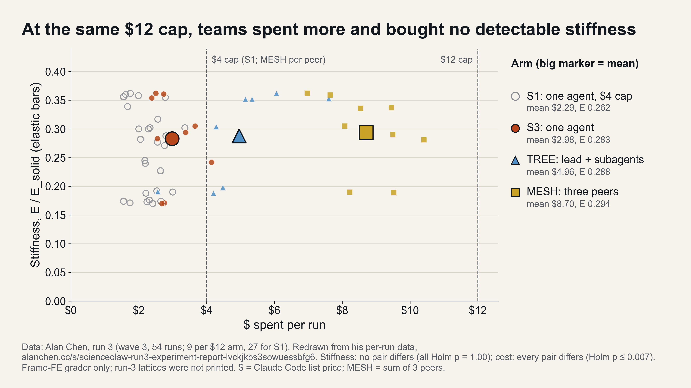
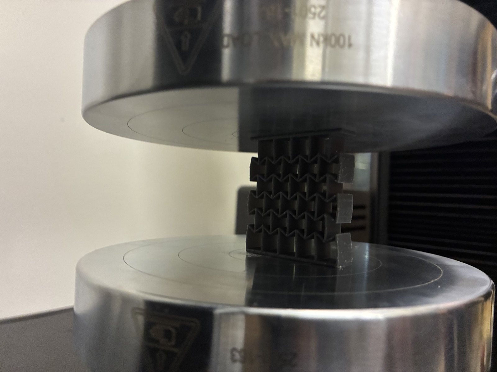
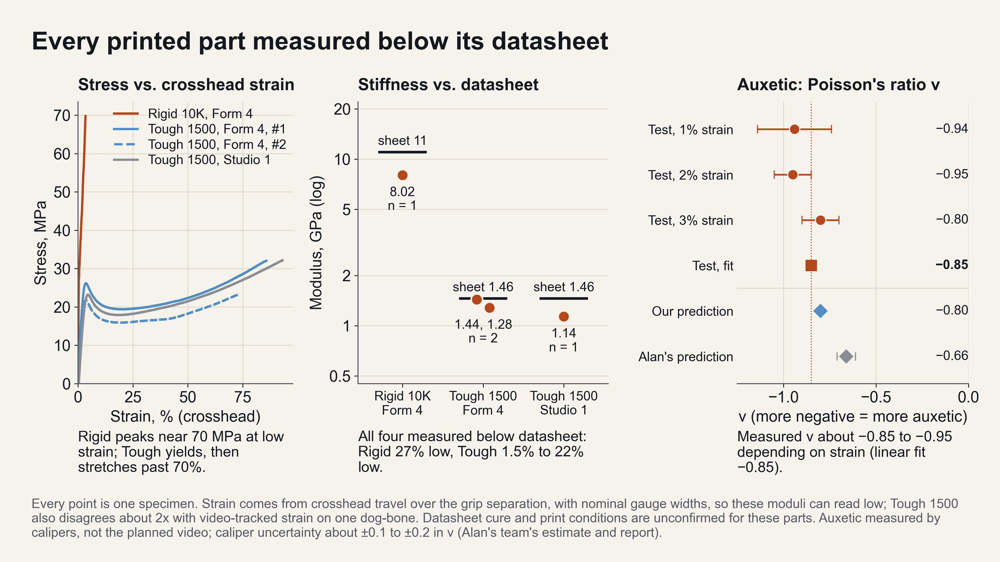

*Figure 1. What round 1 handed in, rendered from the submitted meshes at one scale. Orange: a section through each part. The loop at lower left won the official score.*

## Summary

The task, given verbatim to every agent, was to make an implant as mechanically homogeneous with bone as possible without losing integrity. The setting is a lumbar interbody fusion cage, which sits where a disc was removed and carries load between two vertebrae; titanium is 4 to 11 times stiffer than cortical bone, so the bone beside a metal cage is under-loaded and resorbs. No measurable quantity equals the goal. Any proxy that stands in for it becomes the target once agents optimise against it, and whoever writes the proxy shapes the designs. We therefore separated the setter of the metric from those meeting it, froze the judge before each round, and treated the arrangement of the agents as the independent variable: a textbook control, a single agent, six isolated agents with a pick, a leaderless collective and a planner-led team, two replicates each.

Round 1 scored a proxy in which every void is filled with fused bone, so less implant material reads as more bone-like. All arms found this within minutes. The winning entry, a wire loop of 1 mm struts, states in its own report that it targets the metric and is not a clinical device; both single-agent designs failed when the implant had to carry load alone. For round 2 the test was held still: a stricter metric written by an agent that had seen no results, scored in the worse of the empty and fused states; an integrity gate with the implant carrying twice the load alone, under which a failure ranks below every pass; one loading state withheld from the agents' tool; and independent re-scoring at twice their resolution. A six-agent group with no assigned roles then scored fourteen designs in 75 minutes, discarded its two best-scoring candidates for thin strength margins, and shipped a 41 % solid Tough 1500 lattice that passed every check at 14.1 of 17 MPa, scored best of the nine designs on the withheld state, and tied the textbook control on the goal metric.

| Item | Detail |
| --- | --- |
| Event | ScienceClaw hackathon, MIT Media Lab, 31 October to 1 November 2026 |
| Team | Adit Bhargava (arena, judge, guard, evaluation); Alan Chen (parallel controlled runs, mesh arm; [his final write-up](https://alanchen.cc/s/scienceclaw-final-a23imm6gtunomv5pq5n2/)) |
| Agents | 38 Claude Code sessions in round 1, 6 in round 2; identical briefs; shared board as the only channel |
| Deliverables | Arena with admission control and credit meter; fail-closed evaluator guard; voxel finite-element judge against orthotropic lumbar bone; goal metric; run log; printed demonstrators |
| Tools | Python, NumPy, Formlabs PreForm API, NVIDIA Warp on Brev L40S, Instron at the MIT Breakerspace |
| Code | [github.com/zcsop1206/bonetwin](https://github.com/zcsop1206/bonetwin), MIT licence |

## 1. Try gaming the metric

The model below is illustrative, not the judge. It uses Gibson–Ashby scaling for the lattice stiffness, a rule of mixtures for the fused state and a strut-size stress concentration for the implant-alone check, with the load scaled so the round 2 cage lands at the judge's 14.1 MPa. The real judge is a voxel finite-element solver with four load cases; its code, specifications and hashes are in the repository. The shape of the result is the same: removing material wins the round 1 proxy and fails on its own.

<label style="display:block;font-size:14px;margin-top:8px;color:inherit;opacity:1">Material <select id="bt-mat" style="font:inherit"><option value="1136">Tough 1500 V2 (measured 1136 MPa)</option><option value="8018">Rigid 10K (measured 8018 MPa)</option><option value="110000">Ti-6Al-4V (110 GPa)</option><option value="700">UHMWPE (700 MPa)</option></select></label>
<label style="display:block;font-size:14px;margin-top:8px;color:inherit;opacity:1">Solid fraction φ: <b id="bt-phiV">0.41</b><input id="bt-phi" type="range" min="0.02" max="1" step="0.01" value="0.41" style="width:100%"></label>
<label style="display:block;font-size:14px;margin-top:8px;color:inherit;opacity:1">Strut size, mm: <b id="bt-tV">0.6</b><input id="bt-t" type="range" min="0.3" max="3" step="0.1" value="0.6" style="width:100%"></label>

Presets: <button type="button" id="bt-pLoop">the 1 mm loop</button> <button type="button" id="bt-pR2">round 2 cage</button> <button type="button" id="bt-pCtl">textbook control</button>

Round 1 proxy, fused state (lower wins)<b id="bt-proxy"></b>

Round 2 goal metric M, worse of empty and fused<b id="bt-M"></b>

Implant alone, 2× load, stress / allowable (MPa)<b id="bt-ia"></b>

Verdict<b id="bt-verdict"></b>

<canvas id="bt-cv" width="820" height="300" style="width:100%;height:auto;margin-top:12px;border:1px solid rgba(128,128,128,.35)"></canvas>

## 2. What the agents handed in

<video controls autoplay muted loop playsinline width="1920" height="1080" style="display:block;width:100%" src="/projects/bonetwin/turntable_grid.mp4" aria-label="The eight round 1 designs rotating on a turntable at one scale: the control lattice, the single agents' channel blocks, the best-of-N wire frames, the planners' solid cages and the 1 mm wire loop."></video>

*Figure 2. The eight round 1 submissions, rotating at one scale. The official score ranked them almost inversely to the goal metric (Spearman −0.62, n = 8).*

Every arm, whether one agent or six, read the disclosed metric within minutes and designed to it. The official winner, a loop of 1 mm struts from the best-of-N arm, would carry 1132 MPa against an allowable of 17 when loaded alone. In Alan Chen's parallel run on a lattice task with a two-joint grader, one peer in a mesh group declined to submit a gamed design; its group submitted one anyway. The organisation of the agents did not determine whether the metric was gamed. The construction of the judge did.

The agents also chose their own instruments. Every design had to be handed in as a real Formlabs PreForm scene, and 601 PreForm API calls ran across round 1. One planner agent turned the API into a measuring rig rather than an exporter: 189 calls that write a scene, read it back, and fail on any mismatch of hash, bounding box or scale, which exposed that auto-layout can rotate a part without changing its canonical model hash. On compute, agents were told which sponsor tools existed and nothing more; NVIDIA Warp was the one they ran. One wrote a matrix-free hexahedral solver with an adjoint sensitivity in Warp kernels and verified the adjoint against central finite differences to a relative error of 3 × 10⁻⁴; another measured a Warp operator at about seven times the speed of its NumPy equivalent on a laptop GPU. The frozen judge itself ran on Brev L40S instances at up to 20 million unknowns, which no laptop in the room could fit.

## 3. Inside the part

<video controls autoplay muted loop playsinline width="1920" height="1080" style="display:block;width:100%" src="/projects/bonetwin/sim_slice.mp4" aria-label="A moving slice through the finite-element field around two implants: the strain-energy stimulus in the surrounding bone relative to intact bone, blue where shielded and orange where overloaded, for the textbook control and a round 1 single-agent design."></video>

*Figure 3. Strain-energy stimulus in the bone around the textbook cage and a round 1 single-agent design, from the judge's own solver on a coarse mesh. Blue is shielded, orange overloaded. Illustrative; not a score.*

## 4. Round 2: holding the test still

The second round changed nothing about the agents' freedom and everything about the test.

| Change | What it prevents |
| --- | --- |
| Metric scored in the worse of the empty-void and fused states | Winning by removing material |
| Integrity checked with the implant carrying 2× load alone; a fail ranks below every pass | Shipping a design that only survives inside bone |
| Early-graft value withheld from the agents' local tool | Tuning against a state they can measure |
| Independent re-scoring at twice the agents' resolution, frozen code | Overfitting to a coarse local solver |
| Metric written by an agent that had seen no results, hashed before launch | The setter learning from the meeters |

Six agents with no assigned roles, a shared board and one million credits each then ran for 75 minutes. They evaluated fourteen candidates in three geometric families, rejected the two with the lowest scores because their implant-alone margins were thin (15.4 and 16.0 of 17 MPa at the coarse resolution), and shipped a 30.3 × 20.3 × 12.5 mm Tough 1500 channel lattice at 41 % solid. PreForm's thin-features check changed the shipped geometry: the leading candidate had 22 regions of 0.3 mm outer skin flagged, so the group padded the box to 0.45 mm skins, cleared the check, and lost nothing measurable in score. They predicted the shipped design would reach 14 to 15 MPa at the judge's resolution; the judge measured 14.10. On the withheld early-graft state it scored 0.283 against the control's 0.301, the lowest of the nine designs. On the goal metric it scored 1.75 with a band of [1.23, 2.26], against the control's 2.28 [2.15, 2.41]: a tie under the metric's own rule, not a win. Its coarse self-assessment of 0.84 became 1.75 on independent re-scoring, with the fused state agreeing within 3 % and the whole gap in the empty state.

## 5. Same nine designs, two tests

| Design | Official fused score (round 1) | Goal metric M (round 2) | Implant alone | Withheld early state |
| --- | --- | --- | --- | --- |
| **Round 2 collective** | 0.0628 | **1.75 [1.23, 2.26]** | pass, 14.1 of 17 MPa | **0.283** |
| Textbook control, Rigid 10K | 0.206 (last of nine) | 2.28 [2.15, 2.41] | pass | 0.301 |
| r2 planner | 0.0183 | 4.71 | pass, narrowly | 0.927 |
| r1 single | 0.0189 | 1.92 | fail | 0.424 |
| r1 planner | 0.0325 | 2.82 | fail, narrowly | 0.801 |
| r2 single | 0.0227 | 3.89 | fail | 1.263 |
| r2 collective | 0.0104 | 4.55 | fail | 1.734 |
| r1 best-of-N | 0.0193 | 6.02 | fail | 1.393 |
| r2 best-of-N, the 1 mm loop | **0.0053, official winner** | 6.73 | fail, 1132 MPa | 1.018 |
| r1 collective | no submission: its sole writer ran out of credit 15 minutes in | | | |

Lower is better in every column. Scores are from the frozen judge at full resolution under a 20-million-unknown cap. The goal metric is post-registered and exploratory; it does not replace the official ranking. Two replicates per arm means no arm ranking is claimed. Round 2 is one arm and one run with no control arm, it knew round 1's lessons, and its design descends from a lattice given in the metric's own specification.

## 6. What decentralisation bought, and what it did not

*Figure 4. Alan Chen's controlled run 3, redrawn from his per-run data: 54 runs, nine per arm, same task, model and cap. Teams spent two to three times what one agent spent (derived from arm means of $2.98, 4.96 and 8.70; cost pairs Holm p ≤ 0.0073) and no pair differed on stiffness (Holm p = 1.00).*

In round 1 the leaderless group agreed on its board that one agent would write the deliverables; that agent posted "PIPELINE READY" and exhausted its credit ten seconds later, fifteen minutes into the run, and no one took over. In round 2 the same arrangement, with larger budgets and board announcements when an agent ran low, spread the work: degree centralisation 0.30 from the board logs, no directive posts, three writers and three design families. Decentralisation therefore bought variety and removed a single point of failure. It did not buy speed, and it did not beat the textbook design. Our own two replicates per arm cannot rank the arms, and Alan's nine per arm found no stiffness difference at a matched budget. His full account of runs 0 to 3, including the lattice task, the mesh arm's own bone cages and the physical tests behind them, is in [his final write-up](https://alanchen.cc/s/scienceclaw-final-a23imm6gtunomv5pq5n2/).

Alan Chen's side of the team ran four experiments over the same two days, each a refinement of the last ([his write-up](https://alanchen.cc/s/scienceclaw-final-a23imm6gtunomv5pq5n2/)). Run 0 put 80 agents on seven demos; run 1 put 25 agents on one shared board, 343 posts, and found refutations across groups but no decisive collective win; run 2 compared solo, tree, mesh and open arrangements on two projects; run 3 is the 54-run controlled comparison above, where single agents scored 0.283 on the stiffness ratio against 0.288 for a lead with subagents, 0.309 for best-of-three and 0.294 for three peers. His lattice task set a target 3.5 times stiffer along the spine than across, matching the bone constants the judge uses (E1, E2, E3 of 204, 236 and 714 MPa), and 40 of 42 wave-1 finals were not periodic lattices at all, the two-joint read-out having been gamed by every arrangement. On the bone problem his four-peer mesh, running NVIDIA Warp topology optimisation on A100s (350 iterations in 232 s) with a peer that proposed nothing doing the verification (4.3 million elements checked in 135 s), produced cages scoring 0.72 to 0.83 at coarse resolution against 1.23 to 1.24 for two single-agent cages, and 0.719 against 1.247 and 1.375 at full resolution. These are his own runs of our scoring tool on the visible load cases, not official scores, and his printed plate is a display stand-in in a different resin. PreForm served his peers as a feedback loop as well, rejecting a pose that needed 16.9 mL of supports for a 1.9 mL part.

## 7. Physical ground truth

*Figure 5. Coupons printed through the PreForm API on a Form 4 and a Form Studio 1, with specimen identifiers engraved on the rafts and randomised logged layouts, and tested on the Breakerspace Instron before any agent ran. Every resin read below its datasheet (Rigid 10K 27 % low, Tough 1500 1.5 to 22 % low); the judge used the measured values. The auxetic block measured ν between −0.85 and −0.95 against our frozen prediction of −0.80. One specimen each, crosshead strain only.*

## 8. Limits

No check compares the judge against a loaded implant; "homogeneous with bone" is a model output throughout. Bone is modelled as homogeneous with perfect bonding, and fatigue is not assessed. Six-agent arms exhausted their credit while single agents finished with half unspent, so equal credits did not mean equal capability. The goal metric's known-answer criterion was loosened after its first run. Printed parts are mechanical demonstrators in engineering resins, not implant-grade devices. The full log of incidents and deviations, including a scheduler bug that briefly duplicated fourteen agents, is `RUN_LOG.md` in the repository. Tough 1500 V2 reads 1136 MPa in our coupon and 627 ± 24 MPa in Alan's; the judge used 1136 and no cause for the gap is established.
