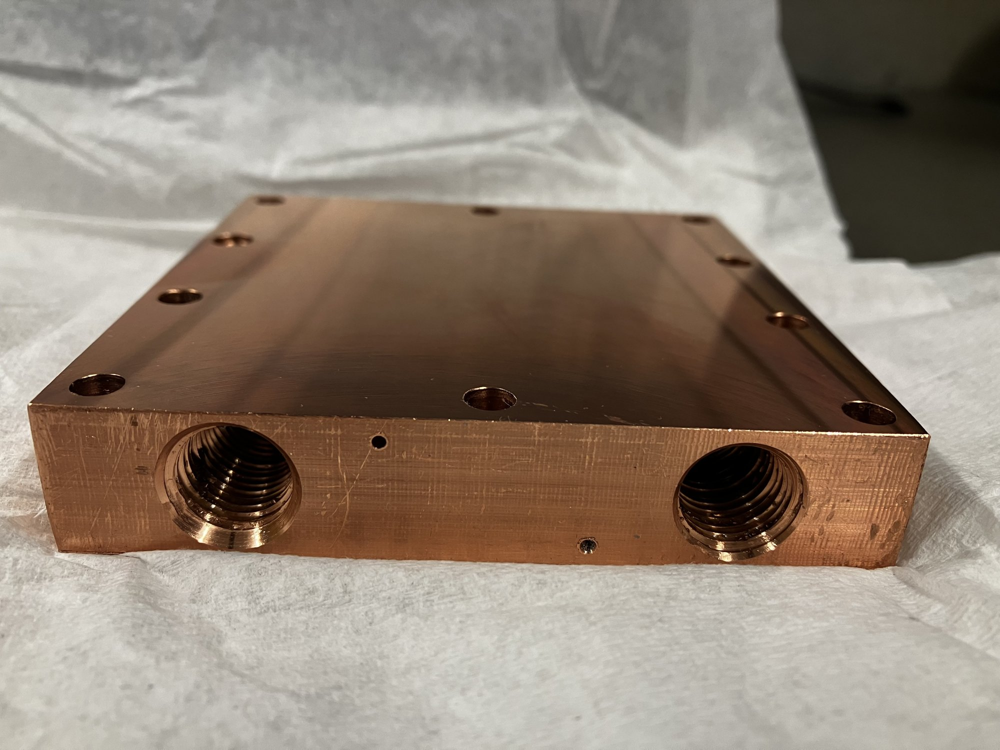
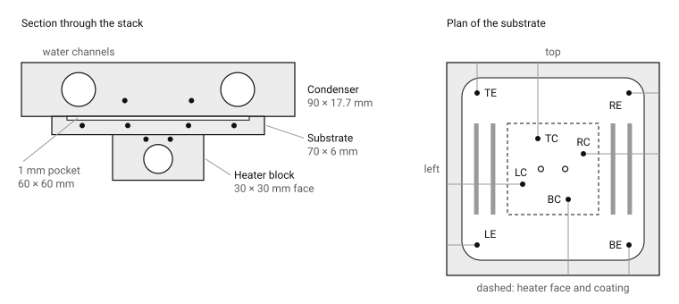
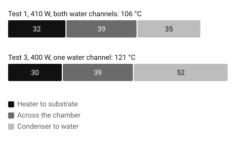
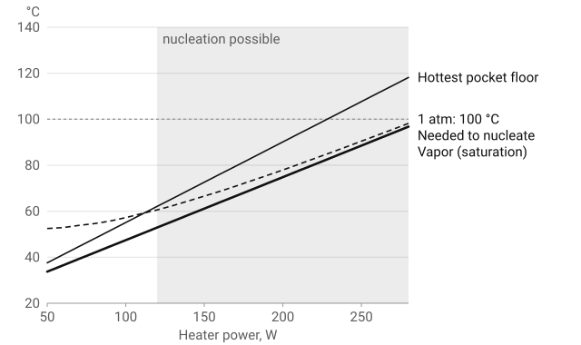

# Why

## Origin

The previous build never reached steady state. Its polycarbonate top could not condense, and the pressure ran up to the 25 psi relief valve. I joined CACT in May 2026 to replace that top with a copper condenser.

# What

## Device

A flat-plate vapor chamber with no wick. A wire-arc-sprayed asymmetric sawtooth coating is meant to pump the liquid. I designed and machined the copper condenser, instrumented the stack and ran three tests.

# Problem

## Requirement

The condenser seals up to the 25 psi of the chamber's relief valve, mates with the existing substrate, gasket and clamp, and brings chiller water close to the vapor face.

## Question

Does charging the chamber lower its resistance, and is the fluid doing the work or the copper?

# Work

## Condenser

C110 copper, GD&T to the mating parts, 1/4 NPT ports, machined from solid on a manual mill.

## Instrumentation

Calibrated thermocouples in the heater block, substrate centre and edge, condenser, and water in and out. Enough to split the stack into resistances.

## Tests

- Test 1: charged with 2.7 mL, 410 W, both water channels at 380 mL/min
- Test 2: dry control, 73 to 318 W
- Test 3: charged, 73 to 400 W at 20 °C inlet, then 410 W at 30 °C, one water channel at 580 mL/min

Every step of Test 3 settled to within 1 °C.

## Resistance

- Substrate to condenser: 0.074 to 0.080 K/W charged, 0.26 to 0.28 K/W dry, at the same powers
- 3.5 times lower charged
- Flat from 73 to 410 W, at 20 or 30 °C inlet, with one water channel or two

## Budget

Heater block to water inlet at 400 W is 121 °C:

- Heater to substrate: 30 °C. 25 of it is the paste joint, 0.5 to 0.6 cm²·K/W, three to five times a well-made joint
- Across the chamber: 39 °C
- Condenser to water: 52 °C with one channel, 35 °C with two

## Mechanism

- Water across the design 200 µm gap, with the copper contacts, would give 0.12 K/W. The measured value is lower.
- Boiling would make its coefficient rise about 3 times from 73 to 400 W, so the resistance would fall. It stays flat from a 36 °C substrate to a 112 °C one.
- Water conducting across a gap of about 70 µm fits both observations.
- The chamber was filled open and never evacuated, so it held air at about 1 atm, as in the thesis (Faria, p. 19).
- An evacuated run and a measured gap will settle it.

## Gradient

- The centre runs 17 °C above the edge at 400 W: 42 to 52 mK/W charged, 44 to 47 dry
- The plate model gives the same gradient from copper alone, so no sideways vapor transport shows
- Under 1 °C at 400 W would take about 20 times the plate's sideways conductance

## Checks

- Water-side heat transfer is about 4 times the laminar textbook value, most likely from the jet out of each push-to-connect fitting, plus some buoyancy
- The water reads 13 to 18% more heat than the heater supplies, in proportion to power: either the flow reading (about 500 mL/min true where 580 was read) or an outlet thermocouple in the unmixed laminar stream
- How Test 1's two channels were plumbed, series or parallel, was not recorded

# Next

## Rig

Keep the original polycarbonate top as a window. Cool the specimen from below with a water-cooled aluminium frame in place of the PTFE housing.

- Same outline and bolts as the PTFE housing, 19 mm tall so it meets the specimen rim, about 27 cm² of contact through a thermal pad
- Today the heater face stands 2 mm proud of the housing, so the specimen rim sits over air
- PTFE liner around the heater block; Ø8 mm water channel around three sides
- Not from the sides: they sit 2.4 mm from the bolts and carry the thermocouple bores

## Signal

Heat enters at the centre and leaves at the rim, so the centre-to-edge gradient reads sideways transport through the chamber.

- Copper alone: 76 to 78 mK/W, 14 °C at 186 W
- Chamber adding 3 times the plate's conductance: 20 mK/W, 4 °C at 186 W
- Camera: where the vapor forms, which way it moves, whether the liquid comes back

## Balance

At 20 °C water and 250 mL/min:

- The water takes 98 to 99% of the heater power. Window 1 to 4 W, room under 1 W.
- 7% bypasses the specimen through the PTFE liner. It reaches the water, and is subtracted from the heater block temperature.
- 250 mL/min, not 580: the water rises 4 to 15 °C, so a 0.2 °C sensor error is 5% at 73 W, 2% at 186 W
- The frame's laminar water side is the largest resistance in the stack: 0.27 K/W, 1300 W/m²K over the rim
- A heater-off run first measures the sensor offset and the room loss

## Saturation

Evacuated, the pressure is the vapor's saturation pressure, and the vapor temperature is set over the cooled rim.

- 40 to 92 °C from 73 to 261 W with 20 °C water, 7 to 75 kPa: saturated by construction, below 1 atm
- A low saturation temperature needs more superheat to nucleate: 14 K at 40 °C, 1.7 K at 92 °C for 25 µm cavities
- The plate offers at most 6 K at 73 W, 14 K at 186 W: onset near 115 W, so a 120 W step
- Inlet temperature is the knob: after the dry run, set it so the vapor is near 70 °C at 186 W, never over 100 °C

## Air

Run 2, with air left in, cannot boil.

- Its pressure is the heated air plus the vapor. The wall stays 12 to 58 °C below saturation at that pressure.
- Warmer water heats the gas too: the 25 psi relief opens with the gas near 109 °C, before the wall saturates, as in the original build
- So run 2 is the no-boiling control. 261 W at 20 °C water reaches 220 kPa, under the valve's 274 kPa.

## Runs

0. Heater off, water at 20 °C and 250 mL/min: sensor offset, room loss
1. Dry at 73, 120, 186, 261 W: copper baseline, liner bypass, frame conductance, then the inlet temperature for run 3
2. Charged with 2.7 mL, air left in
3. Evacuated, then charged with degassed water

Pressure, in-stream water thermocouples, power and video at every step. Time constant about 200 s, so 15 to 20 minutes a step: about a day in all.

## Limits

- Window: at the vapor temperature, 92 °C at most at 261 W. The thesis stopped at 135 °C (p. 25). Inspect it for crazing between runs.
- Condensate: about 4 g an hour on the window at 186 W. A 5 W film heater on the outside keeps it clear.
- Vacuum: the window deflects about 5 µm, stress under 1 MPa
- Relief pressure: 680 N on the window, inside the bolts' roughly 2 kN preload
- Heater block: 122 °C at most

## Vacuum

Run 3 needs no new machining. The polycarbonate top already has two 1/8 NPT ports into the chamber.

- Port 1: a tee to a valve to the vacuum pump, and a valve to charge the degassed water
- Port 2: a tee to the pressure transducer and the 25 psi relief valve
- Leak check, cold: pump down, close the pump valve, watch the pressure for 10 to 15 minutes. Holds, heat. Rises, find the leak first.
- Weakest seal: the NPT threads in the polycarbonate, which wore out in both earlier builds (Faria, p. 30). Fit metal threaded inserts or use sealant and check them first.
- Never tested under vacuum: the gasket and the relief valve

## Decisions

- Machine the aluminium frame and PTFE liner, with a thermal pad on the rim?
- A vacuum pump, two tees, two valves and degassed water for run 3?
- An absolute pressure transducer, about 0 to 50 psia, on port 2? The thesis's PX2300 is 0 to 1 psi differential.
- A film heater for the window, and foam under the base?
- Which camera, and how to light through the window?

