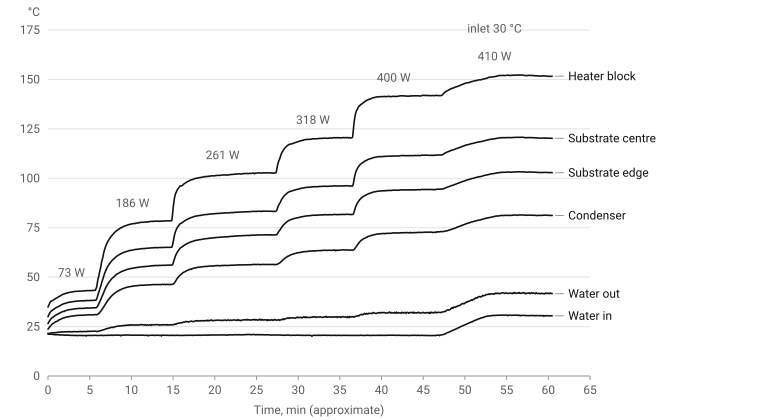

# Why

## Origin

I joined the Centre for Advanced Coating Technologies in May 2026. The lab's wickless heat pipe needed a condenser that could actually condense.

# What

## The device

A vapor chamber where a sprayed sawtooth coating pumps the liquid instead of a wick. I designed and machined its copper top plate, instrumented the assembly, and tested it charged and dry.

# Problem

## Requirement

Vapor has to give up its heat at the top plate. The plate must seal at 25 psi, mate with existing parts, and bring chiller water close to the vapor face.

## Difficulty

One block seals, conducts and carries thermocouples, machined from solid copper on a manual mill. Then the test has to show the fluid is doing the work, not the copper.

# Work

## Tolerances

Position on the bolt pattern and ports, flatness on the vapor face, 0.1 mm elsewhere. Only what the assembly needs.

## Instrumentation

Calibrated thermocouples in the heater block, substrate centre and edge, condenser, and water in and out. Enough to split the stack into resistances.

## Charged run

Steady at every step from 73 W to 410 W, 46 W/cm² at the top. The heat left through the chiller water.

## Dry control

The same assembly with no fluid, stepped to 318 W.

## Thermal resistance

Substrate to condenser: 0.074 to 0.080 K/W charged against 0.26 to 0.28 dry at the same powers. Flat from 73 W to 410 W, at either inlet temperature, with one water channel or two.

## Plate gradient

The centre ran 18 °C above the edge, the same per watt charged and dry. A conduction model with one uniform sink fits the eight thermocouples, so the gradient is the copper plate. Holding 1 °C at 400 W takes about 20 times its in-plane conductance, and that is the next thing to design out.

## Questions

- The drawing and its tolerances
- Machining the block
- The energy balance
- Conduction or boiling in the chamber
- Next experiments
