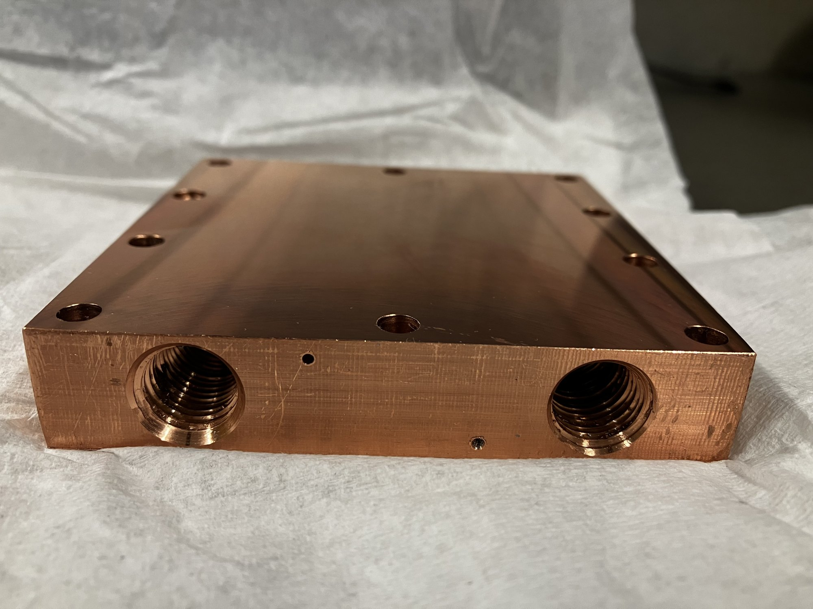
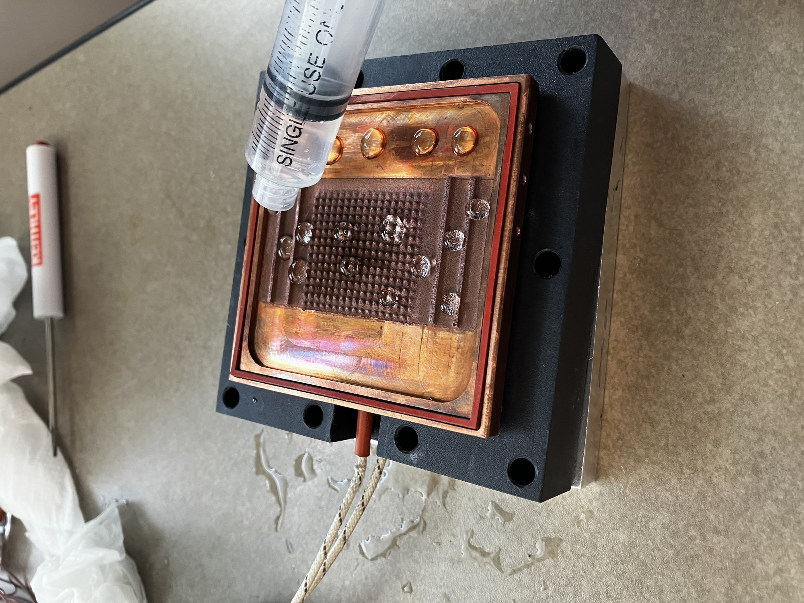
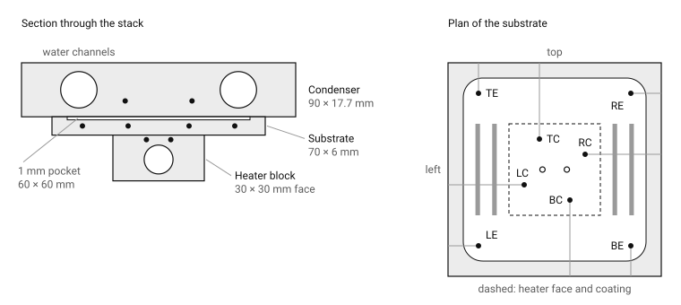
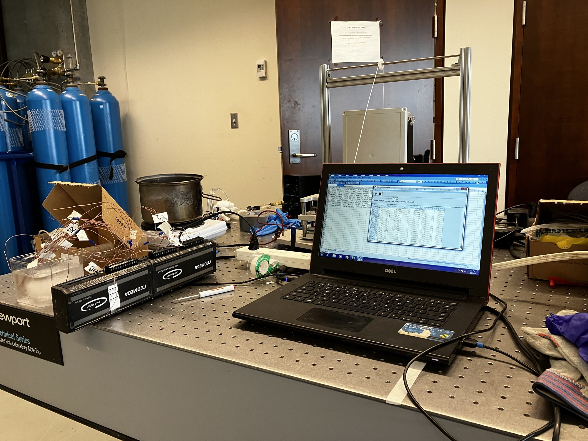
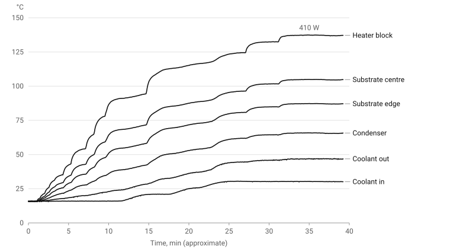
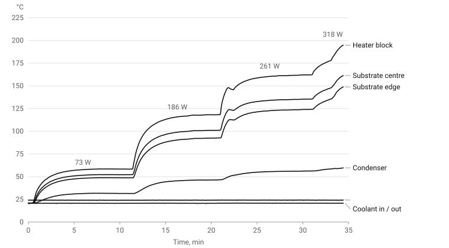

# Why

## A heat pipe that never reached steady state

I joined the Centre for Advanced Coating Technologies in May 2026. The lab's wickless heat pipe had been built and it did not work: pressure climbed to the relief valve every run.

The diagnosed cause was the top plate. My job was to replace it and find out if the diagnosis was right.

# What it is

## A vapor chamber with no wick

A sprayed sawtooth coating pumps the liquid instead of a porous wick. Heat goes in at the bottom, the fluid boils, and it has to condense on the top plate.

I designed and machined that top plate in copper, instrumented the assembly, and tested it charged and dry.

# The problem

## The old top plate could not condense

Polycarbonate conducts about 0.2 W/m·K. Vapor had nowhere to give up its heat, so pressure rose until the valve opened.

The condenser has to seal at 25 psi, mate with parts that already exist, and bring chiller water close to the vapor face.

## What makes it hard

- One block does three jobs: seal, conduct, and carry thermocouples.
- It comes out of solid copper on a manual mill, in a week.
- Then the test has to show the fluid is doing the work, not the copper.

# The work

## Tolerance what the assembly needs

Position on the bolt pattern and ports so it lines up with the existing substrate, gasket and clamp. Flatness on the vapor face for the seal. 0.1 mm everywhere else.

The 1/4 NPT version won because the stock set the thickness.

## The hardest feature was the smallest

Ø1.2 mm thermocouple bores, 25 mm deep, in gummy copper. One bit broke and stayed in the part. Short pecks on the mill got the rest through.

## Where the temperatures are read

Heater block, substrate centre and edge, condenser, water in and out. Enough to split the stack into resistances and to see a gradient across the plate.

## Calibrated before trusted

Every thermocouple against an ice bath, two points, on the DAQ it would run on.

## Charged: steady at 410 W

The previous build never settled. This one held 410 W, 46 W/cm², with no channel moving more than 0.2 °C in the last five minutes.

The chiller water carried away the electrical input to within 7%.

## Dry: the control

Same assembly, no fluid. Stopped at 318 W with the heater block at 199 °C and still rising.

## The fluid cuts the resistance by 3.5 to 3.8

Substrate to condenser: 0.074 K/W charged, 0.26 to 0.28 K/W dry.

Heater to substrate is the same in both, as it should be. The fluid is not in that path.

## What did not work

I expected under 1 °C across the plate. The centre ran 18 °C above the edge, and per watt that gradient was the same charged and dry.

A 2-D conduction fit to the eight beads recovers the heater power to within 8%. The gradient is just 5 mm of copper carrying the heat outward.

## Ask me about

- The GD&T drawing and why each tolerance is there
- How far to trust the energy balance
- The two measurement corrections and the bypass in the chamber
- The next experiments
