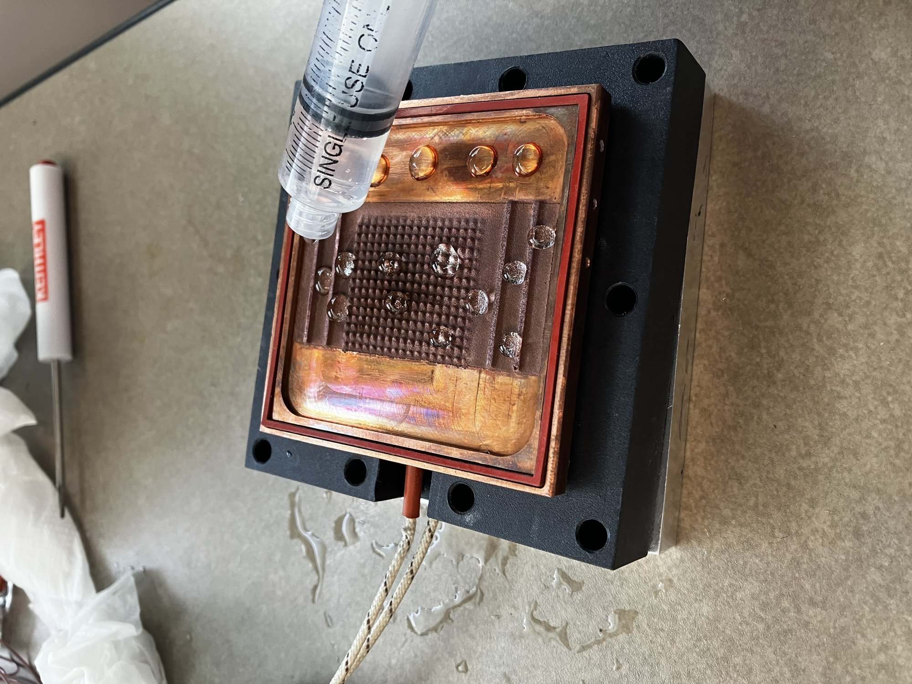
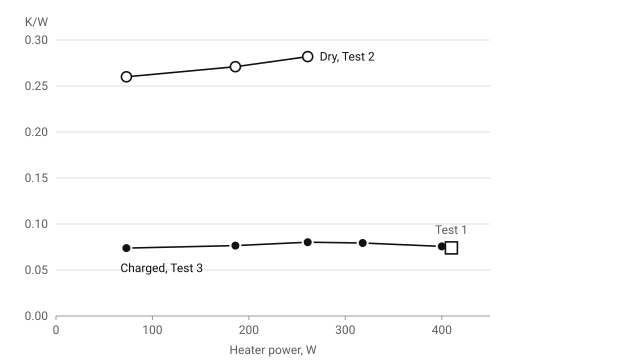
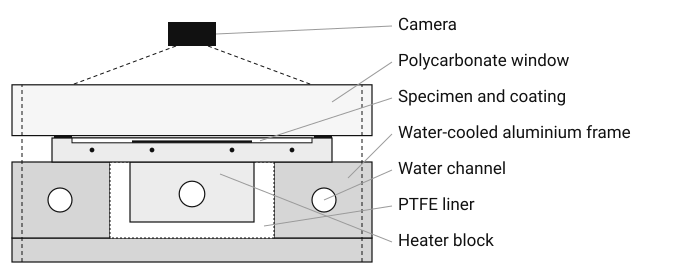
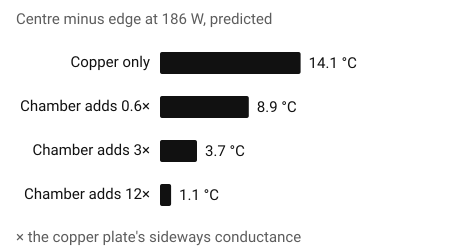
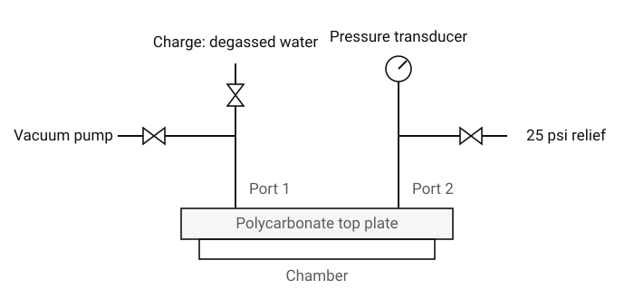

# Why

## Origin

The previous build never reached steady state. Its polycarbonate top could not condense, and the pressure ran up to the 25 psi relief valve. I joined CACT in May 2026 to replace that top with a copper condenser.

# What

## Device

A flat-plate vapor chamber with no wick. A wire-arc-sprayed asymmetric sawtooth coating is meant to pump the liquid. I designed and machined the copper condenser, instrumented the stack and ran three tests.

# Problem

## Requirement

The condenser seals at 25 psi, mates with the existing substrate, gasket and clamp, and brings chiller water close to the vapor face.

## Question

Does charging the chamber lower its resistance, and is the fluid doing the work or the copper?

# Work

## Condenser

C110 copper, GD&T to the mating parts, 1/4 NPT ports, machined from solid on a manual mill.

## Instrumentation

Calibrated thermocouples in the heater block, substrate centre and edge, condenser, and water in and out. Enough to split the stack into resistances.

## Tests

- Test 1: charged with 2.7 mL, 410 W, both water channels at 380 mL/min
- Test 2: dry control, 73 to 318 W
- Test 3: charged, 73 to 400 W at 20 °C inlet, then 410 W at 30 °C, one water channel at 580 mL/min

Every step of Test 3 settled to within 1 °C.

## Resistance

- Substrate to condenser: 0.074 to 0.080 K/W charged, 0.26 to 0.28 K/W dry, at the same powers
- 3.5 times lower charged
- Flat from 73 to 410 W, at 20 or 30 °C inlet, with one water channel or two

## Budget

Heater block to water inlet at 400 W is 121 °C:

- Heater to substrate: 30 °C. 25 of it is the paste joint, 0.5 to 0.6 cm²·K/W, three to five times a well-made joint
- Across the chamber: 39 °C
- Condenser to water: 52 °C with one channel, 35 °C with two

## Mechanism

- Water conducting across the design 200 µm gap would give 0.13 K/W. The measured value is lower.
- Boiling would make the resistance fall about 3 times from 73 to 400 W. It stays flat from a 36 °C substrate to a 112 °C one.
- Water conducting across a gap of about 70 µm fits both observations.
- The chamber pressure, whether air is inside, and the real gap will settle it.

## Gradient

- The centre runs 17 °C above the edge at 400 W: 42 to 52 mK/W charged, 44 to 47 dry
- The plate model gives the same gradient from copper alone, so no sideways vapor transport shows
- Under 1 °C at 400 W would take about 20 times the plate's sideways conductance

## Checks

- Water-side heat transfer is about 3 times the laminar textbook value: short channels, push-to-connect inlets, buoyancy
- The water reads 13 to 18% more heat than the heater supplies, in proportion to power, so the flow reading is high: about 500 mL/min where 580 was read
- The one-channel to two-channel ratio fits Test 1's channels being in series

# Next

## Rig

Keep the original polycarbonate top as a window. Cool the specimen from below with a water-cooled aluminium frame in place of the PTFE housing.

- Same outline, bolts and clamp load, 29 cm² of contact on the specimen rim
- PTFE liner around the heater block
- Not from the sides: they sit 2.4 mm from the bolts and carry the thermocouple bores

## Signal

Heat enters at the centre and leaves at the rim, so the centre-to-edge gradient reads sideways transport through the chamber.

- Copper alone: 76 mK/W, 14 °C at 186 W
- Chamber adding 3 times the plate's conductance: 20 mK/W, 4 °C at 186 W
- Camera: where the vapor forms, which way it moves, whether the liquid comes back

## Runs

1. Dry at 73, 186 and 261 W: copper baseline, liner leak, contact conductance
2. Charged with 2.7 mL, air left in
3. Evacuated, then charged with degassed water

Pressure, in-stream water thermocouples, power and video at every step. Top step 261 W until the dry run measures the contact, to keep the polycarbonate below 115 °C.

## Vacuum

Run 3 needs no new machining. The polycarbonate top already has two 1/8 NPT ports into the chamber.

- Port 1: a tee to a valve to the vacuum pump, and a valve to charge the degassed water
- Port 2: a tee to the pressure transducer and the 25 psi relief valve
- Leak check, cold: pump down, close the pump valve, watch the pressure for 10 to 15 minutes. Holds, heat. Rises, find the leak first.
- Never tested under vacuum: the gasket, the NPT threads in the polycarbonate (sealant), the relief valve

## Decisions

- Machine the aluminium frame and PTFE liner?
- A vacuum pump, two tees, two valves and degassed water for run 3?
- A pressure transducer on port 2?
- Which camera, and how to light through the window?

