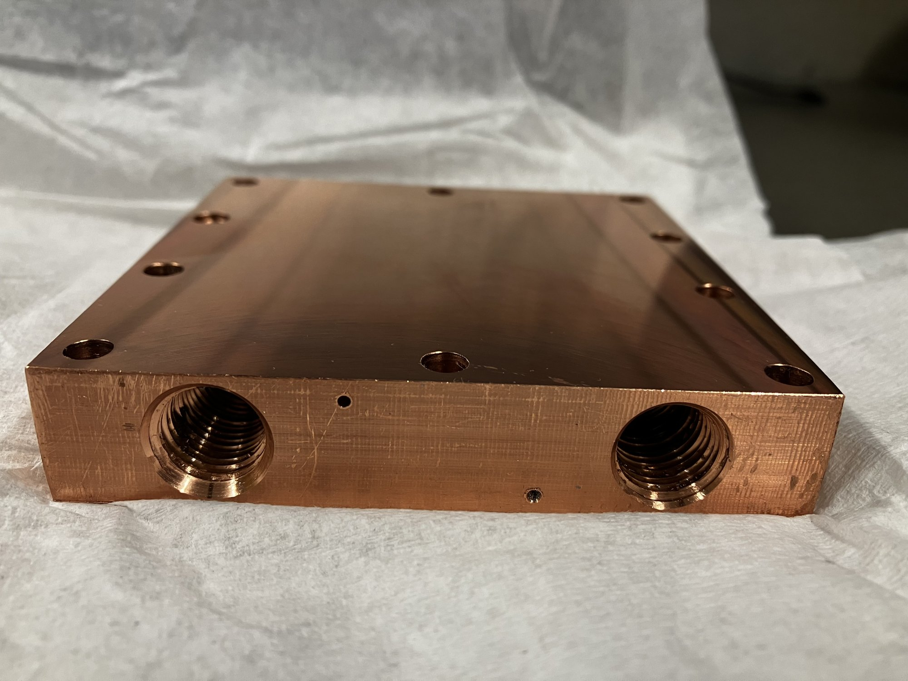
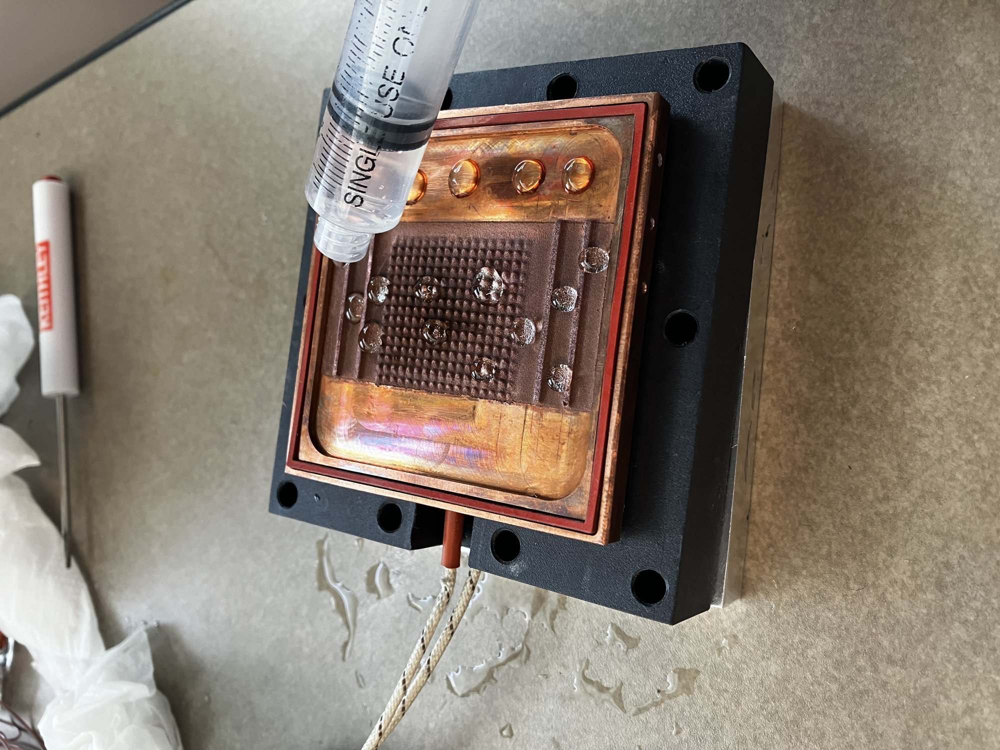
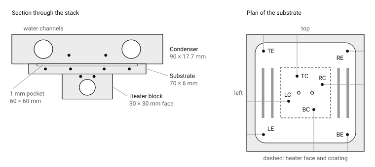
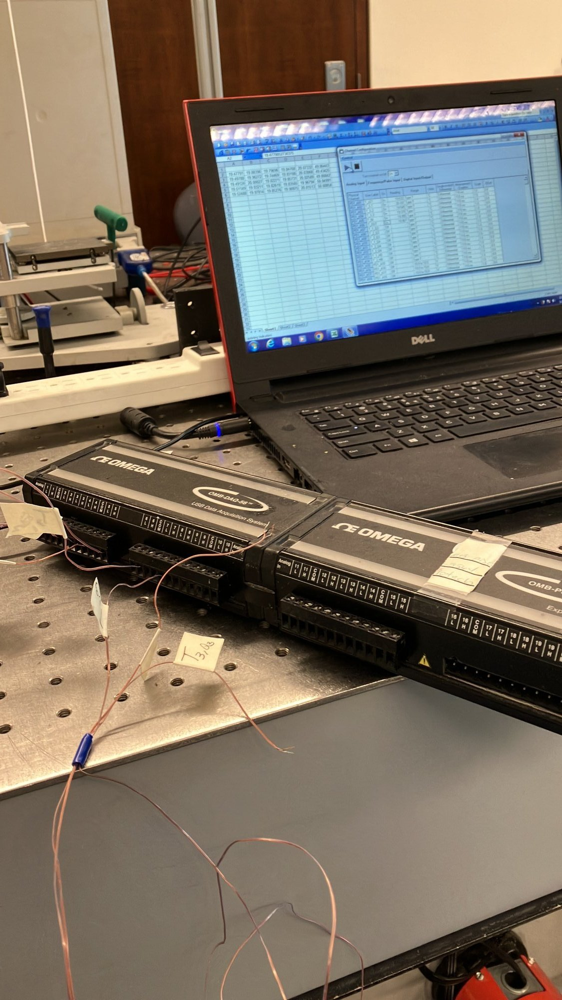
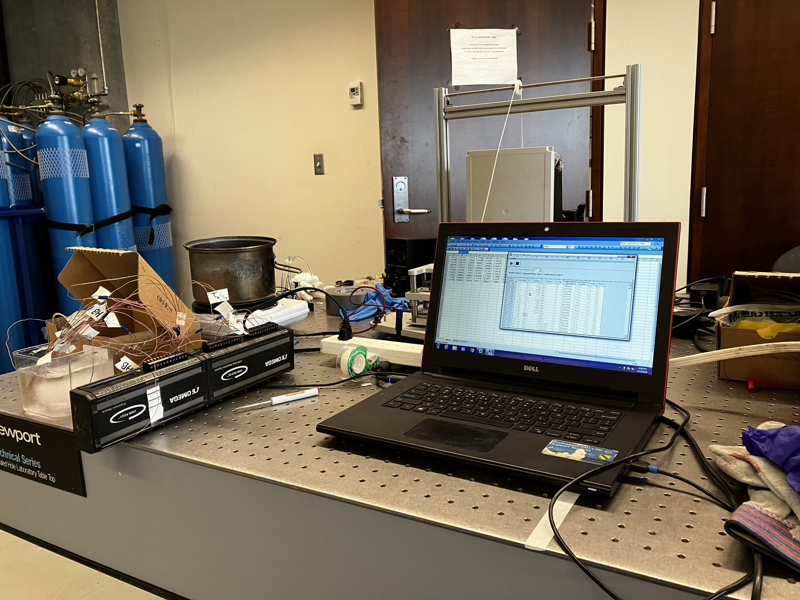
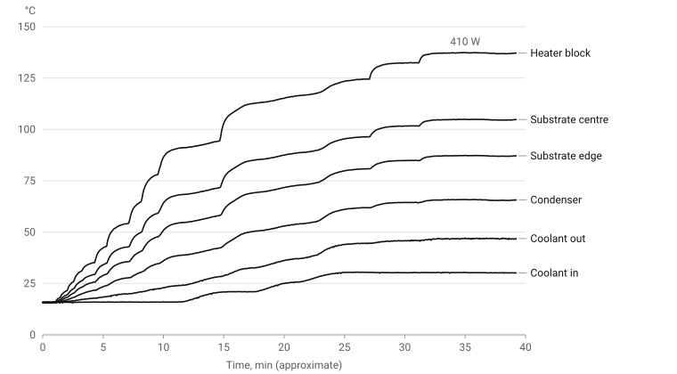
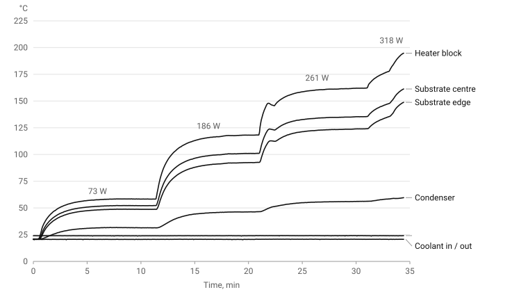
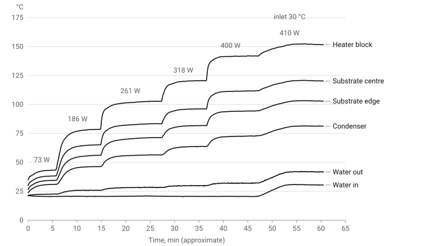
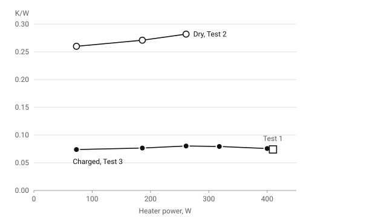
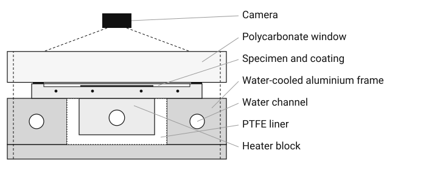

*Figure 1. The condenser block as machined: two of the four 1/4 NPT water ports, ten clamp holes on the 80 mm square pattern, and the thermocouple bores entering from the side faces.*

## Summary

A wickless flat-plate heat pipe under development at the Centre for Advanced Coating Technologies pumps fluid with a wire-arc-sprayed asymmetric sawtooth coating instead of a capillary wick. The previous build had a polycarbonate top plate that could not condense vapor, identified as the root cause of the device never reaching steady state. This report covers the replacement: a C110 copper condenser designed and machined to a GD&T drawing, the thermocouple and DAQ instrumentation of the assembly, and three tests: two with the chamber charged with water and a control with it dry. Charged, the device reached steady state at every step from 73 W to 410 W, and the chiller water carried away the electrical input, with the water reading 7 to 18% high. The resistance from substrate to condenser was 0.074 to 0.080 K/W at every power, against 0.26 to 0.28 K/W dry at the same powers. It did not change when the chiller inlet was raised from 20 to 30 °C, or when the water was run through one condenser channel instead of two, which nearly doubled the resistance on the water side. The substrate was not uniform: the centre ran 17 °C above the edge at 400 W, and that gradient per watt was the same charged and dry. Set against theory, the charged resistance is lower than conduction through the liquid would give at the design 200 µm gap, but it is flat with power and temperature, which conduction across a gap of about 70 µm would also give and boiling would not. An evacuated run and a measurement of the gap will decide it. The flow inside the chamber and its distribution across the plate are not resolved by these thermocouples. A 2-D conduction model of the plate, fitted to the eight substrate thermocouples, reproduces them with one uniform conductance to the condenser and is used to animate the temperature field. Two measurement corrections and a known bypass in the chamber are identified, and the next experiments are specified.

| Item         | Detail                                                                                                                                         |
| ------------ | ---------------------------------------------------------------------------------------------------------------------------------------------- |
| Organisation | Centre for Advanced Coating Technologies (CACT), University of Toronto                                                                         |
| Period       | May 2026 to present, research placement                                                                                                        |
| Role         | Design, machining, instrumentation and testing of the condenser                                                                                |
| Deliverables | Drawing FPHPM2601 (Appendix A), the machined block, a calibrated 14-channel thermocouple map, the charged and dry test logs                    |
| Tools        | SolidWorks with GD&T, manual mill and drill press, NPT tapping, Omega OMB-DAQ-56 with thermocouple expansion modules, chiller, DC power supply, Python (NumPy, SciPy) for the log reduction, the plate fit and the animations |

## 1. Background

Modern chips produce heat fluxes that air cooling cannot remove. Vapor chambers spread that heat by evaporation and condensation, but conventional ones need a porous wick to return liquid to the hot spot. Wicks are expensive, add thickness, and fail when they dry out or clog.

The lab's approach removes the wick. An asymmetric sawtooth microstructure, sprayed onto copper, makes vapor bubbles nucleate on the teeth, and the asymmetry leaves buoyancy, surface tension and drag on each vapor slug unbalanced, so the slugs move one way. On the lab's loop heat pipe rig the thesis student had already measured that pressure directly, about 204 Pa at steady state, consistent with a 196 to 392 Pa estimate from hydrostatic head. Separate gap tests on a sprayed specimen fixed a 200 µm air gap above the coating, and spray trials fixed 9 passes for a target structure height of about 1000 µm.

*Figure 2. The vapor chamber substrate with the sprayed sawtooth structure, the laser-cut silicone gasket and the thermocouple leads, being filled by syringe.*

The flat-plate device built from those results never reached steady state. Internal pressure climbed to the 25 psi relief valve and the flow became valve-driven. The polycarbonate top plate, with a conductivity around 0.2 W/m·K, gave almost no condensing surface. A copper condenser was the identified fix.

## 2. Objectives

1. Design a copper condenser that mates with the existing substrate, gasket and clamp plate, seals at 25 psi, and carries chiller water close to the vapor-side face.
2. Machine it in-house on a manual mill from solid C110.
3. Instrument the heater block, substrate and condenser with calibrated thermocouples on a DAQ so the spatial gradient can be read directly from the log.
4. Run the heater-to-chiller test, with a dry control, and establish whether the chamber moves heat to the condenser.

## 3. Condenser design

### 3.1 Design basis and alternatives

The condenser combines two earlier designs from the lab: the polycarbonate top plate's sealing arrangement from J. Faria's thesis, and the coolant cavity of M. Ma's condenser. Two versions were drawn with GD&T, one for 3/8 NPT fittings and one for 1/4 NPT push-to-connect fittings, each with two thermocouple bores. The 1/4 NPT version was chosen because the copper stock available set the block thickness, and the 3/8 NPT port did not fit within it.

### 3.2 Geometry

| Feature | Specification | Purpose |
| --- | --- | --- |
| Block | 90 × 90 × 17.7 mm, C110 copper | Matches the substrate footprint; copper for the condensing surface |
| Water channels | 2 × Ø11.92 mm, straight through the block on the mid-plane; each tapped 1/4 NPT at both ends, with 55.86 mm of plain bore between the ports | Chiller loop close to the vapor-side face |
| Ports | 1/4 NPT: Ø11.13 mm tap drill, 17.07 mm deep, 100° countersink | Push-to-connect fittings seal on the taper without a gasket |
| Clamp holes | 10 × Ø5.30 mm through, on an 80 mm square pattern 5 mm in from the edges | Clamps the stack against the existing plate |
| Thermocouple bores | 2 × Ø1.20 mm, 25 mm deep | Beads on known lines between the two water channels |

### 3.3 Tolerancing

The drawing carries the tolerances that matter for the assembly rather than blanket tight limits.

- Datum A is the vapor-side face. The bolt holes carry a Ø0.5 mm positional tolerance to A, B, C so the block lines up with the existing substrate, gasket and clamp plate. The water ports and thermocouple bores carry Ø0.5 mm to A, C.
- The vapor-side face has to be flat enough for the gasket to seal at 25 psi and for the contact with the chamber to conduct. The drawing does not call out flatness; the face was finished with light passes, and its flatness was not measured. This is addressed in Section 7.
- General tolerances are 0.1 mm linear and 0.5° angular.

## 4. Manufacturing

The block was machined from solid on a manual mill over one week.

| Day | Operations |
| --- | --- |
| 1 | Block squared to size in x and y |
| 2 | Faced to thickness in z; M5 clearance holes on the bolt pattern; channel positions centre-drilled |
| 3 | Thermocouples checked against ice water and boiling water (Section 5.1) |
| 4 | Channel bores drilled; ports tapped 1/4 NPT for push-to-connect fittings |
| After | Thermocouple bores; sealing face finished with light, shallow passes to keep it flat |

The Ø1.2 mm thermocouple bores, 25 mm deep, were the hardest operations. A small drill at that depth in gummy copper grabs. One bit broke and lodged in the part. The remaining bores were drilled on the mill with short pecks, clearing chips between each, and went through cleanly.

## 5. Instrumentation and test rig

### 5.1 Thermocouples and DAQ

| Item | Detail |
| --- | --- |
| Channels | 14 thermocouples across the heater block, substrate and condenser |
| Acquisition | Omega OMB-DAQ-56 with thermocouple expansion modules |
| Calibration | Two points per channel before installation: ice-water bath at 0 °C and boiling water at 100 °C |
| Channel map | Leads labelled to channel so the spatial gradient reads straight off the log |
| Scan rate | 0.6 Hz in the dry control, and taken as the same in Test 3. About 0.66 Hz in Test 1, where the rate was not recorded |

*Figure 5. Where the beads sit. The section is cut across the water channels. The condenser beads are shown at a nominal height. In the plan, the grey bars are the sprayed channel walls and the open circles are the heater block beads, below the plate.*

| Location | Channels | Bead position |
| --- | --- | --- |
| Heater block | 2: left and right | 1.5 mm below the 30 × 30 mm contact face |
| Substrate, four sides (left, top, right, bottom) | 8: one edge and one centre on each side | On the mid-plane of the 6 mm plate, 1.8 mm below the floor of the 1.2 mm pocket. Centre beads are 25 mm in from the side, over the heater block. Edge beads are 10 mm in, near the corners of the pocket and outside the heater footprint. The middle bore on each side was not used |
| Condenser | 2: left and right | 25 mm in from opposite side faces, between the two water channels |
| Chiller water | 2: condenser inlet and outlet | In the water lines |

The heater block, substrate and gasket are J. Faria's design and the positions above are from those drawings. The sawtooth coating covers the 30 × 30 mm over the heater block. The bottom-side bores, the heater block bores and the channels beside the coating all run in the same direction.

*Figure 3. The DAQ with expansion modules and the labelled thermocouple leads.*

*Figure 4. Two-point calibration of the thermocouples against an ice bath.*

### 5.2 Test rig

A copper heater block stands in for the chip, driven by a DC power supply. Its contact face is 30 × 30 mm, so 410 W is 46 W/cm². The vapor chamber substrate with its gasket sits on the heater block. The condenser sits on top, plumbed to a chiller through the NPT ports, with the water through both of its channels or through one. The DAQ logs all channels.

### 5.3 Planned measurements

- Temperature uniformity across the vapor chamber. Hypothesis: without a heat sink the substrate shows a gradient from centre to edge; with the condenser fitted the gradient falls below 1 °C.
- Condenser inlet and outlet temperatures, for the heat rejected to the chiller.
- Thermal resistance of the system, heater to condenser.
- Heat sink efficiency, from the rejected heat against the electrical input.

## 6. Results

Three runs were logged.

| Run | Chamber | Powers, W | Chiller water |
| --- | --- | --- | --- |
| Test 1, 2026-05-27 | Charged, 2.7 mL | Stepped up to 410 (118 V, 3.47 A); only the last step recorded | Both channels, 380 mL/min, inlet raised in steps to 30 °C |
| Test 2, 2026-09-23 | Dry, the control | 73, 186, 261, 318 | Both channels, 600 mL/min falling to 580, chiller at 20 °C |
| Test 3 | Charged, 2.7 mL | 73, 186, 261, 318, 400 at 20 °C inlet, then 410 at 30 °C | One channel, 580 mL/min |

The 2.7 mL fill is the 70% fill ratio of the thesis, in a 3.9 mL channel. Test 3 repeats the control's powers with the chamber charged, so the two can be compared step for step.

Every table, figure and video in this section is produced from the raw DAQ files by a set of Python scripts, so a corrected channel map, scan rate or power regenerates all of them together.

### 6.1 Test 1: charged, 410 W

*Figure 6. The charged test. Each line is the mean of the thermocouples at that location. The power was stepped up by hand and only the final step, 410 W, was recorded. The time axis assumes 0.66 Hz.*

The device reached steady state. Between the start and the end of the last five minutes no channel moved by more than 0.2 °C.

| Location | Steady temperature, °C |
| --- | --- |
| Heater block, left and right | 135.8, 138.1 |
| Substrate centre: left, top, right, bottom | 98.1, 109.0, 107.9, 103.4 |
| Substrate edge: left, top, right, bottom | 82.1, 90.7, 92.4, 82.8 |
| Condenser, left and right | 66.0, 65.0 |
| Chiller water, out and in | 46.7, 30.2 |

The chiller water rose 16.6 °C across the condenser. At 380 mL/min that is 437 W, against 410 W of electrical input. The balance closes at 107%. The coolant cannot carry more heat than the heater supplies, so the 7% is the combined error of the flow reading and the two water thermocouples. Within that error, all of the heat left through the condenser.

Earlier in the run the balance is less tidy. Between about minutes 17 and 27 the temperature drops inside the copper did not change, so the heater power did not. Over the same period the coolant pickup went from about 300 W to about 370 W as the inlet was raised from 21 to 30 °C. On that evidence the coolant measurement is good to about 20%, not 7%.

### 6.2 Test 2: dry control

*Figure 7. The dry control. The first three steps settled. The 318 W step was stopped with the hotter heater block bead at 199 °C and still rising.*

The two chiller water channels did not respond in this run. They stayed within 20.2 to 20.9 and 23.7 to 24.2 °C through every step while the condenser block rose to 60 °C. At 600 mL/min, 261 W would warm the water by 6 °C. The channel labelled outlet read the chiller setpoint and the one labelled inlet read 3 °C above it, so they were not reading the water across the condenser and there is no energy balance for the control. The comparison below uses the condenser block temperature instead, which does not depend on them.

### 6.3 Test 3: charged, 73 to 410 W

*Figure 8. Test 3. Five power steps with the inlet at 20 °C, then the inlet raised to 30 °C with the power at 410 W. The time axis assumes 0.6 Hz.*

Every step reached steady state: over the last 100 scans of each, the heater block moved by less than 1 °C.

| Power, W | Heater block, °C | Substrate centre, °C | Substrate edge, °C | Condenser, °C | Water in, °C | Water out, °C | Heat to the water, W |
| --- | --- | --- | --- | --- | --- | --- | --- |
| 73 | 43.2 | 38.2 | 34.4 | 30.9 | 20.5 | 22.6 | 83 |
| 186 | 78.4 | 65.0 | 56.0 | 46.3 | 20.6 | 25.9 | 214 |
| 261 | 102.7 | 83.3 | 71.4 | 56.4 | 20.8 | 28.3 | 304 |
| 318 | 120.5 | 96.2 | 81.7 | 63.7 | 20.6 | 29.9 | 374 |
| 400 | 141.8 | 111.6 | 94.3 | 72.7 | 20.5 | 32.0 | 464 |
| 410, inlet 30 °C | 151.7 | 120.3 | 102.9 | 81.3 | 30.5 | 41.7 | 452 |

Each temperature is the mean of the thermocouples at that location. In this log the water channel labelled outlet reads the chiller setpoint and the one labelled inlet rises with every step, so they are used the other way round.

The water picked up 13 to 18% more heat than the heater supplied at every step with the inlet at 20 °C, and 10% more at 30 °C. The excess grows in proportion to the power. An offset in a water thermocouple would add the same number of watts at every step, so the flow reading is the first suspect. Read with Test 1's 107%, the heat leaves through the condenser and the water side overstates it by 7 to 18%.

Raising the inlet by 10 °C, with 10 W more power, moved the substrate and condenser by 8.2 to 9.0 °C and the heater block by 10 °C. The resistances did not change.

Test 1 ran the water through both condenser channels at 380 mL/min. Test 3 ran it through one at 580 mL/min. From the condenser beads to the mean water temperature that is 0.066 K/W in Test 1 and 0.116 K/W in Test 3, so one channel nearly doubled the water-side resistance even with 50% more flow. The substrate-to-condenser resistance was 0.074 K/W in Test 1 and 0.076 K/W at 400 W in Test 3.

### 6.4 Thermal resistance

Each resistance is a temperature difference between location means divided by the electrical power.

| Run | Power, W | Heater to substrate, K/W | Substrate to condenser, K/W | Heater to condenser, K/W |
| --- | --- | --- | --- | --- |
| Test 1, charged | 410 | 0.100 | 0.074 | 0.174 |
| Test 2, dry | 73 | 0.109 | 0.260 | 0.369 |
| Test 2, dry | 186 | 0.115 | 0.271 | 0.387 |
| Test 2, dry | 261 | 0.124 | 0.282 | 0.406 |
| Test 3, charged | 73 | 0.095 | 0.074 | 0.168 |
| Test 3, charged | 186 | 0.096 | 0.076 | 0.173 |
| Test 3, charged | 261 | 0.097 | 0.080 | 0.177 |
| Test 3, charged | 318 | 0.099 | 0.079 | 0.179 |
| Test 3, charged | 400 | 0.097 | 0.076 | 0.173 |
| Test 3, charged, inlet 30 °C | 410 | 0.098 | 0.074 | 0.172 |

*Figure 9. Substrate to condenser, charged and dry. Open circles are the dry control, filled circles Test 3 at 20 °C inlet, the square Test 1.*

At the same three powers the substrate-to-condenser resistance is 3.5 to 3.6 times lower with the chamber charged. Charged, it holds at 0.074 to 0.080 K/W from 73 W to 410 W, across both charged runs, both inlet temperatures and both water plumbings. The dry values are lower bounds: with no energy balance, some of the electrical power left to the room and did not cross to the condenser.

The fluid is not in the heater-to-substrate path. That resistance is 0.095 to 0.100 K/W in both charged runs, and dry it is 15 to 28% higher at the same powers, rising with power.

Per unit of heater area, which is how a package datasheet states them: 0.67 to 0.72 cm²·K/W across the chamber charged against 2.3 to 2.5 dry, and about 0.9 cm²·K/W from the heater block to the substrate.

From heater block to chiller inlet the charged assembly is 0.26 K/W with both water channels and 0.30 K/W with one. With both channels the drop divides into three roughly equal parts. With one, the water side grows and the other two do not.

| Step | Test 1, 410 W, both channels, °C | Test 3, 400 W, one channel, °C |
| --- | --- | --- |
| Heater block to substrate centre | 32 | 30 |
| Substrate centre to condenser | 39 | 39 |
| Condenser to chiller inlet | 35 | 52 |

### 6.5 Uniformity

| Run | Power, W | Centre minus edge, °C | Per watt, mK/W | Spread over the 8 substrate channels, °C | Condenser left minus right, °C |
| --- | --- | --- | --- | --- | --- |
| Test 1, charged | 410 | 17.6 | 43 | 26.9 | 1.1 |
| Test 2, dry | 73 | 3.4 | 47 | 8.5 | 1.7 |
| Test 2, dry | 186 | 8.6 | 46 | 22.1 | 5.4 |
| Test 2, dry | 261 | 11.4 | 44 | 29.8 | 8.0 |
| Test 3, charged | 73 | 3.8 | 52 | 5.4 | 0.4 |
| Test 3, charged | 186 | 9.0 | 49 | 13.5 | 1.4 |
| Test 3, charged | 261 | 12.0 | 46 | 17.7 | 2.3 |
| Test 3, charged | 318 | 14.4 | 45 | 21.5 | 3.1 |
| Test 3, charged | 400 | 17.3 | 43 | 26.1 | 3.9 |
| Test 3, charged, inlet 30 °C | 410 | 17.4 | 42 | 26.6 | 4.2 |

The sub-1 °C uniformity hypothesis of Section 5.3 was not met. The centre of the substrate ran 17 to 18 °C above the edge at 400 and 410 W. Per watt, the centre-to-edge gradient is the same charged and dry, now at the same powers: 46 to 52 mK/W charged against 44 to 47 dry from 73 to 261 W. The substrate did not show the spreading the sawtooth structure is meant to produce. Charging did narrow the spread over all eight channels, to 18 °C at 261 W against 30 °C dry.

### 6.6 Temperature field

Eight beads are enough to fit a conduction model of the plate, though not to map it directly. The substrate is treated as a 2-D copper plate, 6 mm thick and about 5 mm (4.8 mm) under the pocket, with insulated edges:

$$\nabla \cdot (k\,t\,\nabla T) + q'' - g\,(T - T_\text{condenser}) = 0$$

The heat $Q$ enters uniformly over the 30 × 30 mm heater face. It leaves over the pocket to the condenser through one conductance per area, $g$. At every scan $Q$ and $g$ are fitted to the eight beads, with a linear tilt across the plate for whatever is not symmetric. The power is not an input. At the steady states it comes back from the fit:

| Run | Electrical power, W | Power from the fit, W | $g$, W/m²K | RMS error at the beads, °C |
| --- | --- | --- | --- | --- |
| Test 1, charged | 410 | 441 | 4300 | 2.2 |
| Test 2, dry | 73 | 74 | 1100 | 1.1 |
| Test 2, dry | 186 | 198 | 1100 | 2.9 |
| Test 2, dry | 261 | 262 | 1000 | 4.5 |
| Test 3, charged | 73 | 103 | 5800 | 0.2 |
| Test 3, charged | 186 | 227 | 4700 | 0.4 |
| Test 3, charged | 261 | 305 | 4300 | 0.6 |
| Test 3, charged | 318 | 367 | 4300 | 0.7 |
| Test 3, charged | 400 | 440 | 4300 | 0.9 |
| Test 3, charged, inlet 30 °C | 410 | 442 | 4300 | 0.8 |

In Tests 1 and 2 the fit recovers the power to within 8% from temperatures alone. In Test 3 it reads high: by 8 to 22% from 186 W up, and by 41% at 73 W, where the eight beads span only 5 °C. The fitted $g$ is the steadier number. It is 4300 W/m²K at every charged step from 261 W up, in both charged runs, against 1000 to 1100 dry. The chamber changes $g$, by a factor of four, and the same plate carries the heat outward to it charged or dry. Section 7.4 works out why that leaves the centre-to-edge gradient unchanged.

<video controls autoplay muted loop playsinline width="1280" height="720" style="display:block;width:100%" src="/projects/cact/cact_test1_field.mp4" aria-label="The charged run. A plan view of the substrate shows the fitted temperature field with isotherms growing outward from the heater face as the power steps up, with the eight thermocouples drawn as dots coloured by their measured value. Beside it a section of the stack shows the heater block, substrate, condenser and coolant temperatures."></video>

*Video 1. Test 1, charged. The field is the fitted model. The dots are the measurements, so a dot that stands out from the field is where the model is wrong.*

<video controls autoplay muted loop playsinline width="1280" height="720" style="display:block;width:100%" src="/projects/cact/cact_control_field.mp4" aria-label="The dry control. The same view through four power steps. The substrate runs much hotter than the condenser and a left-to-right tilt grows with power."></video>

*Video 2. Test 2, the dry control, on a wider colour scale.*

<video controls autoplay muted loop playsinline width="1280" height="720" style="display:block;width:100%" src="/projects/cact/cact_test3_field.mp4" aria-label="Test 3. The same view through five power steps at 20 °C inlet and then the inlet raised to 30 °C. The isotherms keep the same shape at every step while the whole plate warms, and the field fits the eight dots closely."></video>

*Video 3. Test 3, charged, through the dry control's powers and on to 410 W.*

The fit assumes each scan is at steady state, and $Q$ and $g$ are only loosely separated by eight beads, so between the checked points the fitted power is less certain than the table suggests and is not shown in the videos. The tilt is 14 °C across the plate in Test 1 and 12 °C in Test 3 at 400 W. In the dry run it is in a different direction and grows with power, to 30 °C at 261 W.

## 7. Analysis against theory

The copper condenser did what it was built for. The previous build never reached steady state. This one settled at every step from 73 W to 410 W in two charged runs, and the heat arrived in the chiller water. This section takes each part of the stack in turn, sets the measurement against the theory that should describe it, and says which numbers that theory explains and which it does not. All values are at about 400 W unless stated.

### 7.1 Heater block to substrate

The heater beads and the centre substrate beads are 4.5 mm of copper apart. Fourier's law in one dimension gives the drop across that copper:

$$\Delta T_\text{Cu} = \frac{q'' L}{k} = \frac{44\ \text{W/cm}^2 \times 0.45\ \text{cm}}{3.9\ \text{W/cm·K}} \approx 5\ \text{°C}$$

The measured drop is 30 °C. The other 25 °C is the joint between the block and the substrate, which was made with thermal paste. Divided by the heat flux it is a specific resistance of 0.50 to 0.60 cm²·K/W across both charged runs. A conducting joint should not depend on power, and this one changes little: 0.50 at 73 W, where the whole drop is only 5 °C and the beads' error matters most, and 0.55 to 0.60 from 261 W up.

Its size is the problem. A layer of paste has a specific resistance of its thickness over its conductivity, $t/k$. A typical paste of about 3 W/m·K, clamped to a bond line of 25 to 50 µm, gives 0.1 to 0.2 cm²·K/W. The measured value is what about 170 µm of that paste would give, or a thinner layer between faces that are not flat. Paste was applied, but its type, its thickness and the clamp pressure were not recorded. Bringing the joint to 0.15 cm²·K/W would take about 18 °C off the heater block at 400 W, which makes it the cheapest temperature in the stack to recover.

### 7.2 Condenser to water

Whether flow in a pipe is smooth or turbulent is set by the Reynolds number, $\text{Re} = 4\dot m/(\pi D \mu)$, the ratio of inertia to viscous forces, with turbulence above about 2300. In the Ø11.92 mm channels Re is about 500 per channel in Test 1 if the two channels shared the 380 mL/min, 1000 if they were in series, and 1200 in Test 3. All three are laminar. Each channel has only 56 mm of plain Ø11.92 mm bore between the fittings, under five diameters, so the layer of water warmed by the wall is still growing when it leaves, and the heat transfer is that of the entrance region. The standard correlation for it, written with the Nusselt number $\text{Nu} = hD/k$ and the Prandtl number of water, Pr, is

$$\text{Nu} = 1.86\left(\text{Re}\,\text{Pr}\,\frac{D}{L}\right)^{1/3}$$

Over the 56 mm of plain bore it gives a film coefficient $h$ of 770 to 1090 W/m²K, and a condenser-to-water resistance $1/(hA)$ of 0.25 to 0.31 K/W for Test 1 and 0.44 K/W for Test 3. Measured, from the condenser beads to the mean water temperature, they are 0.066 and 0.116 K/W: the real $h$ is about 3600 to 4100 W/m²K, about four times the correlation. Some water also reaches the tapped ends, which this leaves out, so four times is an upper bound. The copper between the beads and the channel walls would push the measurement the other way, so the difference is in the water. The correlation already covers a developing velocity profile. What it leaves out is the jet where the narrower bore of each push-to-connect fitting opens into the channel, which is the likeliest main cause, and buoyancy: Gr/Re², its ratio to inertia, is 0.2 to 1.4 here, enough for warm water rising off the wall to stir the flow, though over so short a channel the gain should be modest. The gap is not resolved.

The ratio between the runs is 1.76: one channel at 580 mL/min against both at 380 mL/min. If forced laminar flow set $h$, that would point to the channels being in series in Test 1 (the correlation gives 1.78 in series, 1.41 in parallel). But $h$ is four times what that flow law gives, so its dependence on flow is not known, and if $h$ barely depended on flow the ratio would be about 2 either way. How Test 1 was plumbed has to be checked on the rig, not inferred.

### 7.3 The chamber: conduction or phase change

The substrate-to-condenser resistance is the number the chamber exists to lower, and there are two candidate explanations for the 0.074 to 0.080 K/W it reached.

The first is conduction through the liquid. At the design geometry, water flooded to the top would conduct 0.34 K/W across the 200 µm gap over the 30 × 30 mm coating ($t/kA$, with water at 0.66 W/m·K) and 0.67 K/W across the 1.2 mm depth of the rest of the pocket. In parallel with the 0.27 K/W dry path through the copper contacts, that is 0.12 K/W. The measurement is lower. Solving the same parallel sum for the gap instead, conduction alone matches the measurement if the water layer over the coating is about 75 µm thick. At a 70% fill the pocket is not flooded: capillarity should keep the thin gap full and leave the gas in the 1.2 mm channels, and then the gap that fits is 60 to 70 µm. Either way it is about 70 µm. The coating was sprayed to a target of about 1000 µm in a 1.2 mm channel, so that is a coating 120 to 140 µm taller than its target. Neither the coating height nor the gap was measured on this specimen.

The second is phase change, which the sawtooth structure and the 70% fill are designed for. If boiling carried the heat, the resistance would fall as the power rose. In nucleate boiling the heat flux grows with roughly the cube of the wall superheat (the Rohsenow correlation), so $h \propto q''^{2/3}$, and from 73 W to 400 W the boiling coefficient should rise 3.1 times. Boiling also needs the wall above the saturation temperature. At 73 W the hottest substrate bead was 39 °C, where water boils only below 0.07 bar. These runs were not evacuated: the chamber was filled by syringe while open (Figure 2), and the copper condenser has no port to pump it down through. So it held air at about atmospheric pressure, as in the thesis, which ran all its experiments at atmospheric conditions (J. Faria's thesis, p. 19). With air inside, evaporation and condensation are limited by vapor diffusing through that air, at a rate that follows the vapor pressure. The vapor pressure of water rises 26 times from 36 °C to 112 °C, the range of the substrate across Test 3. The trapped air also limits boiling at the top steps: heated to 60 to 90 °C and joined by the vapor, it puts the chamber near 1.4 to 2 bar, where water boils at 110 to 120 °C, so even the hottest bead, 123 °C at 410 W, was at most a few degrees above saturation.

The measurement shows neither. The resistance is the same to within ±4% from 73 W with the substrate at 36 °C to 410 W with it at 112 °C, and the same with the inlet at 20 or 30 °C. Liquid conduction predicts that. The conductivity of water rises 9% over that temperature range, and with the liquid carrying about 70% of the conductance the resistance would fall about 6% from the lowest step to the highest, inside the scatter.

So the simplest reading of these three runs is conduction through a water layer thinner than the design gap, and the data do not show the power dependence boiling would add. They say nothing about the chamber evacuated, which is how heat pipes are normally run. There the resistance of thin evaporating and condensing films is also set by conduction through liquid, and is also nearly flat with power. Run 3 of Section 8 tests the evacuated chamber, and measuring the gap above the coating tests the conduction reading.

### 7.4 Plate uniformity

A vapor chamber is meant to make the plate isothermal by carrying heat sideways as vapor. That is the hypothesis of Section 5.3, and the plate gradient tests it. Heat entering the 30 × 30 mm heater face leaves over the 60 × 60 mm pocket. The distance it spreads through the 5 mm of copper before leaving is $\lambda = \sqrt{k t / g}$, 21 mm charged and 43 mm dry. Both are longer than the 15 mm from the heater edge to the edge beads, so in both runs the condenser takes heat from the whole pocket, and two thirds to three quarters of it has to cross the copper outward from under the heater first. The centre-to-edge gradient is set by that copper and hardly by $g$. The plate model of Section 6.6 gives 44 mK/W for the dry $g$ and 39 mK/W for the charged $g$. Measured, it is 44 to 47 dry and 42 to 52 charged.

The same model sets the target. To hold the centre within 1 °C of the edge at 400 W, the plate and chamber together would need about 20 times the sideways conductance of the copper alone, an effective conductivity near 8000 W/m·K over its 5 mm. That is the range commercial vapor chambers reach with vapor flowing sideways. Here the gradient is what copper alone gives, so no sideways transport through the chamber shows in these beads.

### 7.5 Energy balance

The heat to the water is $\rho \dot V c_p \Delta T$. At 580 mL/min that is 40 W for every kelvin of rise, and the excess over the electrical power can be traced by how it grows. An offset in a water thermocouple adds the same number of watts at every step. The excess in Test 3 is equivalent to 0.25 K at 73 W and 1.6 K at 400 W, a fixed fraction of the power, not a fixed offset. Heat lost from the hot stack to the room would push the balance below 100%, not above it. Two causes grow in proportion to power. One is the flow reading: the balance closes if the true flow was about 500 mL/min where 580 was read. The other is the outlet thermocouple: at Re near 1200 the outlet stream is laminar and not mixed, so a probe in the warm layer near the wall, or one fed heat along its stem from the block, reads above the mixed mean. The inlet temperature does not separate them. Raising it moved the balance up in Test 1 and down in Test 3. A timed-volume flow check and a mixed outlet will.

### 7.6 What the thermocouples cannot resolve

The flow inside the chamber and how it distributes across the plate are not answered by these beads. They are in 5 mm of copper, and Section 6.6 shows that the copper sets what they read: the same conduction model fits the charged and dry runs, with only $g$ changed. One uniform $g$ over the pocket fits Test 3 to under 1 °C, so the beads do not resolve where on the plate the vapor forms, where it condenses, or whether the liquid circulates through the channels as designed.

### 7.7 Known errors in the measurement

1. Thermocouple position. Each bead sits inside the copper, not on the surface. With a known heat flux $q''$ and copper conductivity $k$ there is a linear gradient between the surface and the bead, so a surface the heat flows toward sits below the bead by $q'' d / k$, with $d$ the bead's distance from it on the drawing, and a surface the heat flows away from sits above it. At 400 W the heater beads, 1.5 mm below the heater face, read about 1.7 °C above it. At the pocket floor, 1.8 mm above the substrate beads, the upward flux is about a third of the heater flux, so the correction is under 1 °C. Raw bead temperatures were reported, so this is a systematic bias in the resistances of Section 6.4.
2. Interface contact. The condenser-to-chamber contact resistance was not characterised. Flatness was not measured, and no thermal interface material or contact pressure measurement was used. The gasket is designed to compress 0.2 to 0.25 mm, which leaves the rim of the substrate at or close to the condenser face, and the sprayed channel walls are meant to reach it. In the dry run the heat crosses through those copper contacts. The dry run shows the effect: the left of the condenser ran 8 °C hotter than the right at 261 W while the left of the substrate ran cooler, which is what better contact on the left would give. Charged, the two sides agreed to 1 °C with both water channels in use, and to 4 °C with one.

Beyond the measurement, the chamber has a known bypass. The channel walls on the substrate do not touch the sawtooth structure, giving the vapor a lower-resistance path around the pump. That was flagged in the thesis but not fixed in the hardware tested here.

## 8. Next test: cooled from below, seen from above

The beads cannot see the flow (Section 7.6). The original polycarbonate top could, but with it the device had no condenser and never settled. The next test keeps the polycarbonate top as a window and moves the cooling to the underside of the specimen.

*Figure 10. The proposed stack. Only the PTFE housing is replaced; the top plate, gasket, specimen, heater block, base plate and bolts are J. Faria's.*

### 8.1 Why from below

The sides do not work. The specimen's side faces are 70 × 6 mm, 17 cm² in all, about 2.4 mm from the M5 bolts, and they carry the twelve thermocouple bores. A side cooler would need a new bolt pattern and would have to work around the bores.

The underside does. In J. Faria's drawings the heater block is 15 mm tall in a 13 mm deep pocket of the 17 mm PTFE housing, so its face stands 2 mm proud: the specimen rests on the heater block alone, with its rim over a 2 mm air gap. A water-cooled aluminium frame with the housing's 90 × 90 mm outline and bolt pattern, made 19 mm tall so its top is level with the heater face, drops into the housing's place and closes that gap. It touches the specimen rim over about 27 cm², outside a 41 × 51 mm opening, or 26 cm² with the slot for the heater cartridge. The clamp load then splits between the heater block and the frame, so their faces must be level to within the paste's bond line, or the rim joint made with a compliant thermal pad. A PTFE liner with 5 mm walls fills that opening and holds the heater block as the housing did. Through PTFE the block leaks about 0.1 W/K to the frame, about 10 W at a 100 °C difference, which the dry run measures. The water runs in a drilled channel around three sides of the frame, with the inlet and outlet either side of the heater slot.

### 8.2 What it measures

Heat now enters at the centre and leaves at the rim, which is how a vapor chamber spreads heat: vapor carries it outward over the pocket and condenses over the cooled rim, and the sawtooth structure returns the liquid. That outward transport is what the centre-to-edge gradient reads. The plate model of Section 6.6, with its sink moved to the rim, gives 76 mK/W for copper alone. That is twice the 39 mK/W of the current top-cooled stack, and nearly the same for any contact conductance from 2000 to 10,000 W/m²K. Sideways transport through the chamber lowers it:

| Sideways conductance the chamber adds, times the copper plate's | Centre minus edge, mK/W | At 186 W, °C |
| --- | --- | --- |
| 0, copper only | 76 | 14.1 |
| 0.6 | 48 | 8.9 |
| 3 | 20 | 3.7 |
| 12 | 6 | 1.1 |

The rows treat the vapor as perfectly coupled to the copper, so they are best cases for a given transport. Calibrated beads separate them at any power above about 50 W. The camera shows where the vapor forms, which way it moves, and whether the liquid comes back along the channels. With the condenser gone, its two DAQ channels move to two of the unused 17.5 mm bores, for a three-point profile from centre to edge on two sides.

### 8.3 Runs

1. Dry, from 73 W up. This sets the copper-only gradient, the leak through the liner and the contact conductance to the frame, which set how far the power can go (Section 8.4).
2. Charged with 2.7 mL as before, air left in, at the same powers.
3. Evacuated, then charged with degassed water, at the same powers. Runs 2 and 3 separate the effect of the air (Section 7.3).

In every run: the chamber pressure logged through the second NPT port of the top plate, the water thermocouples in the stream, the power recorded at each step, and video at each steady state.

### 8.4 Limits

The polycarbonate touches the vapor. The thesis gives about 140 °C as its limit and stopped runs at 135 °C (p. 25). Polycarbonate also crazes with long exposure to hot water, so the pocket is held below 90 °C. With 20 °C water the model reaches 90 °C at 160 W if the frame conducts 1000 W/m²K to the water, 270 W at 2000 and 450 W at 5000. That conductance lumps the rim contact, the aluminium and the laminar water side, and for a bare clamped copper-to-aluminium joint 1000 to 2000 is realistic. So the dry run starts at 73 W and each step is checked against the limit before the next, and 186 W may be the top step. The 25 psi relief valve stays. About 2 W leaves through 12.7 mm of polycarbonate, so the window's inner face sits just below the vapor temperature and will collect condensate, a few grams an hour. A thin film heater on the outside is part of the rig, not a fix to add later.

## 9. Recommendations

1. Log the chamber pressure, so the substrate temperatures can be placed against the saturation temperature, and record whether the chamber is evacuated before filling. With the measurement below, this decides between the two readings of Section 7.3.
2. Measure the gap between the coating and the condenser face, by the coating height on a profilometer or by a soft-metal squash test in the assembled stack. Conduction alone explains the charged resistance if it is about 70 µm.
3. Resolve the flow and its distribution across the plate. The beads in the copper cannot, so this needs the window of Section 8. A charged run on a substrate with no sawtooth structure would then show what the structure itself adds.
4. Re-make the heater-to-substrate paste joint with a paste of known conductivity under a measured clamp pressure, and measure the flatness of both faces. At 0.5 to 0.6 cm²·K/W it is three to five times a well-made paste joint (Section 7.1).
5. Measure the flatness of the condenser's sealing face on a surface plate or with a dial indicator. Apply the thermocouple gradient correction of Section 7.7 and recompute the resistances from the existing logs.
6. Check the chiller flow reading against a timed volume at 20 and 30 °C, and read the outlet water after a bend or mixer so the thermocouple sees the mixed temperature. One of the two explains the 7 to 18% excess of Section 7.5.
7. Repeat the dry control with the water thermocouples in the stream, so the heat crossing the dry chamber is measured and not bounded.
8. Record the power at every step, as in Test 3, and how the water channels are plumbed. Test 1 was stepped up many times by hand and only its last power is known.
9. Close the bypass by revising the channel boundary to contact the sawtooth structure.
10. Sweep the chiller flow at fixed power and plumbing. The condenser-to-water part of the budget should move with the flow and the rest should not. Test 3 has already shown the second half: one channel instead of two nearly doubled the water side and left the chamber unchanged. How the water side moves with flow tells which regime it is in: as the cube root of the flow in forced laminar flow, hardly at all if buoyancy dominates, and as the 0.8 power if the flow were turbulent.

## 10. Conclusions

The copper condenser was designed, machined and installed, and the assembly was instrumented and tested end to end. With it the device reaches steady state at every step from 73 W to 410 W and the heat arrives in the chiller water. Charging the chamber lowers the substrate-to-condenser resistance from at least 0.26 K/W to 0.074 to 0.080 K/W at the same powers, and that value does not move with power, inlet temperature or the water plumbing. Set against theory, that flat resistance is what conduction through a water layer about 70 µm thick would give, and not the falling resistance boiling would give; an evacuated run and a measurement of the gap above the coating will settle which it is. The substrate is not isothermal, and its in-plane gradient is what the copper plate alone gives. Of the rest of the stack, the heater paste joint is three to five times what a well-made joint would be, and the water side does about four times better than the textbook laminar correlation. The flow inside the chamber and its distribution across the plate remain unresolved. The next test keeps the original polycarbonate top as a window and cools the specimen from below, so the camera can see the flow and the beads can read the chamber's sideways transport.

This was the first part I made to a drawing I wrote, with tolerances that came from the mating parts rather than from habit, and then had to live with in a test.

## Appendix A. Condenser drawing

[Drawing FPHPM2601, PDF](/projects/cact/cact_condenser_drawing.pdf). The drawing defines datum A as the vapor-side face, the Ø0.5 mm positional tolerances on the bolt holes, ports and thermocouple bores, and the general tolerances of 0.1 mm and 0.5°.
