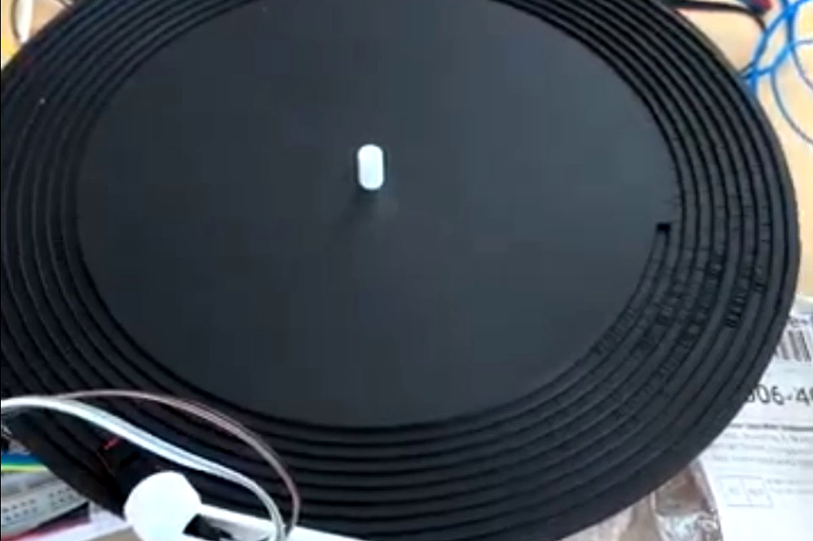
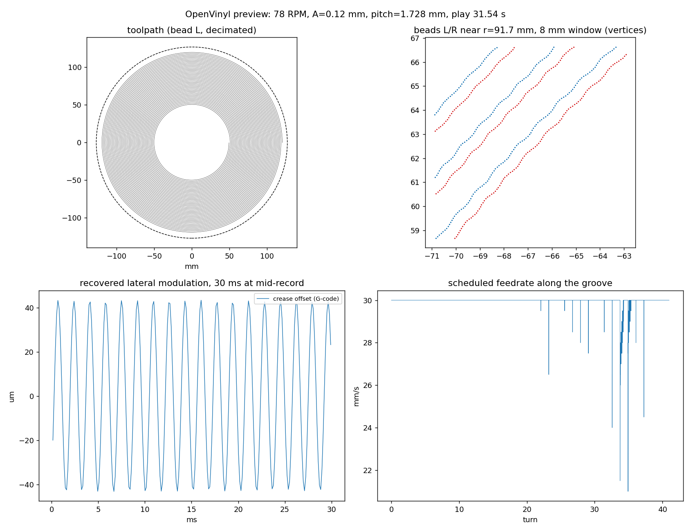
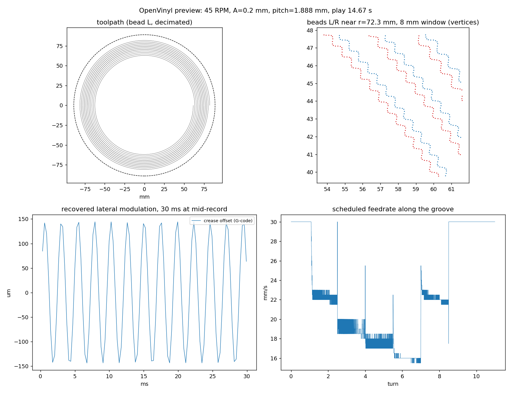

# Why

## Origin

Can a hobby 3D printer make a record that plays? A project with two collaborators, and a turntable we built for it.

# What

## Encoder

Software that turns audio into the path the nozzle follows. Every groove parameter comes from bead width, stylus contact and printer acceleration.

# Problem

## Bead width

A printed bead is 0.48 mm, 10 to 20 times a vinyl groove. v1 stored the audio as depth because a sideways wiggle looked impossible.

## Slope and acceleration

Amplitude times frequency is capped twice: by the groove slope the stylus can follow, and by the printer's acceleration. Both caps change with radius.

# Work

## Direct G-code

The limit was the slicer, not the bead. Written directly as G-code, the same bead places to about 0.01 mm, so v2 cuts sideways on the printer's precise axes.

## The v2 groove

Two beads per turn with a crease between them. Both wiggle together and the stylus rides the crease.

## Print speed

Each segment's speed is set from its curvature: loud passages print slowly, quiet ones fast. The groove prints in about 25 minutes.

## Round trip

The tool decodes its own G-code back into audio. A 440 Hz tone commanded at 100 µm returns at 100.5 µm.

## Stress disc

A tone ladder from 300 to 680 Hz that pushes the slope limit and the speed schedule.

## First prints

Print. The open risk is tracking, whether a stylus stays in the crease for 40 turns, so the first prints are small coupons with one question each.

## Questions

- Contact mechanics
- v1
- Constant or variable platter speed
- Play time
