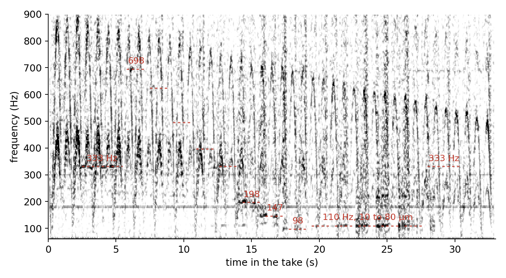
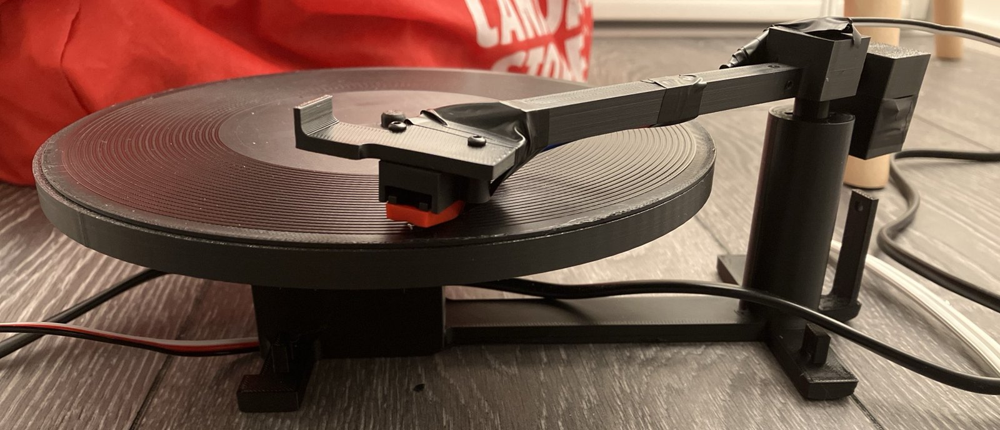
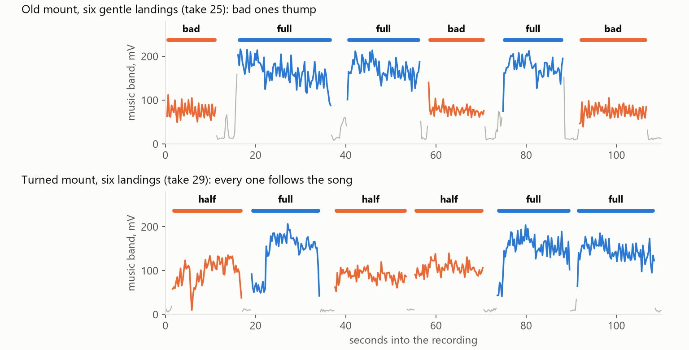
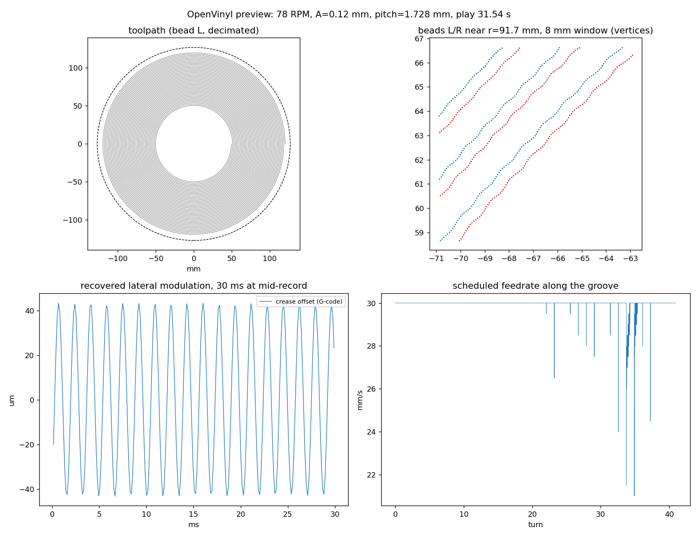
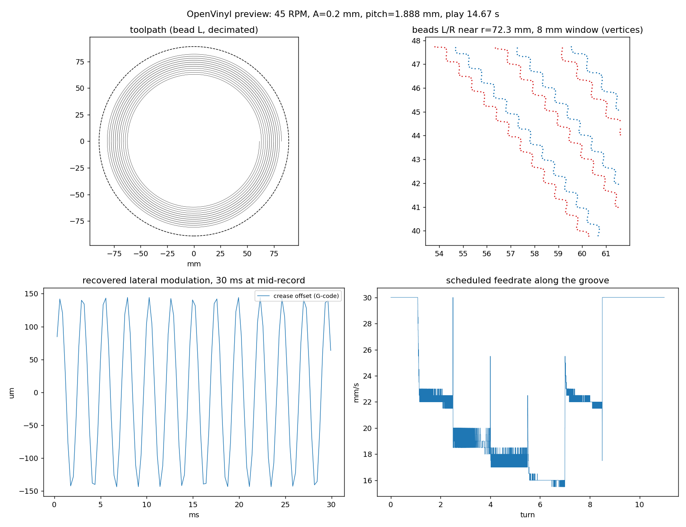
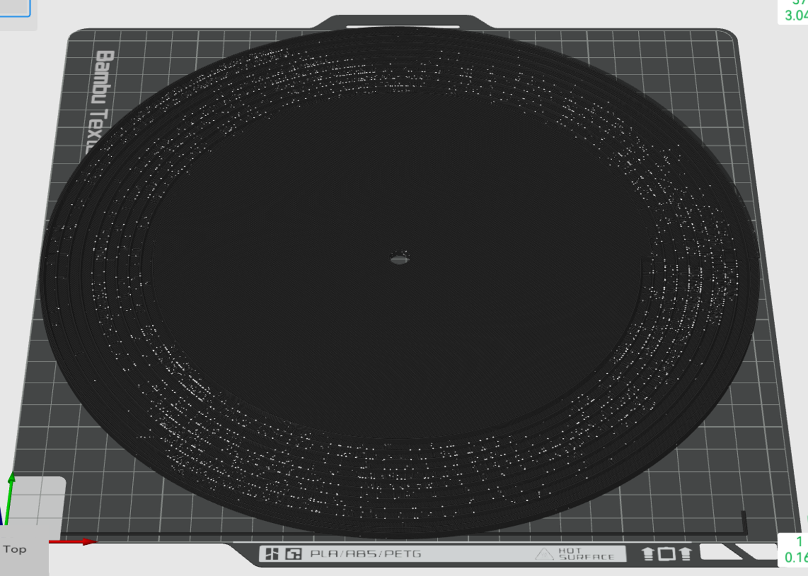
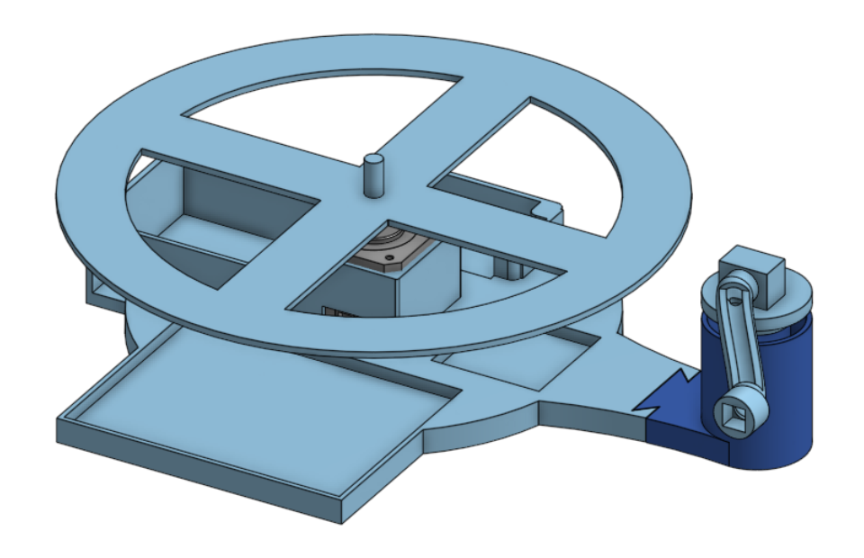

<video controls autoplay muted loop playsinline width="1280" height="720" style="display:block;width:100%" poster="/projects/openvinyl/openvinyl_v2_song_play.jpg" src="/projects/openvinyl/openvinyl_v2_song_play.mp4" aria-label="Take 30 of the printed song disc, filmed on a phone and muted. A hand lowers the printed arm onto the outer groove of the black printed disc, and the cartridge rides the spiral inward as the platter turns."></video>

OpenVinyl turns digital audio into groove geometry on records printed on a hobby FDM printer, played back on a turntable I designed with two collaborators. v1 worked, barely. I went back to first principles and reversed its central design decision. On November 22, 2026 the first v2 record played: a 7 inch test disc on a new turntable, tracked from the outer groove to the label. Two days later a printed song disc played start to finish.

## First play

The disc is a measurement, not music. Each section asks one question.

| Section | Question |
| --- | --- |
| Silence, outer and inner | Noise floor |
| 333 Hz at 20 µm, outer and inner | Speed, wow and flutter; what changes toward the label |
| Tones 698 down to 98 Hz | Frequency response |
| 110 Hz at 10, 20, 40, 60, 80 µm | Where the stylus stops following |

Every amplitude is held to 70% of the encoder's curvature limit at the radius it plays, so the limiters never touch the signal. Every tone and its first five harmonics sit at least 5 Hz from a multiple of 60 Hz, where mains hum lands.

The dashed lines are where each section should be, from the disc's schedule and the measured platter speed. The tones arrive on time from the outer reference to the inner one: the stylus followed the groove for all 31 seconds.

| Measured (take 4, about 5 g) | Result |
| --- | --- |
| Platter speed | 39.85 RPM, steady to ±0.02 |
| 198, 147, 98 Hz at 25 µm | 44, 52, 40 mV |
| 110 Hz ladder | Level grows to 60 µm, flat at 80 µm |
| 698 and 627 Hz | Barely above the noise: 3 to 5 dB over the frequencies beside them, against 11 dB for the 333 Hz reference. The bead-smear model predicted −33 and −41 dB, so it is pessimistic |
| Groove noise, 80 Hz to 2 kHz | About 150 mV rms |

The noise is now the limit, and it has a shape. It comes in falling chirps, two per revolution: the bursts repeat every 0.754 s, half of the 1.506 s turn. That is what straight parallel lines under the groove would sound like. The base disc's top layer is straight infill, and the groove crosses those lines at a rate that rises and falls twice per turn. The next disc prints one spiral layer under the groove first, so the stylus rides on lines that run with it.

## The turntable

Built in a weekend from parts on hand.

- Drive. An STS3215 bus servo in velocity mode turns the platter directly. Measured from its own encoder: 39.85 RPM against 40 commanded.
- Arm. 135 mm effective length, pivot 119.8 mm from the spindle, 28.1° offset, ±0.69° tracking error across the groove band. It balances on one point: the tip of a sewing T-pin in the hex socket of an M3 button-head screw, steel on steel.
- Cartridge. A ceramic CZ-800 clone with no screw holes. Measured with calipers, modelled, and a headshell designed around the model: a stepped ceiling sets the stylus height, two sprung tongues grip the body.
- Recording. An Arduino UNO's ADC at 9,615 samples/s, its input held at mid-rail by two 1 MΩ resistors. A ceramic cartridge needs no preamp.

The first takes did not track. The needle slid inward off the outer grooves, then on another take climbed outward. The counterweight was on backwards. A single-point arm can roll about the line from its pivot point to the stylus, and the only thing holding it level is how far its centre of mass hangs below that line: 8.4 mm here. With the counterweight's cup on the cartridge's side, the arm rolled, and a tilted cartridge pushes the stylus sideways. The right way round, it tracked the whole disc.

## A song

The second disc is music: about 32 seconds of The Caretaker's Libet's Delay, 7 inch, 40 RPM. Under the whole song runs a 75 Hz pilot tone at 10 µm. It is the playback's clock: speed and wow are read from its phase and taken out afterwards, so a wobbly platter does not have to be a wobbly song.

The first cut did not track. The stylus bounced, and the recording matched the song only in scattered one-second windows, with jumps of exactly one turn. The tone disc had shown what the stylus follows: about 9° of groove slope and 90 m/s² of sideways acceleration. Music at a 40 µm peak asked for 12° and 130 to 200 m/s² almost the whole time. The encoder's existing limits keep the nozzle's path printable. Nothing limited it to what a stylus can follow.

So the encoder got a tracking limit. Slope is held to 7° and acceleration to 70 m/s², under what the tone disc proved, after the pilot's share is taken off. It tilts the treble down first, then turns the gain down slowly wherever the music still asks too much. The groove is then rebuilt around the peak that is left, about 33 µm.

The groove got narrower too. Up close the tip touched one bead wall, not both: it reads about 0.1 mm on calipers, against a nominal gap of 0.05 mm between the beads, so the beads print narrower than drawn. The spacing went from 1.1 to 1.0 bead widths.

| Disc | Groove | Played |
| --- | --- | --- |
| First song disc | 40 µm music, 1.1 bead widths, one wall layer | Mistracked at about 5 g. With more weight: 12 s, a three-turn skip, then to the end. After the arm fix below, the whole song |
| v3 | tracking limit, 1.0 bead widths, two wall layers | The whole song, no skips, at a weaker signal |

Spacing, wall layers and the tracking limit all changed between the two, so the table cannot say which one helped. The groove search below is for that.

The clip at the top is take 30, on the turned mount below. It is muted. The song is not mine to publish.

## Landings

On the first turntable every needle drop was either clean or bad. Bad landings thumped 2.7 to 2.9 times a second and carried little or none of the song; 9 of 13 drops on the first disc were bad.

The arm was drawn for a record turning the other way. Its offset angle suits a disc turning counter-clockwise, and this platter turns clockwise, because that is the only way the spiral plays forwards. The cartridge sat about 45° off the groove. Turned round on its mount, it stopped thumping.

On the turned mount every drop picks up the song, but only some at full level: 5 of 11 on one wall layer, 1 of 6 on two. The weak ones pulse at about 2.8 Hz with the music still in them. That pulse is mostly loudness, with 1 to 2% of pitch. A log of the servo's own shaft position shows 0.2 to 0.4% ripple at that rate, so it is not the drive. The arm's roll, which nothing damps, is the suspect.

The reprint, designed and sliced, answers it: the pin is clamped into a V by one screw so the pivot has no play, a skirt under the hub dips into a cup of liquid to damp the roll, the counterweight carries acorn nuts in fixed holes and hangs its centre of mass 13 mm under the roll axis instead of about 8, crush ribs grip the servo, and a clamp ring holds a warped disc's edge down. The arm's offset angle gets flipped in the CAD before the arm prints.

All 33 takes, with what each one tested and ruled out, are in the working notes: [every take](/projects/openvinyl/log/2026-11-25-every-take/).

## Cleaning the sound

Raw, the recording is the song under hum, clicks and groove noise. The cleanup notches the mains harmonics, fills clicks, takes the speed wobble out using the pilot, and band-limits to 150 to 900 Hz. A live version runs while the disc plays, with an equaliser fitted on half of the song and checked on the other half.

Scored against the original recording, the best cleaned play gets a match of 2.4 dB: the song's power over the power of what differs. That is low. Only a small part of the recording stays in step with the original: coherence 0.15 at 150 to 300 Hz, about zero above 600 Hz. Against the audio as it was cut into the groove, after the encoder's compression and tracking limit, it is 0.57 at the bottom. Part of the gap is the encoder's own conditioning; the rest is the readback.

## The groove search

Four things about the groove are unsettled, and testing them one at a time would take a print each. A Taguchi L9 array tests four factors at three levels each in nine runs instead of 81, and each factor's effect is read from the mean of the three runs at each of its levels.

| Factor | Levels |
| --- | --- |
| Bead spacing | 1.0, 1.05, 1.1 bead widths |
| Wall layers | 1, 2, 3 |
| Tracking limit, slope | 5°, 7°, 9° (acceleration 10× the angle, in m/s²) |
| Floor layers under the groove | 0, 1, 2 |

The nine runs are bands on one disc, each with its own clip of the song and one pilot running through all of them. A band's score is its signal-to-noise ratio, in dB, against what was cut there. The bands are ordered so three of the factors see the same mix of radii. Wall layers cannot be balanced that way, so a second disc plays the bands in reverse and the two cancel the radius. On simulated plays, effects that are not there stay under 1 dB with two plays per disc.

The floor is fixed first. The tone disc's noise came from straight infill under the groove, and a spiral floor turns that infill with the groove. On the first spiral floors the seam between two floor beads sometimes sat under the crease, where the stylus rides. The floor is now three interleaved copies of the groove's own spiral, each a third of the pitch wide, so one floor line sits centred under every crease and the seams fall under the beads.

## The pivot

v1 encoded audio as groove depth because an FDM bead is 0.48 mm wide, so a lateral wiggle looked impossible at 10 to 20 times the width of a real vinyl groove. It assumed the geometry would go through a slicer, and a slicer can only reproduce what a mesh describes at bead resolution. If the encoder writes the G-code itself, the bead can be placed to about 0.01 mm even though it is 0.48 mm wide.

So v2 is a lateral cut, emitted directly as G-code, on the printer's fast and precise XY axes. Layer-height quantization, slicer segment merging, and the staircase noise all disappear; the ceramic cartridge works in its designed direction, and the groove pass prints in about 25 minutes instead of hours. The constraint was in the FDM slicer. v2 goes one level lower, so printer precision, and FDM physics are constraints.

## What v1 got right

The contact mechanics, the slope limit and the habit of deriving everything from two hardware numbers all carry over unchanged.

- Hertzian contact. An 18 µm LP stylus at 4 g on PLA peaks near 700 MPa, about 14x the yield stress. First play plastically sets the groove. A 3 mil (76 µm) 78-RPM tip cuts peak pressure by about 2.6x, to about 270 MPa, because pressure scales as $R^{-2/3}$. That is still over 5x yield. Fortunately this is less of a concern now that this deformation doesn't act on the geometry encoding the audio.
- Slope constraint. $A \cdot f \leq \tan(\theta_{\max}) \cdot v / 2\pi$. At 78 RPM, $r = 40$ mm and 45°, this is $A \cdot f \leq 52$ mm·Hz.
- Radius-dependent bandwidth. Outer turns get 3x the inner turns on a 10 inch disc.
- The compressor to fit the amplitude budget, and the three-tier validation: melody recognition, SNR, pitch accuracy.

## Slicer constraint based assumptions in v1

Half of v1's parameters were consequences of the slicer. Each one was re-derived or dropped.

| v1 item | v2 verdict | Reason |
| --- | --- | --- |
| Z modulation | Dropped | See above. Also, Z on the P1S is the heavy bed on leadscrews; modulating it mid-print would force ~3 mm/s feedrates. |
| 4-bit depth from 0.08 mm layers | Gone | Nothing is quantized. Dynamic range is set by XY repeatability, assumed 0.01 mm, so about 20 dB at $A = 0.1$ mm. |
| Slicer minimum segment length | Closed by construction | Segment length is a parameter of the emitter, 0.1 mm default. |
| 300 Hz highpass | To be re-derived by listening | It came from "no harmonics inside 681 to 2042 Hz". In a lateral cut, low frequencies are the easy ones, since slope scales with $f$. Any highpass now exists for amplitude budget: bass eats amplitude, and pitch pays for $2A$. Default drops to 100 to 150 Hz. |
| $\theta_{\max} = 45°$ | Kept as a parameter, number unearned | In lateral the limit is probably the stylus riding up the bead flank plus cantilever resonance, not a tangent angle. Measured by the amplitude-ladder disc. |
| Nyquist from steps per revolution | Replaced by nozzle smear | A feature shorter than one bead width along the path is averaged out: $f_{\text{smear}} = v / w_e$. Same numbers v1 got, 680 Hz inner and 2 kHz outer, because it is the same physics. A 0.2 mm nozzle doubles it. |
| Staircase noise at $v/h$ | Gone | No staircase in a planar groove. New periodic noise source: bead-edge ripple from extrusion pulsing, unmeasured. |
| Cartridge as a given | Now a design variable | Ceramic stays because it is displacement-proportional, so no RIAA and no pre-emphasis. Tip radius and compliance can be chosen for a 0.5 mm crease. |
| Constant RPM | CAV first, CLV designed for | See below. |
| Fixed pitch | Variable pitch later | Cutting lathes vary spacing with the signal envelope. We write the G-code, so we can too. |
| "12 inch" 254 mm disc | It is a 10 inch | A 12 inch LP is 302 mm and does not fit a 256 mm bed. |
## The v2 groove

Two beads per turn, 1.1 bead widths apart, so a V-crease forms between them. Both beads wiggle together and the stylus rides the crease.

Both beads follow the same radial offset $x(\theta) = A \cdot \text{audio}(t)$ on top of a flat sliced disc. The stylus self-centres in the crease and reads $x$ as lateral displacement, which is what a ceramic cartridge is built to sense.

Pitch = bead spacing + bead width + $2A$ + land. Numbers from the encoder's own `info` command:

| Quantity | 10 inch, 78 RPM | 7 inch, 45 RPM |
| --- | --- | --- |
| Bead width $w_e$ | 0.48 mm | 0.48 mm |
| Bead spacing | 0.528 mm | 0.528 mm |
| Amplitude $A$ | 0.10 mm | 0.10 mm |
| Land | 0.48 mm | 0.48 mm |
| Pitch | 1.688 mm | 1.688 mm |
| Turns | 47 | 28 |
| Play time | 36 s | 37 s |
| Groove speed, inner / outer | 327 / 980 mm/s | 165 / 386 mm/s |
| Nozzle-smear bandwidth, inner / outer | 681 / 2042 Hz | 344 / 805 Hz |
| Stylus geometric limit, inner (3 mil tip) | 684 Hz | 345 Hz |
| $A \cdot f$ slope budget at inner radius, 45° | 52 mm·Hz (full amplitude legal to 520 Hz) | 26 mm·Hz |
| G-code segments per revolution, inner / outer | 2513 / 7539 | 2199 / 5152 |

A coincidence worth noting: with a 3 mil tip, $2\pi R = 0.478$ mm, almost exactly one bead width, so the stylus filter and the nozzle-smear filter land at the same frequency.

Play time is the price of the lateral cut: 36 s versus v1's 64 s on the same disc, because every pitch pays $2A$ plus land. 45 RPM gives about the same time at 0.5x the bandwidth. Variable pitch and CLV both claw time back.

## The encoder

The software derives the groove, writes the G-code, then decodes that same file back into audio to prove it.

- Conditioning. Mono, highpass, lowpass at the inner-radius smear limit, 6:1 compressor to 18 dB, normalize ignoring filter edge transients. The edge-transient bug silently scaled every record to 79% until the round-trip test caught it.
- Sampling. The spiral is sampled at constant arc length (0.1 mm), so outer turns get finer sampling automatically. v1's "per-turn adaptive bandwidth" extension is free on the geometry side.
- Slope limiter. Runs on $x(\theta)$ after mapping, because the bound depends on radius. Gain envelope is a running minimum over 1 mm, smoothed twice, iterated to convergence. Reports the fraction of samples touched.
- Feedrate scheduling. Printer XY acceleration bounds $A \cdot f$ exactly like the stylus does, and print speed is the free knob. Each segment's speed is set from the bead centreline curvature ($v^2 \kappa \leq 2000$ mm/s²) with 1 mm lookahead, capped at 30 mm/s. Loud passages print slowly, quiet ones fast. This is the print-time optimizer.
- Base disc. Sliced in Bambu Studio and exported as G-code. The tool reads disc top Z, centre and extrusion mode from the export and inserts the groove before the end G-code, reusing the printer's own start sequence, bed levelling and purge.
- Self-describing G-code. Every parameter is written as `; OV key=value` comments and each bead pass is labelled. The preview decodes the file that goes to the printer back into a WAV and a PNG. Tests check the decoded signal matches the internal one to under 2 µm.
- Validation gate. Exit code 2 if any check fails: bed bounds, minimum segment length, volumetric flow, planner segment rate, feedrate range, groove slope, land width, inner radius, disc fits bed, outer bead inside disc.

The four panels above are decoded from the G-code file itself, not from the encoder's internal state. Top right is the pair of beads near mid-record with the wiggle visible. Bottom left is the modulation the stylus should see. Bottom right shows the feedrate only dipping where the melody gets loud.

<video controls autoplay muted loop playsinline width="1280" height="720" style="display:block;width:100%" src="/projects/openvinyl/openvinyl_v2_toolpath_melody.mp4" aria-label="The melody G-code as the printer will run it, decoded from the file. The whole toolpath fills in as the L bead runs inward and the R bead returns outward, coloured by scheduled feedrate. A 3 mm window follows the nozzle with both beads at true width and the crease between them. The G-code lines being executed scroll beside it, and a cursor runs along the feedrate schedule, which dips where the modulation envelope is loud. Time runs at real speed at the start, the turnaround and the end, and up to 150 times faster between."></video>

The same file, played as the printer will run it. The L bead runs inward and the R bead returns outward alongside it, so the pass has no travel move. Time runs at real speed where the detail is, at the start, the turnaround at the inner radius and the end, and up to 150 times faster between.

The stress disc pushes the slope limiter and the feedrate scheduler on purpose. Each step of the ladder prints at a different speed, down to 15.5 mm/s in the steepest passage.

| Run | Result |
| --- | --- |
| 30 s synthetic melody, 10 inch, $A = 0.12$ mm | 41 turns, 21.8 m of groove, 4.75 g of filament, groove pass 24.4 min, slope limiter untouched, max slope 34.7° |
| 440 Hz tone, round trip through G-code | recovered 100.5 µm vs 100 µm commanded |
| Stress: ladder 300 to 680 Hz at $A = 0.2$ mm, 7 inch, 45 RPM | slope limiter touched 4.9% of samples, feedrate dropped to 15.5 mm/s, groove pass 8.9 min |

Printer profile numbers still to tune on hardware: 30 mm/s ceiling, 2000 mm/s² acceleration budget, 500 segments/s planner assumption, extrusion width factor 1.2, 1 mm bed margin for a 254 mm disc on a 256 mm bed.

## CAV or CLV

A custom turntable can slow down as the needle moves inward, like a CD. That is worth about 1.6x the audio at the same worst-case quality.

CAV, constant angular velocity, is fixed RPM like every vinyl record. Groove speed under the stylus varies 3x from outer to inner turn, so bandwidth, slope budget and print resolution per second all vary 3x, and the whole disc is designed for the worst inner turn.

CLV, constant linear velocity, slows the platter as the stylus moves inward so groove speed is constant. Every turn has the same bandwidth and slope budget, and inner turns hold as much time as outer ones. It is only possible because the turntable is custom: the controller needs stylus position, either from elapsed time after a start trigger (the file knows radius versus time) or from an arm sensor.

Decision: first records are CAV so speed control is not a variable during tracking experiments. The motor controller is designed so it can ramp.

## The test ladder

One print, one question. The dominant risk in v2 is tracking, not bandwidth.

Neither v1's analysis nor the first v2 plan addressed whether a stylus stays in a crease between two round FDM beads for 40 turns. Hence coupons first.

| # | Print | Question | Judged by |
| --- | --- | --- | --- |
| 1 | Straight bead-pair strips at spacing 1.0 / 1.1 / 1.2 / 1.3 $w_e$, 1 and 2 layers, blank | What does the crease look like, does a 3 mil tip sit in it | Macro photo of a section, needle dropped by hand, drag under a stationary cartridge |
| 2 | 7 inch blank-groove disc at best spacing | Tracks 30 turns without skipping? Noise floor? | Level 0 pass/fail, recorded spectrum |
| 3 | 7 inch 400 Hz tone, amplitude ladder 0.02 to 0.20 mm per turn | Where tracking breaks with amplitude: the real slope limit | Distortion or skip onset |
| 4 | 7 inch tone ladder 200 to 2000 Hz at fixed amplitude | Frequency response: smear and stylus filter measured | Level per step vs preview WAV |
| 5 | Two tones, then a short melody | Pitch survives? Recognizable? | Level 1 and Level 3 |

Level 0 is new to the validation tiers: the stylus tracks the full disc without skipping or riding out, judged before any audio content. Prints 1 and 2 only need something that spins; 3 onward need trustworthy RPM, so they wait for the rebuilt turntable rather than an improvised spinner.

In the event the coupons were skipped. The turntable came first, and prints 2 to 4 became one test disc. It passed Level 0 (see First play).

## Open assumptions

- The P1S accepts the spliced file. Confirmed, repacked as a `.gcode.3mf` and printed from the SD card on the printer. Sent through Bambu Studio, it is re-sliced and the groove is dropped.
- Bambu Studio's layer and end markers. Confirmed on a real export after three fixes: its `; CHANGE_LAYER` marker, E values with no leading zero, and the layer height taken from the first extrusion rather than the travel lift.
- A ceramic cartridge's stylus tracks a 1.1 $w_e$ crease. Confirmed across a 7 inch disc at about 5 g. Up close the tip touches one wall, so the song discs try 1.0.
- What the stylus follows. Measured on the tone disc: about 9° of slope and 90 m/s². Music at 40 µm asked for more and mistracked; the tracking limit holds it to 7° and 70 m/s².
- XY repeatability 0.01 mm, planner 500 segments/s, extrusion width factor 1.2.
- Surface noise. Measured: about 150 mV rms, in chirps twice per turn from the straight infill under the groove. The floor now prints as the groove's own spiral, aligned under the crease.

## Phases

| Phase | Deliverable | State |
| --- | --- | --- |
| 0 | Package, tests, docs | Done |
| 1 | Lateral emitter, splice, first-order preview | Done, printed |
| 1.5 | Tracking coupons and a coupon command | Skipped: a test disc went first |
| 2 | Deposition heightmap, sphere stylus and cartridge model simulator; per-radius lowpass | Next |
| 3 | Test discs 2 to 5 through the turntable, fit the simulator | Tone disc and two song discs played; the groove-search discs are next |
| 4 | Turntable rebuild: closed-loop motor and encoder, RPM UI with CLV-capable ramp, ceramic preamp and line out on one PCB, printed platter, tonearm, swappable headshell | Playing: servo drive, printed platter, arm and headshell, Arduino recorder. Reprint with a rigid, damped pivot and disc clamps designed; briefcase case in progress. PCB not started |
| 5 | Variable pitch, CLV records, continuous-Z experiment branch | Later |

Where the case is going: a concept render of the briefcase build, from the CAD. Not built yet.

<video controls autoplay muted loop playsinline width="1280" height="720" style="display:block;width:100%" src="/projects/openvinyl/openvinyl_concept_render.mp4" aria-label="A Blender render of the planned briefcase turntable on a desk under a lamp. The case opens, the arm lifts out and settles onto a printed disc, a close shot follows the stylus in the groove, and the case closes again."></video>

## v1: what was built and played

Two v1 pipelines exist. One printed and played. The other is the design the rest of this page derives from, and its one print did not track.

**The record that played** came from Amanda Ghassaei's Processing record generator, modified for a 10 inch disc at 150 RPM on the P1S with a 0.4 mm nozzle and 0.08 mm layers. The audio was a mono WAV decimated by 11 to about 4 kHz with no filter, then peak-normalized to 4-bit integers. The sketch puts 1,600 samples on each revolution and cuts a V groove 2.9 mm wide at 5.1 mm pitch, with the floor set by the sample: eleven floor heights 0.18 mm apart, 1.0 to 2.8 mm below the surface of a 3.0 mm disc. Nine revolutions fit between the edge and the 86 mm radius where the sketch stops, so the disc holds 3.6 s of the 28.7 s file. The mesh is 102,400 triangles with six open edges where the spiral starts, which the slicer's vertex welding closed on import. It played, and the needle got stuck in it: a 3 mil tip bottoms in a V that deep.

  <iframe
    src="https://www.youtube-nocookie.com/embed/aqkWe6JU3gI"
    loading="lazy"
    style="position: absolute; top: 0; left: 0; width: 100%; height: 100%; border:0;"
    title="OpenVinyl v1 demo"
    allow="accelerometer; autoplay; clipboard-write; encrypted-media; gyroscope; picture-in-picture"
    allowfullscreen>
  </iframe>

The turntable was built by Samantha Chan (mechanical CAD) and Niegel Fernandes (electronics) for 150 RPM. The playback transfer function was never measured.

**The designed pipeline** is `wav_to_record.py`: a hill-and-dale groove on an Archimedean spiral, the floor height in 0.08 mm steps, every parameter derived from nozzle diameter and layer height, and the signal processing designed last. The first disc from it: 254 mm, 2.40 mm tall, 28 layers, 5 h 17 min, 111 g of PLA. The needle struggled to hold its spiral because the groove at the surface was almost nothing, and the sliced G-code shows why. The groove band runs from 100 to 119 mm radius with modulated floors between 1.28 and 1.92 mm, but every layer above 1.92 mm is solid across the whole disc and the top layer is a continuous skin with gap infill over the band. The mesh had quads across the top of the V, so the slicer printed the grooves as tunnels under a 0.5 mm roof and left the stylus the roof's texture. The mesh does not survive; the slice does. The numbers below are the design at its last version, with a 0.2 mm nozzle, and were never printed.

| | Inner radius (40 mm) | Outer radius (120 mm) |
| --- | --- | --- |
| Steps per revolution (0.2 mm nozzle) | 1,047 | 3,142 |
| Sample rate | 1,361 Hz | 4,085 Hz |
| Nyquist | 681 Hz | 2,042 Hz |

| Stage | Parameter | Derivation |
| --- | --- | --- |
| Highpass | 300 Hz, 4th-order Butterworth | Content below 300 Hz has no harmonics inside 681 to 2042 Hz |
| Lowpass | 681 Hz, 4th-order Butterworth | Inner-radius Nyquist as a conservative global cutoff |
| Compression | ≥ 6:1 | Fit 24 dB of input into the 18 dB the slope constraint allows |
| Dither | TPDF only | Zero Nyquist headroom, so noise shaping has nowhere to put the noise |

The 300 to 681 Hz passband means most musical fundamentals could not be encoded directly. The ear reconstructs pitch from harmonics 2 to 4 if the signal is monophonic and periodic, so the useful input range was roughly A4 to C#5.

### The mesh

The hard part of v1 was turning a waveform into a watertight, printable solid. The groove follows an Archimedean spiral $r_c(\theta) = r_0 - \frac{p}{2\pi}\theta$. At each angular step the sample sets the floor height. The mesh must be a closed 2-manifold, every edge shared by exactly two triangles, or the slicer rejects it.

- Five vertices per step: outer and inner wall top at the surface, floor centre at $Z_{\text{base}} + (s + n_{\min}) h$, and outer and inner wall bottom at $Z = 0$. Consecutive steps form the quad strips for the two walls and the floor.
- The land between turns is bridged top and bottom, by indexing back one full revolution at every step. Skip it and each turn is a separate shell floating in space. Ten triangles per step with the bridges.
- Four boundaries to seal: the rim to the record's edge, the inner disk to the spindle hole, and the open notch of the V at each end of the groove, one triangle each. The rim's last quad and the inner disk's first quad are split where the groove starts and ends, or the seams are T-junctions.
- Sign convention. High sample values map to a deeper floor, never above the surface, so turns can never self-intersect.
- Checked, not assumed. For the 60 s record at 78 RPM with a 0.2 mm nozzle, 81,666 steps and 825,046 triangles, every edge in exactly two triangles, all facing out.

<video controls autoplay muted loop playsinline width="1280" height="720" style="display:block;width:100%" src="/projects/openvinyl/openvinyl_v1_mesh_build.mp4" aria-label="The v1 signal chain snapping to 16 levels of 0.08 mm, then a toy record of 48 steps per turn and 3 turns built step by step. Open edges are drawn red and counted. The land bridge is withheld on turn two so the floating shell is visible, then the bridges, rim, inner disk and caps close the count to zero. The end cap goes in wound the wrong way first and is counted as an inside-out face."></video>

The toy record above has 48 steps per turn so the topology is visible; the construction is the same as the real one. The committed generator does not pass that check. Its land quads sit across the top of the V and roof the trench, which is what the February disc printed, and the groove spans the whole pitch so the bridges are degenerate. The animation and the numbers above use the corrected generator in `anim/v1_mesh.py`.

### Stylus contact

Hertzian contact between an 18 µm tip and PLA at 4 g: contact radius about 5.2 µm, peak pressure about 700 MPa, roughly 14x PLA's yield of about 50 MPa. The first play plastically sets the groove floor and effective depth resolution drops from 4 bits toward 3. Abrasive wear is a separate, much slower mechanism.

A spherical tip also cannot resolve floor features shorter than $2\pi R$ along the groove. For an 18 µm tip that limit sits about 4x above the print-limited Nyquist, so in v1 the printer, not the stylus, was the bottleneck. With a 3 mil tip in v2 the two limits coincide.

### Manufacturing limits that no longer apply

- Z quantization. 0.08 mm layers gave 16 levels over 1.28 mm, with the bottom 1 to 2 bits suspect at $\pm 0.02$ mm Z accuracy.
- Slicer segment merging. Inner-radius steps of 0.24 mm sat at the slicer's minimum segment length and were dropped from the G-code.
- Staircase noise. The layer staircase produced a tone at $v / h$, about 4 kHz at the inner radius.
- Gap infill. The land between grooves was 0.13 mm, thinner than the nozzle, so the slicer filled it as a gap. A groove has to survive slicing, not just meshing.

None of the four is relevant once the groove is written as G-code on the XY plane.

## References

- Ghassaei, A. (2012). 3D Printed Record. Objet Connex 500 resin, vertical modulation chosen because that printer was most precise in Z; about 11 kHz sample rate, 5 to 6 bits. Notes that mono records are normally cut laterally for better quality and dynamic range. Our situation is hers inverted: the P1S is most precise in XY.
- IEC 60098, analogue audio disc records and reproducing equipment.
