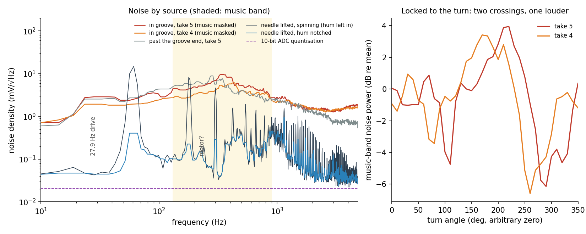
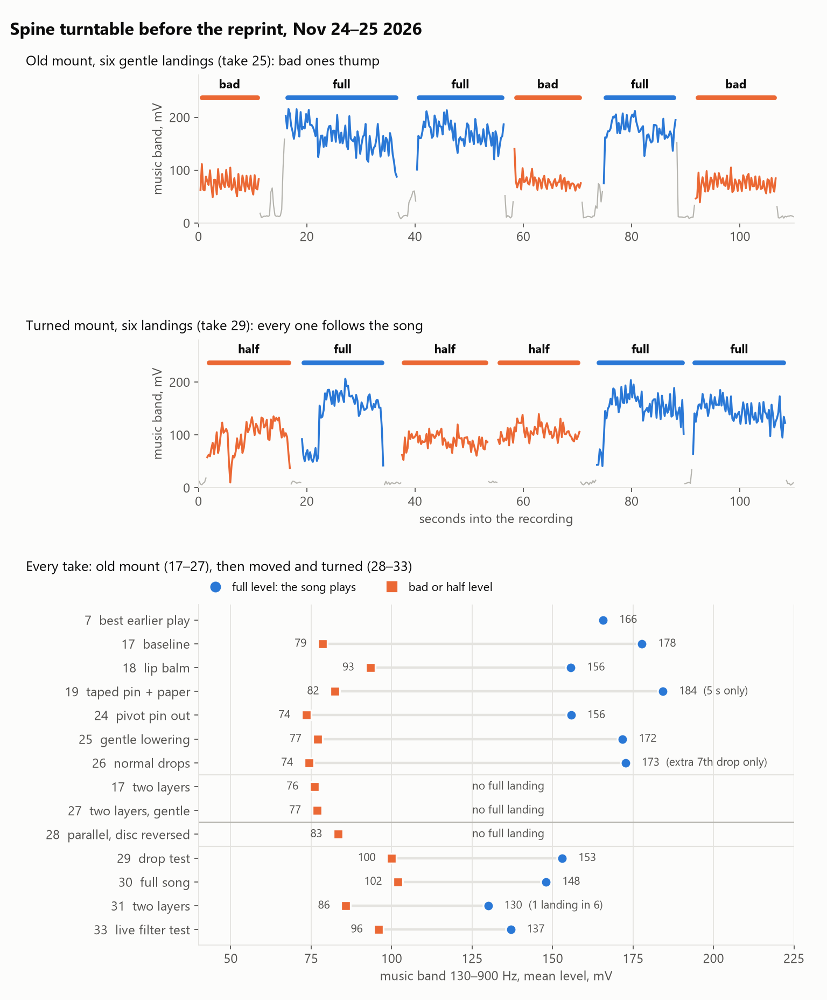

Thirty-three recordings on the spine turntable, November 22 to 25: the cartridge straight into an Arduino UNO's ADC at 9,615 samples/s, the platter on the servo at 39.8 to 39.9 RPM in every take. Takes 1 to 5 play the tone disc and can be heard below. Takes 6 to 33 play the song disc. They are not published, because the song is not mine.

## Root causes, in the order they were found

1. **Arm roll.** The counterweight was on backwards, so the arm rolled and the tilted cartridge pushed the stylus sideways. Turned round, the tone disc tracked end to end (take 4).
2. **Straight infill under the groove.** The noise comes in chirps twice per turn, where the stylus crosses the base's top-surface lines (takes 4 and 5). The groove now prints on a spiral floor.
3. **Music asked more than the stylus follows.** The first song disc bounced (take 6). A tracking limit under what the tone disc proved made the whole song play (takes 8 to 11).
4. **Not the drive.** A 2.8 Hz pulse appears from take 8 on. The servo's own shaft log shows only 0.2 to 0.4% ripple at that rate (takes 12 to 15), so the servo and gearbox are ruled out.
5. **The arm's offset angle.** It is drawn for a disc turning the other way, and the cartridge sat about 45° off the groove. Every second landing thumped (takes 17 to 27). Turned on its mount, it stopped (takes 28 to 31). Fixed in the CAD.
6. **One wall layer, not two.** Full-level landings: 5 of 11 on one layer, 1 of 6 on two (takes 17, 27, 29, 31).
7. **Electronics are not the limit.** With the platter stopped, hum and servo noise are far under the bare groove (takes 22, 23, 32).

## Every take

| Take | Disc | What was tested | What happened |
| --- | --- | --- | --- |
| 1 | Tone | First play on the spine build | Audio below |
| 2 | Tone | No added arm weight | Audio below |
| 3, 3b | Tone | 11 g added | 3b's servo log ends in a bus error |
| 4 | Tone | About 5 g, counterweight the right way round | The whole disc, 31 s, on time from the outer reference to the inner. 39.85 RPM |
| 5 | Tone | New headshell | Played. Used for the noise analysis below |
| 6 | Song v1 (40 µm, 1.1 bead widths) | About 5 g | Mistracked: bounced, matched the song only in scattered 1 s windows, jumps of exactly one turn |
| 7 | Song v1 | More weight | 12 s, a three-turn skip near r 66 mm, then to the end. No 2.8 Hz pulse |
| 8 to 11 | Song v3 (tracking limit, 1.0 bead widths, two layers) | The tracking limit | The whole song, no skips. Pilot weaker, 17 to 40 mV against 60 to 100. The 2.8 Hz pulse starts at take 8 |
| 12 to 15 | Song | Servo shaft position logged during the take | Shaft ripple 0.2 to 0.4% at 2.8 Hz: not the drive. Take 14, on the v1 disc, has the pulse that take 7 did not |
| 16 | Song | | The servo did not start: a bus error in the log |
| 17 | Song, two layers, then one | Baseline: clay, taped disc, taped nuts, extra weight | Two layers: weak and pulsing at 2.77 Hz throughout (video). One layer: weak 0 to 31 s, then clean from 40.7 s (video) |
| 18 | Song, one layer | Lip balm in the pivot funnel to damp the roll | No change on this mount. The first try lost the ADC input wire |
| 19 | Song | Pivot made rigid: tape on the pin, paper in the bore | Weak and pulsing 3 to 69 s, clean from 69 s (video). One try, no change shown |
| 20, 21 | | Fixed nut carriage, clamp ring | Skipped: random landings would have hidden the effect |
| 22 | | Platter stopped, needle down, motor holding, then torque off | 7.9 and 5.7 mV in the music band. Holding adds rumble under 55 Hz |
| 23 | Song | Platter turned by hand, servo out of the loop | Weak, 5 to 30 mV. No 27.9 Hz drive line |
| 24 | Song | Pivot pin out, arm on the sleeve | No change shown, one try |
| 25 | Song, one layer | Six gentle landings | 3 of 6 full, three thumped (figure) |
| 26 | Song, one layer | Six normal drops | 0 of 6 full. An extra, uncued 7th drop was clean |
| 27 | Song, two layers | Six gentle landings | 0 of 6 full |
| 28 | Song | Cartridge moved across, parallel, disc running stylus to pins | 0 of 6 full: every landing followed the song weakly |
| 29 | Song, one layer | Mount turned round, six landings | Every one followed the song. 3 full, 3 at half level with a 2.85 to 2.89 Hz pulse (figure) |
| 30 | Song, one layer | Turned mount, full play | First drop: the whole song, no skips (the clip at the top of the post) |
| 31 | Song, two layers | Turned mount, six landings | 1 of 6 full, the rest weak with a 2.78 Hz pulse |
| 32 | | Platter stopped: 12 V on, 12 V off, needle lifted | 6.8 to 8.9 mV. Switching the supply off helps nothing |
| 33 | Song, one layer | Live cleanup filter while playing | 1 of 3 full |

## The tone disc, raw

High-passed and level-matched, nothing else. Each recording is about 65 s: silence, the 333 Hz reference, tones from 698 Hz down to 98 Hz, the 110 Hz ladder from 10 to 80 µm, then the inner reference.

Take 1
<audio controls preload="none" style="display:block;width:100%" src="/projects/openvinyl/log/2026-11-25-every-take/openvinyl_tone_take1.m4a"></audio>

Take 2, no added weight
<audio controls preload="none" style="display:block;width:100%" src="/projects/openvinyl/log/2026-11-25-every-take/openvinyl_tone_take2.m4a"></audio>

Take 3, 11 g
<audio controls preload="none" style="display:block;width:100%" src="/projects/openvinyl/log/2026-11-25-every-take/openvinyl_tone_take3.m4a"></audio>

Take 4, the first full play
<audio controls preload="none" style="display:block;width:100%" src="/projects/openvinyl/log/2026-11-25-every-take/openvinyl_tone_take4.m4a"></audio>

Take 5, new headshell
<audio controls preload="none" style="display:block;width:100%" src="/projects/openvinyl/log/2026-11-25-every-take/openvinyl_tone_take5.m4a"></audio>

## Noise by source (takes 4 and 5)

The groove itself is the noise. Hum, the drive and the electronics sit 11 to 45 dB under it. The swing with turn angle is the stylus crossing the straight infill lines.

## Landings (takes 17 to 33)

On the old mount every landing was either clean or bad. On the turned mount every landing follows the song, some at half level. The fixes tried on the old mount (lip balm damper, rigid pivot, pin out, gentle lowering) moved nothing outside the spread between landings. The reprint repeats them on the corrected arm.
