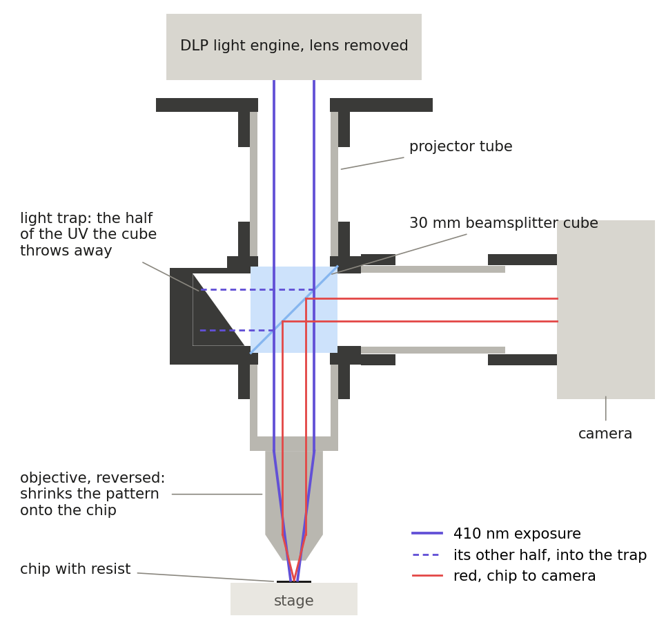
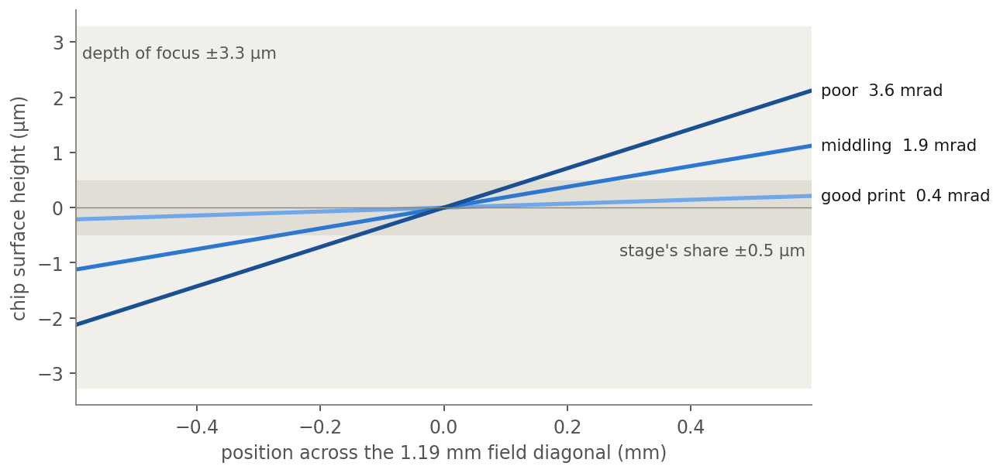
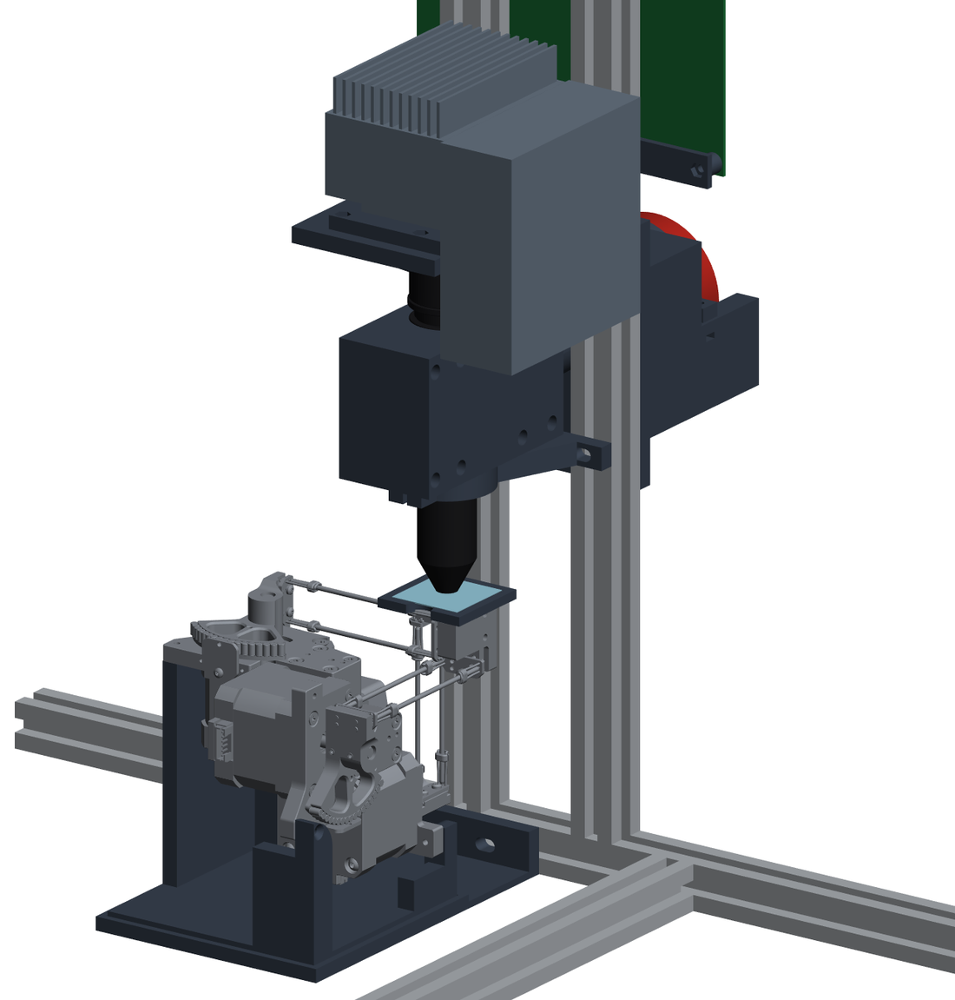

# Why

## Origin

Toronto Hacker Fab is building a maskless lithography stepper. I took on the analysis of the stage it sits on, and fitting the real stage into the chapter's CAD.

# What

## Machine

A DLP projector shows the pattern, a microscope objective shrinks it onto resist, and a camera watches under red light. The chip rides on an open 3D-printed parallel-kinematic stage.

## Approach

Model the stage and check the CAD before building, so the first measurements test predictions.

# Problem

## Requirement

Depth of focus at 410 nm and NA 0.25 is ±3.3 µm. Five things share it. The stage's share allows 0.84 mrad of tilt across a 1 mm field.

## Difficulty

Hand-cut rods and balls on printed parts are never exact, and nobody has measured by how much.

# Work

## Kinematics

The firmware model, ported and checked by hand: 15 mm/rad per motor, 1.1 to 1.5 nm per encoder count, a ±8.3 mm reachable cube.

## Blind spot

A 10 µm mismatch in one rod pair tilts the platform by 0.59 mrad. The encoder reads the crank, so it never knows.

## Errors

Every rod and ball given its own error, over three levels of print quality. Scale error calibrates out with the camera. Tilt, 0.4 to 3.6 mrad, cannot: the stage has no tilt axis.

## Field by field

Tilt changes as the stage steps, so levelling once does not fix it.

## Test

A mirror on the stage, a laser spot on a wall 2 m away. It resolves 0.13 mrad and decides whether the stage needs a tilt actuator.

## Options

A hexapod from the same parts, a piezo tripod under the chuck, piezo XY on top, or crossed-roller stages. The piezo tripod is the long-stroke / short-stroke split real steppers use.

## Assembly

The chapter's CAD with the real stage and Thorlabs' tubes. The clash check found the chip holder sitting on 0.5 mm of stage hardware; it now has a 1 mm relief.

## Motion

Mated in Onshape through its API. One crank turned 5° moves the platform 1.307 mm, against 1.31 mm from the firmware's kinematics.

## Calibration

A plate of coupons, each setting one value in the chapter's CAD: tube bores, cube ribs, the camera fit, fasteners, the projector's screw square.

## Preload

Each joint is a seat held on its ball by a stretch cord. Six-rod statics give a worst rod tension of 0.28 N, so every cord must pull 0.57 N. The stage can test its own joints: shake, return, image the chip.

## Questions

- How the six-rod model works
- Why tilt, not resolution
- The depth-of-focus budget
- What the coupons set
- How the cords keep the joints seated
