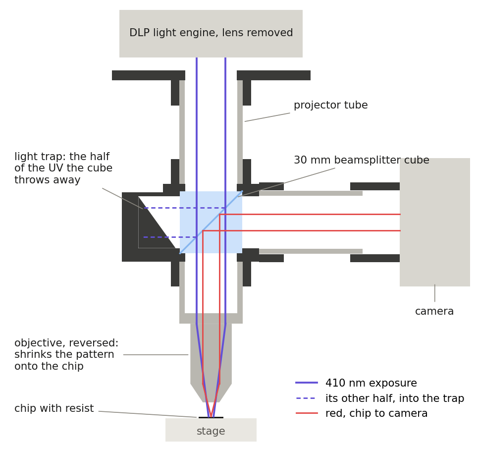
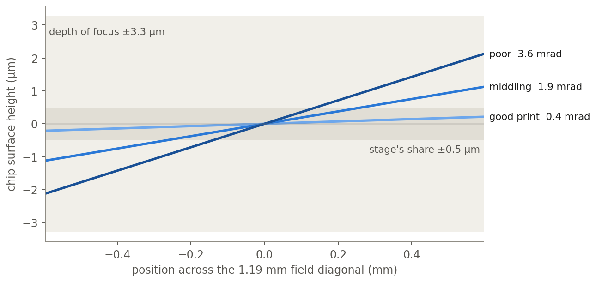

# Why

## Origin

Toronto Hacker Fab is building a maskless lithography stepper. I took on the optics column and the analysis of the stage it sits on.

# What

## Machine

A DLP projector shows the pattern, a microscope objective shrinks it onto resist, and a camera watches under red light. The chip rides on an open 3D-printed parallel-kinematic stage.

## Approach

Model the stage and draw the column before building, so the first measurements test predictions.

# Problem

## Requirement

Depth of focus at 410 nm and NA 0.25 is ±3.3 µm. Five things share it. The stage's share allows 0.84 mrad of tilt across a 1 mm field.

## Difficulty

Hand-cut rods and printed ball seats are never exact, and nobody has measured by how much.

# Work

## Kinematics

The firmware model, ported and checked by hand: 15 mm/rad per motor, 1.1 to 1.5 nm per encoder count, a ±8.3 mm reachable cube.

## Blind spot

A 10 µm mismatch in one rod pair tilts the platform by 0.59 mrad. The encoder reads the crank, so it never knows.

## Errors

Every rod and ball given its own error, over three levels of print quality. Scale error calibrates out with the camera. Tilt, 0.4 to 3.6 mrad, cannot: the stage has no tilt axis.

## Field by field

Tilt changes as the stage steps, so levelling once does not fix it.

## Test

A mirror on the stage, a laser spot on a wall 2 m away. It resolves 0.13 mrad and decides whether the stage needs a tilt actuator.

## Options

A hexapod from the same parts, a piezo tripod under the chuck, piezo XY on top, or crossed-roller stages. The piezo tripod is the long-stroke / short-stroke split real steppers use.

## Column

Six parametric printed parts. Every unknown is a named placeholder, and every fit reads from a test print.

## Prints

Bore and pocket ladders, insert bosses, slotted flanges, and a creep coupon read over a week.

## Questions

- How the six-rod model works
- Why tilt, not resolution
- The depth-of-focus budget
- What the test prints decide
