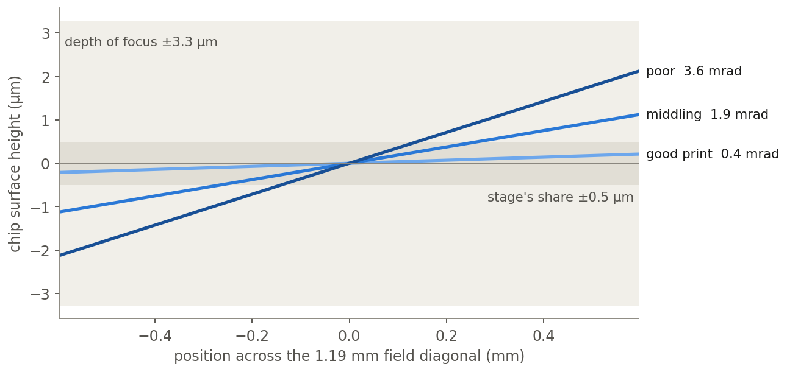
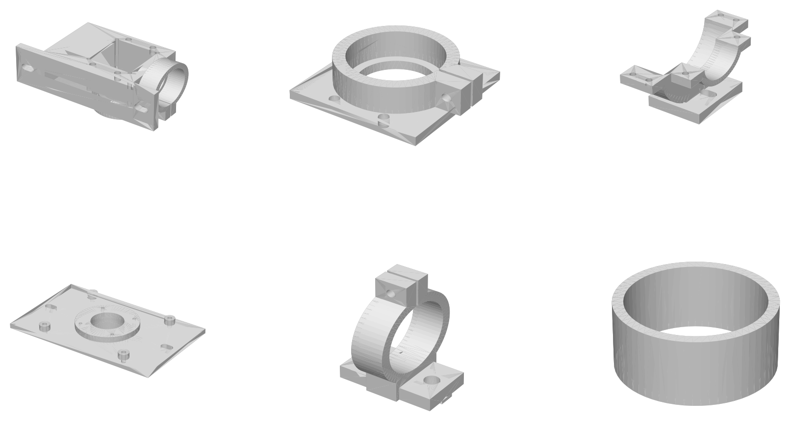

*Figure 1. The column cut through its axis, drawn from the CAD's parameters. Sizes I have not measured yet, like the objective and the tube lengths, are placeholders.*

## Summary

The Toronto Hacker Fab is building a maskless stepper. A projector shows the pattern on an array of micromirrors, and a microscope objective shrinks it onto photoresist. The chip moves underneath on the Open Micro-Manipulator, an open-source 3D-printed stage. I took on the optics column and the analysis of the stage.

The stage counts 1.5 nm per encoder step, and that is not the problem. Its rods are cut and crimped by hand and its ball seats are printed, so none of them is exactly the right size. The mismatch tilts the chip by different amounts at different places, and the encoders cannot see it. Tilt puts one side of an exposure out of focus. Whether that matters depends on how well the parts were printed, which nobody has measured.

Nothing is built yet. Every number on this page is a prediction, paired with the measurement that will test it.

| Item | Detail |
| --- | --- |
| Organisation | Toronto Hacker Fab |
| Period | November 2026 to present |
| Role | Optics column design and the stage analysis |
| Deliverables | Kinematics port with a six-rod error model, six parametric printed parts and the column assembly, test-print coupons with protocols, 19 hand-check tests |
| Tools | Python, NumPy, pytest, CadQuery, Onshape FeatureScript |

## The machine

The projector is TI's DLP evaluation board with its blue LED swapped for a 410 nm one and its lens removed. A microscope objective, used backwards, shrinks the pattern onto the chip.

A beamsplitter cube in the column sends half the exposure light down to the chip. The other half goes sideways into a light trap, where it can't scatter back. The projector's red LED lights the chip without exposing the resist, and the cube sends the reflected light to a camera for focus and alignment.

CMU's Hacker Fab built the same stage and projector and measured them ([Gonzalez et al. 2025](https://arxiv.org/abs/2510.15082)). Their numbers are the reference wherever this page cites a measurement.

## Focus sets the budget

At 410 nm through an NA 0.25 objective, the depth of focus is λ/2NA² = ±3.3 µm.

Everything that moves the chip surface up or down has to fit inside it:
- how repeatably the autofocus lands;
- chip bow and resist thickness;
- drift during an exposure;
- levelling;
- tilt that changes as the stage moves.

I gave the stage ±0.5 µm. Across the 1.19 mm diagonal of one exposure field, that allows 0.84 mrad of tilt.

## What the encoders miss

Three motors turn 15 mm cranks. Each crank drives a pair of 72.5 mm rods on ball joints up to the platform. The two rods of a pair are parallel and equal, so the platform moves without rotating.

I ported the stage firmware's kinematics to Python and checked it by hand. At the centre of travel, each motor moves one axis by 15 mm per radian. One encoder count is 0.2/2²¹ rad, so 1.1 to 1.5 nm at the tool. CMU measured 0.3 µm of apparent motion on moves of zero length, 200 times coarser. Resolution is not the limit.

The firmware assumes the rods of a pair are exactly equal and every ball sits exactly where the CAD puts it. Neither is true of a hand-built stage.

<svg viewBox="0 0 680 270" width="680" height="270" xmlns="http://www.w3.org/2000/svg" role="img" aria-label="One rod pair seen side on, to scale: two 72.5 mm rods 17 mm apart run from the motor's crank to the moving platform. Drawn dashed, equal rods keep the platform upright. Drawn solid, the top rod is 10 micrometres longer, drawn about 500 times larger, and the platform tilts by 10 micrometres over 17 millimetres, 0.59 milliradians. The encoder on the motor reads the crank angle, which is the same in both cases." style="display:block;margin:0 0 0;max-width:100%;height:auto;font-family:inherit;font-size:13px">
<g fill="none" stroke="currentColor" stroke-width="1.5">
<circle cx="88" cy="130" r="46" stroke-opacity="0.35"/>
<line x1="88" y1="130" x2="150" y2="130" stroke-width="5" stroke-linecap="round"/>
<line x1="150" y1="88" x2="150" y2="172" stroke-width="5" stroke-linecap="round"/>
<line x1="150" y1="95" x2="450" y2="95" stroke-dasharray="5 4" stroke-opacity="0.45"/>
<rect x="444" y="80" width="40" height="100" stroke-dasharray="5 4" stroke-opacity="0.45"/>
<line x1="150" y1="165" x2="450" y2="165"/>
<g style="color:#3987e5">
<line x1="150" y1="95" x2="469.3" y2="97.7" stroke="currentColor" stroke-width="2"/>
<rect x="444" y="80" width="40" height="100" stroke="currentColor" stroke-width="2" transform="rotate(15.9 450 165)"/>
</g>
<path d="M 128 95 L 120 95 L 120 165 L 128 165" stroke-opacity="0.7"/>
<path d="M 150 60 L 150 52 L 450 52 L 450 60" stroke-opacity="0.7"/>
<path d="M 450 196 A 70 70 0 0 0 469 196" stroke="#3987e5"/>
</g>
<g fill="currentColor" stroke="none">
<circle cx="88" cy="130" r="4"/>
<circle cx="150" cy="95" r="6"/>
<circle cx="150" cy="165" r="6"/>
<circle cx="450" cy="165" r="6"/>
<circle cx="469.3" cy="97.7" r="6" fill="#3987e5"/>
<circle cx="450" cy="95" r="6" fill-opacity="0.35"/>
</g>
<g fill="currentColor">
<text x="88" y="200" text-anchor="middle">crank</text>
<text x="88" y="217" text-anchor="middle" fill-opacity="0.75">motor and encoder</text>
<text x="112" y="134" text-anchor="end">17 mm</text>
<text x="300" y="45" text-anchor="middle">rods, 72.5 mm</text>
<text x="300" y="87" text-anchor="middle" fill="#3987e5">this rod 10 µm longer</text>
<text x="300" y="187" text-anchor="middle" fill-opacity="0.75">other rod as designed</text>
<text x="500" y="70">platform tilts</text>
<text x="500" y="88" fill="#3987e5">10 µm / 17 mm = 0.59 mrad</text>
<text x="500" y="230" fill-opacity="0.75">the encoder sees the same</text>
<text x="500" y="247" fill-opacity="0.75">crank angle either way</text>
<text x="20" y="262" fill-opacity="0.6" font-size="11">to scale, except the 10 µm error, drawn about 500 times larger</text>
</g>
</svg>

*Figure 2. One rod pair, side on. A 10 µm mismatch between the two rods tilts the platform by 10 µm over their 17 mm spacing. The encoder reads the crank, not the rods, so it cannot tell.*

I gave every rod its own length and every ball its own position error, then solved for where the platform really goes when the firmware commands a point. Nobody has measured how well these parts print, so I ran three levels of print quality, 60 random stages each, over a ±5 mm square where the fields would be exposed:

| Print quality | Rod length, ball position (sd) | Scale error | Tip and tilt that change across the square |
| --- | --- | --- | --- |
| Good | 5 µm, 10 µm | 0.16 % | 0.4 mrad |
| Middling | 20 µm, 50 µm | 0.8 % | 1.9 mrad |
| Poor | 50 µm, 100 µm | 1.6 % | 3.6 mrad |

Each value is the 95th percentile of its 60 stages. Scale error is fixable in software: move to marks, measure where they land with the camera, and correct with a lookup table. Tilt is not. The stage has no tilt axis to correct it with.

## Tilt is the result

*Figure 3. The chip surface across one field, tilted by each level's 95th-percentile tilt along the field's diagonal, the worst direction. A good print stays inside the stage's ±0.5 µm share; middling and poor use two and four times it.*

<video controls autoplay muted loop playsinline width="1280" height="720" style="display:block;width:100%" src="/projects/stepper/tilt.mp4" aria-label="One modelled stage of middling print quality stepping a 5 by 5 grid of exposure fields over a 10 mm chip. Left, the chip from above, each field shaded by its focus wedge once exposed. Right, the current field edge on, its surface line tilting as the stage moves, inside or outside the stage's share of the depth of focus."></video>

*Video 1. A typical middling stage, levelled once at the centre field, stepping a 5 × 5 grid. Tip and tilt change from field to field, so one levelling cannot fix them all: most fields stay inside the stage's share and the corners reach ±0.6 µm. Figure 3 is worse because it takes the 95th percentile and the worst direction.*

CMU measured 2 to 9 % scale error. Poor prints reach the bottom of that range, but 9 % does not come from the rods and balls alone. Their camera's pixel scale, which they did not measure separately, is the first suspect.

## One test decides

Glue a small mirror to the platform and bounce a laser pointer off it onto a wall 2 m away. Step the stage over the ±5 mm square and mark the spot each time. The spot moves twice the tilt times the distance, so a 0.5 mm reading resolves about 0.13 mrad.

Under 0.84 mrad, the stage stays as it is: correct its scale with the camera and autofocus every field.

Over it, the stage needs a tilt axis:
- Three piezo stacks under the chuck give Z, tip and tilt, separate from the stage that travels. This is the coarse-plus-fine split production steppers use. It needs 11 to 97 µm of stroke depending on the print and the leg spacing, and it is my first choice.
- Or put each of the six rods on its own crank and motor. The same parts become a hexapod with tilt as an axis, at the cost of three more motors and six-axis firmware.
- Bought crossed-roller stages tilt only 0.1 to 0.15 mrad, but they are manual, or expensive once motorised.

A piezo stage for nanometre XY would not help yet. Run open loop, its hysteresis is coarser than the stage's own repeatability. Run closed loop on the camera, it only pays once features shrink from CMU's 2 µm toward the objective's 1 µm limit.

## The column, printed

*Figure 4. Six of the eight printed parts, each drawn to its own scale.*

Every printed part is parametric. Dimensions I have not measured, like the camera body, the projector's mounting holes and the objective, are named placeholders. Every fit reads from a test print, so a measurement changes one number and every part that uses it regenerates.

Drawing the parts turned up one more tilt problem. A printed bore that slides on a 30.5 mm tube with 0.1 mm of clearance lets the tube tilt up to 10 mrad, twelve times what focus allows between objective and chip. That tilt has to come from an adjustment, not from the fit.

Before any final print, I'm printing:
- ladders of bores and cube pockets in 0.05 and 0.1 mm steps;
- heat-set insert bosses and slotted flanges;
- a PETG cantilever loaded to 5 and 10 MPa and read with a dial indicator for a week, at room temperature and at 40 °C. Printed parts under load creep, and the focus budget is a few microns.

## Measurements, in order

1. Tilt across the ±5 mm square, from the laser and mirror. It decides whether the stage needs a tilt axis.
2. The test prints. They set the final fits and the material.
3. Stage jitter during an exposure, from the camera at its highest frame rate.
4. A focus-exposure series on resist, which checks the ±3.3 µm the whole budget rests on.

The code, derivations and CAD are in the [`hackerfab_stepper` folder of my fork of the stage](https://github.com/zcsop1206/MicroManipulatorStepper/tree/hackerfab-stepper/hackerfab_stepper).
