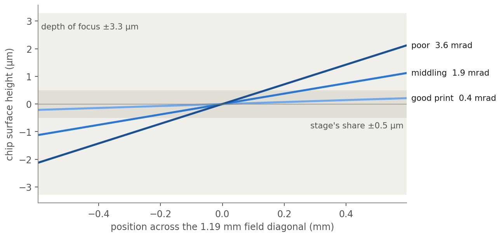

*Figure 1. The column cut through its axis, to show the light paths. It is drawn from my first CAD, which the chapter's CAD (Figure 4) has since replaced. The parts differ; the light paths do not.*

## Summary

The Toronto Hacker Fab is building a maskless stepper. A projector shows the pattern on an array of micromirrors, and a microscope objective shrinks it onto photoresist. The chip moves underneath on the Open Micro-Manipulator, an open-source 3D-printed stage. I took on the analysis of the stage, and putting it into the chapter's CAD of the machine.

The stage counts 1.5 nm per encoder step, and that is not the problem. Its rods are cut and crimped by hand and its balls sit on printed parts, so no rod is exactly the right length and no ball exactly in the right place. The mismatch tilts the chip by different amounts at different places, and the encoders cannot see it. Tilt puts one side of an exposure out of focus. Whether that matters depends on how well the parts were printed, which nobody has measured.

Most of the stage is printed, none of the optics are, and nothing is measured yet. Every number on this page is a prediction, paired with the measurement that will test it.

| Item | Detail |
| --- | --- |
| Organisation | Toronto Hacker Fab |
| Period | November 2026 to present |
| Role | Stage analysis, and the real stage in the chapter's CAD |
| Deliverables | Kinematics port with a six-rod error model, 19 hand-check tests, the chapter's CAD with the real stage and a clash check, a mated Onshape assembly, calibration coupons mapped to the CAD, a ball-joint preload model with a self-test |
| Tools | Python, NumPy, pytest, CadQuery, Onshape REST API, Bambu Studio |

## The machine

The projector is TI's DLP evaluation board with its blue LED swapped for a 410 nm one and its lens removed. A microscope objective, used backwards, shrinks the pattern onto the chip.

A beamsplitter cube in the column sends half the exposure light down to the chip. The other half goes sideways into a light trap, where it can't scatter back. The projector's red LED lights the chip without exposing the resist, and the cube sends the reflected light to a camera for focus and alignment.

CMU's Hacker Fab built the same stage and projector and measured them ([Gonzalez et al. 2025](https://arxiv.org/abs/2510.15082)). Their numbers are the reference wherever this page cites a measurement.

## Focus sets the budget

At 410 nm through an NA 0.25 objective, the depth of focus is λ/2NA² = ±3.3 µm.

Everything that moves the chip surface up or down has to fit inside it:
- how repeatably the autofocus lands;
- chip bow and resist thickness;
- drift during an exposure;
- levelling;
- tilt that changes as the stage moves.

I gave the stage ±0.5 µm. Across the 1.19 mm diagonal of one exposure field, that allows 0.84 mrad of tilt.

## What the encoders miss

Three motors turn 15 mm cranks. Each crank drives a pair of 72.5 mm rods on ball joints up to the platform. The two rods of a pair are parallel and equal, so the platform moves without rotating.

I ported the stage firmware's kinematics to Python and checked it by hand. At the centre of travel, each motor moves one axis by 15 mm per radian. One encoder count is 0.2/2²¹ rad, so 1.1 to 1.5 nm at the tool. CMU measured 0.3 µm of apparent motion on moves of zero length, 200 times coarser. Resolution is not the limit.

The firmware assumes the rods of a pair are exactly equal and every ball sits exactly where the CAD puts it. Neither is true of a hand-built stage.

<svg viewBox="0 0 680 270" width="680" height="270" xmlns="http://www.w3.org/2000/svg" role="img" aria-label="One rod pair seen side on, to scale: two 72.5 mm rods 17 mm apart run from the motor's crank to the moving platform. Drawn dashed, equal rods keep the platform upright. Drawn solid, the top rod is 10 micrometres longer, drawn about 500 times larger, and the platform tilts by 10 micrometres over 17 millimetres, 0.59 milliradians. The encoder on the motor reads the crank angle, which is the same in both cases." style="display:block;margin:0 0 0;max-width:100%;height:auto;font-family:inherit;font-size:13px">
<g fill="none" stroke="currentColor" stroke-width="1.5">
<circle cx="88" cy="130" r="46" stroke-opacity="0.35"/>
<line x1="88" y1="130" x2="150" y2="130" stroke-width="5" stroke-linecap="round"/>
<line x1="150" y1="88" x2="150" y2="172" stroke-width="5" stroke-linecap="round"/>
<line x1="150" y1="95" x2="450" y2="95" stroke-dasharray="5 4" stroke-opacity="0.45"/>
<rect x="444" y="80" width="40" height="100" stroke-dasharray="5 4" stroke-opacity="0.45"/>
<line x1="150" y1="165" x2="450" y2="165"/>
<g style="color:#3987e5">
<line x1="150" y1="95" x2="469.3" y2="97.7" stroke="currentColor" stroke-width="2"/>
<rect x="444" y="80" width="40" height="100" stroke="currentColor" stroke-width="2" transform="rotate(15.9 450 165)"/>
</g>
<path d="M 128 95 L 120 95 L 120 165 L 128 165" stroke-opacity="0.7"/>
<path d="M 150 60 L 150 52 L 450 52 L 450 60" stroke-opacity="0.7"/>
<path d="M 450 196 A 70 70 0 0 0 469 196" stroke="#3987e5"/>
</g>
<g fill="currentColor" stroke="none">
<circle cx="88" cy="130" r="4"/>
<circle cx="150" cy="95" r="6"/>
<circle cx="150" cy="165" r="6"/>
<circle cx="450" cy="165" r="6"/>
<circle cx="469.3" cy="97.7" r="6" fill="#3987e5"/>
<circle cx="450" cy="95" r="6" fill-opacity="0.35"/>
</g>
<g fill="currentColor">
<text x="88" y="200" text-anchor="middle">crank</text>
<text x="88" y="217" text-anchor="middle" fill-opacity="0.75">motor and encoder</text>
<text x="112" y="134" text-anchor="end">17 mm</text>
<text x="300" y="45" text-anchor="middle">rods, 72.5 mm</text>
<text x="300" y="87" text-anchor="middle" fill="#3987e5">this rod 10 µm longer</text>
<text x="300" y="187" text-anchor="middle" fill-opacity="0.75">other rod as designed</text>
<text x="500" y="70">platform tilts</text>
<text x="500" y="88" fill="#3987e5">10 µm / 17 mm = 0.59 mrad</text>
<text x="500" y="230" fill-opacity="0.75">the encoder sees the same</text>
<text x="500" y="247" fill-opacity="0.75">crank angle either way</text>
<text x="20" y="262" fill-opacity="0.6" font-size="11">to scale, except the 10 µm error, drawn about 500 times larger</text>
</g>
</svg>

*Figure 2. One rod pair, side on. A 10 µm mismatch between the two rods tilts the platform by 10 µm over their 17 mm spacing. The encoder reads the crank, not the rods, so it cannot tell.*

I gave every rod its own length and every ball its own position error, then solved for where the platform really goes when the firmware commands a point. Nobody has measured how well these parts print, so I ran three levels of print quality, 60 random stages each, over a ±5 mm square where the fields would be exposed:

| Print quality | Rod length, ball position (sd) | Scale error | Tip and tilt that change across the square |
| --- | --- | --- | --- |
| Good | 5 µm, 10 µm | 0.16 % | 0.4 mrad |
| Middling | 20 µm, 50 µm | 0.8 % | 1.9 mrad |
| Poor | 50 µm, 100 µm | 1.6 % | 3.6 mrad |

Each value is the 95th percentile of its 60 stages. Scale error is fixable in software: move to marks, measure where they land with the camera, and correct with a lookup table. Tilt is not. The stage has no tilt axis to correct it with.

## Tilt is the result

*Figure 3. The chip surface across one field, tilted by each level's 95th-percentile tilt along the field's diagonal, the worst direction. A good print stays inside the stage's ±0.5 µm share; middling and poor use two and four times it.*

<video controls autoplay muted loop playsinline width="1280" height="720" style="display:block;width:100%" src="/projects/stepper/tilt.mp4" aria-label="One modelled stage of middling print quality stepping a 5 by 5 grid of exposure fields over a 10 mm chip. Left, the chip from above, each field shaded by its focus wedge once exposed. Right, the current field edge on, its surface line tilting as the stage moves, inside or outside the stage's share of the depth of focus."></video>

*Video 1. A typical middling stage, levelled once at the centre field, stepping a 5 × 5 grid. Tip and tilt change from field to field, so one levelling cannot fix them all: most fields stay inside the stage's share and the corners reach ±0.6 µm. Figure 3 is worse because it takes the 95th percentile and the worst direction.*

CMU measured 2 to 9 % scale error. Poor prints reach the bottom of that range, but 9 % does not come from the rods and balls alone. Their camera's pixel scale, which they did not measure separately, is the first suspect.

## Step and repeat

Video 1 is one stage. Below, roll your own: pick a print quality, draw a die, and watch the stage expose it one 1.04 × 0.58 mm field at a time. Each field lands where that stage puts it, and blurs where its tilt takes it out of focus.

<!-- stepper-sim -->

## One test decides

Glue a small mirror to the platform and bounce a laser pointer off it onto a wall 2 m away. Step the stage over the ±5 mm square and mark the spot each time. The spot moves twice the tilt times the distance, so a 0.5 mm reading resolves about 0.13 mrad.

Under 0.84 mrad, the stage stays as it is: correct its scale with the camera and autofocus every field.

Over it, the stage needs a tilt axis:
- Three piezo stacks under the chuck give Z, tip and tilt, separate from the stage that travels. This is the coarse-plus-fine split production steppers use. It needs 11 to 97 µm of stroke depending on the print and the leg spacing, and it is my first choice.
- Or put each of the six rods on its own crank and motor. The same parts become a hexapod with tilt as an axis, at the cost of three more motors and six-axis firmware.
- Bought crossed-roller stages tilt only 0.1 to 0.15 mrad, but they are manual, or expensive once motorised.

A piezo stage for nanometre XY would not help yet. Run open loop, its hysteresis is coarser than the stage's own repeatability. Run closed loop on the camera, it only pays once features shrink from CMU's 2 µm toward the objective's 1 µm limit.

## The chapter's machine

The chapter has since drawn the whole machine in CAD: the frame, the mounts for the optics, the chip holder. It replaces the printed parts I drew. Its stage was then a few boxes, so I put in the real one from the stage's own CAD, swapped the bought tubes for Thorlabs' models, and checked where parts overlap.

*Figure 4. The chapter's CAD with the real stage and Thorlabs' tubes. The projector, camera and objective are still simple stand-ins.*

One clash mattered. The chip holder is a 40 mm plate on the stage's 29 mm top face, and on one edge, a piece of the stage's joint hardware stands 0.5 mm above that face, under the plate's overhang. Resting on it, the plate would tilt the chip by over 10 mrad, twice what the whole depth of focus allows across a field. The chapter's chip holder now has a 1 mm relief pocket over that hardware.

I also built the machine as an assembly that moves, in Onshape, through its API: over 200 parts, each crank on a revolute joint, each rod end on a ball joint. Turned 5° there, one crank moves the platform 1.307 mm without tilting it. The firmware's kinematics give 1.31 mm. That is one model checked against another, not against the stage, but it says the CAD and the firmware describe the same linkage.

## Calibration first

Every printed fit in the chapter's CAD is one named value, set for a printer accurate to ±0.2 mm. Before the large parts, a plate of coupons measures what my printer actually does to each fit:

| Coupon | Passes when | Value it sets |
| --- | --- | --- |
| Tube bore ladder, 30.5 to 30.9 mm | An SM1 tube slides through by hand, without force | `TUBE_BORE` |
| Split-bore pair, 30.6 to 30.8 mm, printed as an arch like the cube holder | Bolted shut, it locks the tube with a 0.1 to 0.5 mm gap left between its halves | `TUBE_BORE`, or a second value for split parts |
| Sleeve stub and ladder, 30.8 to 31.2 mm | The printed camera sleeve slides without rocking | `SLEEVE_BORE` |
| Cube pockets, ribs 0.2 to 0.4 mm | The 30 mm cube goes in with a firm push, doesn't rock, and stays when the coupon is turned over | `CUBE_RIB` |
| Camera bore ladder, 62.2 to 62.8 mm | The camera slides for focus without rocking | The clearance over `CAMERA_OD` |
| Fastener plate | M2, M3 and M5 screws pass, nuts press in and stay, heads seat | Eight fastener values, `M2_HOLE` to `M5_TRAVEL` |
| Adapter-plate slice, 2 mm | Its four M2 screws start by hand in the real projector, and its bore centres on the mirror chip | `M2_SQUARE`, `DMD_OFFSET` |

The bought parts are measured first, since they are the gauges: the tubes, the cube, the camera body, the projector's lens face. Corrections go into the CAD, not the slicer, so the CAD records what the printer does. After assembly, the working machine settles what nothing else can: the focus positions, light leaks, and the tilt test above. None of it is measured yet.

## Holding the joints closed

Each rod end is a seat pressed onto a 1 mm steel ball by a stretch cord. A seat can push on its ball but not pull. If a rod goes into tension and its cord pulls less, the seat lifts, and a lifted seat is one more error the encoders cannot see.

Each rod carries force only along its length, and six of them fix the platform, so every load has exactly one set of rod forces. I solved them for the platform with its chip holder and chip, 10 to 22 g, at poses across the exposure square, accelerating at up to 4 m/s², the most the firmware's demo moves use. The worst rod tension is 0.28 N. So each cord must pull at least 0.57 N, about 58 g, along its rod, for a 2× margin. One rod is in tension under gravity alone, so its cords hold its joints shut all the time, not only during fast moves.

At that pull a joint is 2.1 N/µm stiff if the ball touches its seat at a point, and 22 to 64 N/µm if the seat conforms to it. The brass rod itself is 3.25 N/µm. More preload buys little: 2 N raises the point-contact figure only to 3.2 N/µm.

No cord has been measured. Hanging weights from each joint until it lifts would do it, but the stage can also test itself. It shakes along the direction that loads one rod hardest, at rising accelerations, then returns gently to the same spot while the stepper's camera images the chip. A seat that lifted comes back somewhere else. The rod tensions at the last clean step and the first disturbed one bracket that cord's pull. The highest clean acceleration is also the number the stepper needs: half of it becomes its acceleration limit.

## Measurements, in order

1. The bought parts and the calibration coupons. They set the chapter's fits before the optics are printed.
2. Cord pull at all twelve joints, by weights or by the self-test. Every later measurement assumes the seats stay on their balls.
3. Tilt across the ±5 mm square, from the laser and mirror. It decides whether the stage needs a tilt axis.
4. Stage jitter during an exposure, from the camera at its highest frame rate.
5. A focus-exposure series on resist, which checks the ±3.3 µm the whole budget rests on.

The kinematics, the error model and their derivations are in the [`hackerfab_stepper` folder of my fork of the stage](https://github.com/zcsop1206/MicroManipulatorStepper/tree/hackerfab-stepper/hackerfab_stepper).
