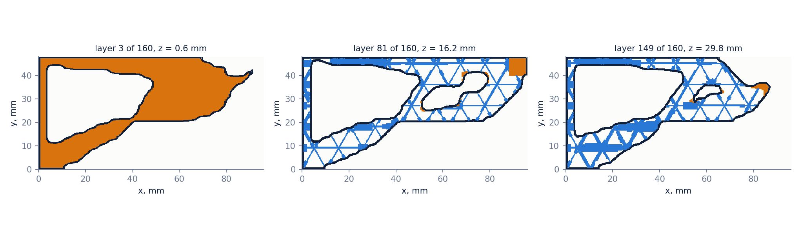
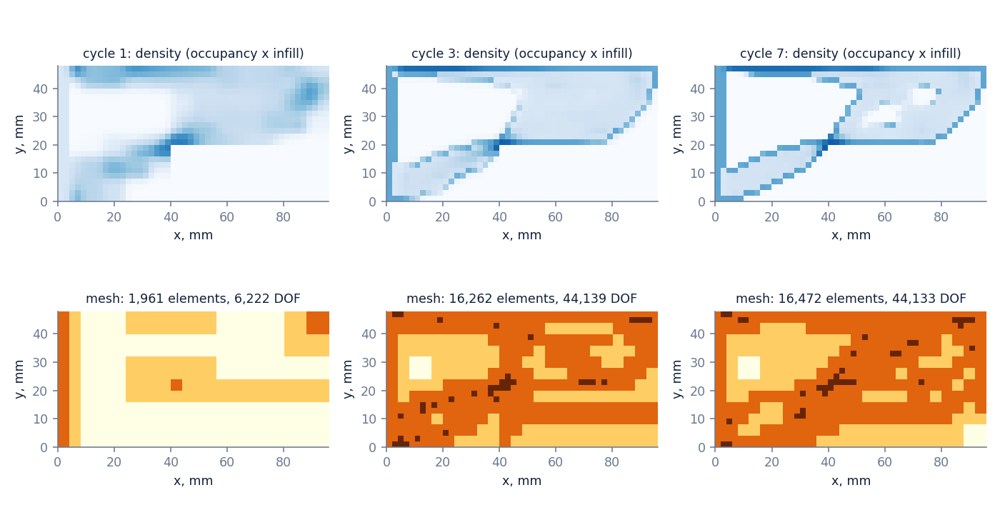
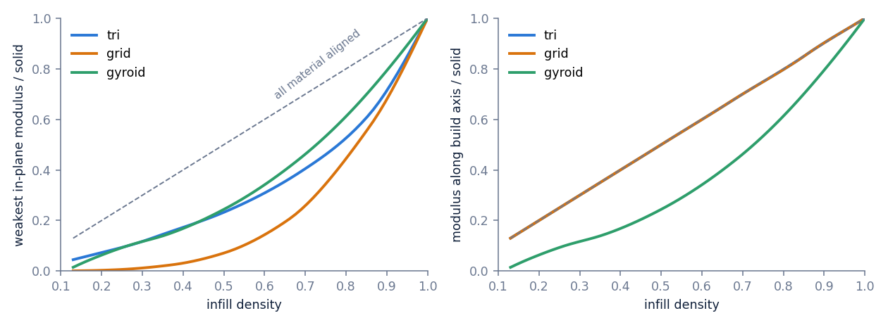
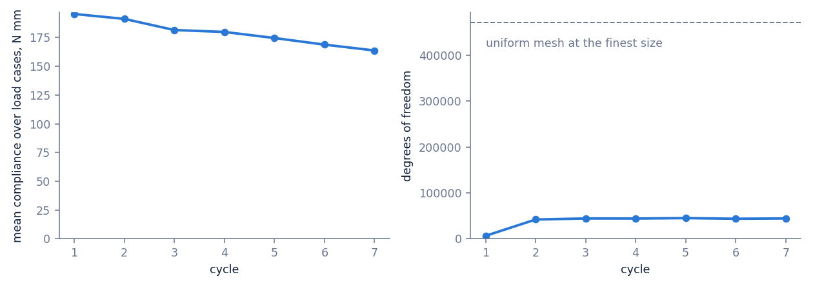

# Why

## Origin

A slicer fills a shape with one pattern at one density. It never sees the load. I wanted the load to come first and the G-code to follow from it.

# What

## Approach

Give it where the part is held, where it is loaded, how much plastic it may use, and which way is up. It runs the analysis, moves material to where it works, and writes the toolpaths.

# Problem

## Requirement

A load-bearing print needs four things known before printing: its stiffness, material where the load is, no supports, and tolerance to a load that is a bit off.

## Difficulty

Infill is neither solid nor empty, so the usual optimization treats it as a fiction. And every design change needs a new analysis, on a mesh fine enough to trust.

# Work

## Loop

Mesh, solve, move material at fixed mass, apply the print rules. Seven cycles, 18 minutes on a laptop.

## Mesh

An octree that refines where the error estimate is large and coarsens where the design is uniform. The final check used 73,000 unknowns where a uniform mesh needs 470,000.

## Infill

Each pattern is solved once as a repeating cell. Its stiffness at each density becomes the material law, so 30% in the model is a printable 30%.

## Bracket

200 N on a wall bracket. Predicted deflection 0.79 mm at 21% of the envelope mass. Two perimeters and 20% gyroid gives 0.99 mm at 33%.

## Slicer

Written for this job. Perimeters, skins, and a triangular infill whose walls are one to six passes wide. No voxel is unsupported.

## Agents

Two sub-problems went to groups of Claude agents, scored by the solver. They converged on thickening one wall direction and turning it toward the stress. That cut deflection from 0.97 to 0.79 mm.

## Next

Print the bracket and the gyroid baseline, load both on an Instron, and feed the measured stiffness back into the material law.

## Questions

- How the mesh decides where to refine
- How infill becomes a material law
- The overhang rule
- What the agents got wrong
- Strength, and why it is not in yet
