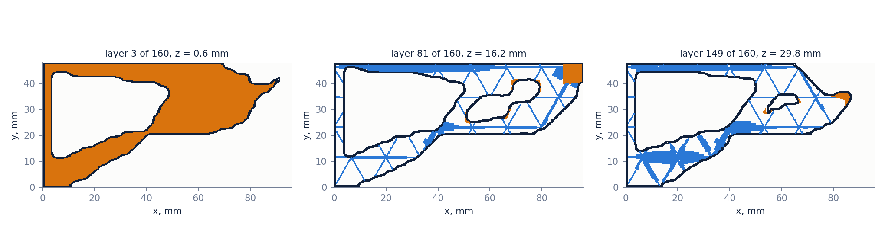
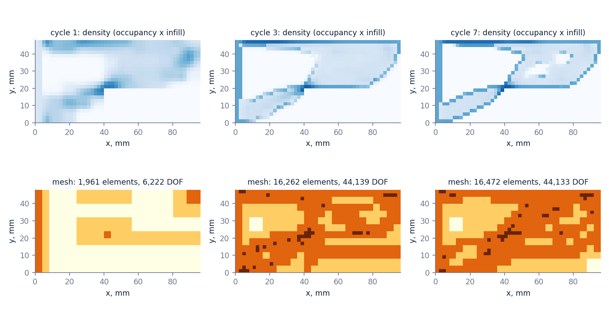
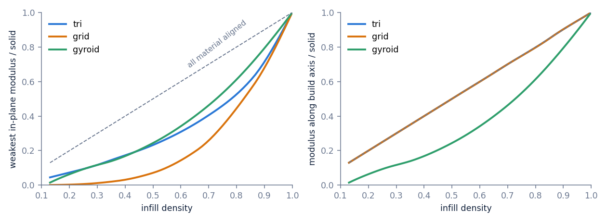
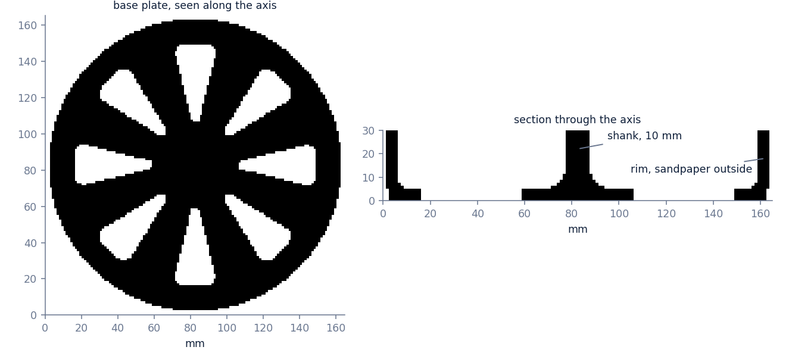
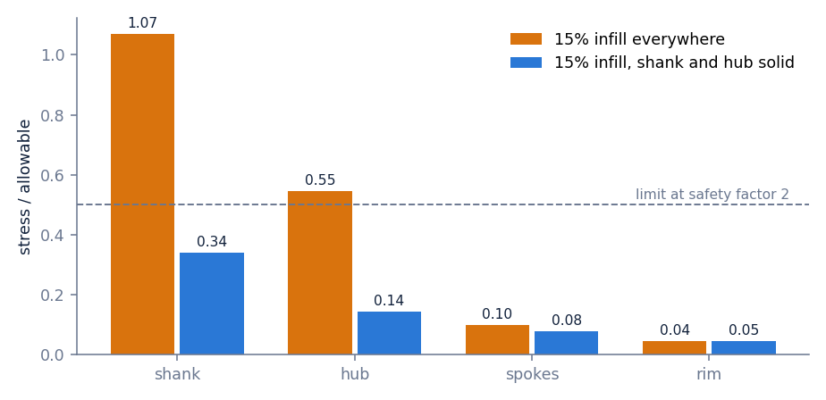
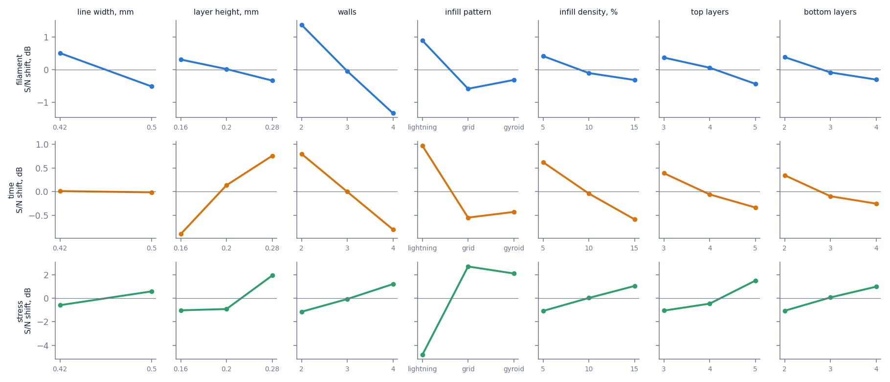

*Figure 1. Toolpaths at three heights. Dark lines are perimeters, orange is solid fill, blue is infill. The thick blue walls sit where the part carries the most load and point along it.*

## Summary

A slicer takes a shape and fills it with one pattern at one density. The part's job never enters. If it has to carry a load, the usual answer is more perimeters and more infill everywhere, then a test print.

Topoprint takes the job first: where the part is held, where it is loaded, how much plastic it may use, and which way is up on the bed. It returns G-code. In between it runs finite element analysis (FEA), which solves for how a part deforms under load, and topology optimization, which moves material to where the analysis says it is working. Infill is not decoration added afterwards. It is a design variable, with stiffness computed from the actual printed pattern.

On the test part, a wall bracket under 200 N, the model predicts 0.79 mm of deflection at 21% of the envelope mass. The same envelope printed the usual way, two perimeters and 20% gyroid, deflects 0.99 mm at 33%. That is 1.25 times the stiffness for 36% less plastic, and the part needs no support.

| Item | Detail |
| --- | --- |
| Period | November 2026 to present |
| Role | Sole author, with groups of Claude agents working two sub-problems |
| Deliverables | The `topoprint` package: adaptive FEA, unit-cell homogenizer, optimizer, slicer; a bracket design with G-code; 10 verification tests |
| Tools | Python, NumPy, SciPy, PyTorch (for gradients), PyAMG |

## 1. What a print needs before it is a part

A print that carries load in service needs four things known before the spool turns.

| Requirement | Usual slicer workflow | Here |
| --- | --- | --- |
| Stiffness under the real load | found by printing and testing | predicted, with the mesh error stated |
| Material where the load is | uniform infill, chosen by feel | density and wall direction set per 2 mm voxel |
| Prints without support | checked by eye, supports added | enforced during optimization |
| Tolerance to a load that is a bit off | not considered | worst direction in a stated cone is designed for |

The fifth requirement is strength, and it is not here yet. Section 7 says what is missing.

## 2. The loop

*Figure 2. Top: material density at cycles 1, 3 and 7. Bottom: the analysis mesh, darker is finer.*

Two fields live on a grid of 2 mm voxels. Occupancy says where the part is. Infill density, between 15% and 70%, says how much wall each voxel gets. One cycle does five things:

- builds a mesh for the current design, coarse where it is uniform and fine where the error estimate is large;
- solves for the deflection under every load case;
- moves both fields along the gradient at fixed mass;
- applies the print rules: every voxel supported from below within 45°, a solid shell on every outer surface;
- once, tries eight load directions on the rim of a 20° cone and adds the worst one as a second load case.

The mesh is an octree of cubes, each one splitting into eight where more resolution is needed. The final check used 73,257 unknowns. A uniform mesh at the same finest size would need 470,547.

## 3. Infill as a material

*Figure 3. Stiffness of three infill patterns as a fraction of solid plastic. Left: the weakest in-plane direction. Right: along the build axis.*

Topology optimization normally treats half-dense material as a fiction to be penalized away. A printer makes half-dense material all the time. So each infill pattern is solved once as a repeating cell, at eight densities, and the resulting stiffness becomes the material law. Stiffness at 30% is then the stiffness of a printable 30% infill, in every direction.

Two things fall out of Figure 3. A square grid is stiff along its walls and has almost no shear stiffness, so a load 15° off its axis finds very little. And any pattern that is constant along the build axis is as good as solid per gram in that direction, which gyroid is not.

## 4. The bracket

| | Optimized | Shell + 12% gyroid | Shell + 20% gyroid |
| --- | --- | --- | --- |
| Deflection at the load, mm | 0.79 | 1.70 | 0.99 |
| Deflection, worst direction in the cone, mm | 0.78 | 1.71 | 1.01 |
| Mass, fraction of the 96 × 48 × 32 mm envelope | 0.214 | 0.267 | 0.333 |

Inside the part, infill density follows the work the material does. Ranking interior voxels by strain energy, the least-loaded quarter averages 17% infill and the most-loaded quarter 34%. Most of the interior sits near the 15% floor, because for stiffness it is usually better to remove lightly loaded material than to thin it, and the solid shell already carries the peak bending stress.

Over the last three mesh refinements, from 37,605 to 73,257 unknowns, compliance moved 1.1%, and 0.4% on the final step.

## 5. From fields to G-code

The slicer is written for this job. Each 0.2 mm layer gets two perimeters, solid skins where the part starts or ends within four layers, solid fill under the load pad, and a triangular infill whose walls are one to six extrusion passes wide. The walls never overhang, because the pattern is the same on every layer.

| Check | Result |
| --- | --- |
| Voxels with no support within 45° below | 0 of 6,441 |
| Separate bodies | 1 |
| Layers | 160 |
| Extruded path | 150 m perimeter, 39 m solid, 124 m infill |

The output is a Bambu `.gcode.3mf` for a P1S in PLA. The start and end sequences are lifted from a file Bambu Studio sliced for the same footprint, so homing, bed levelling, purge and temperatures are the vendor's own. Only the layers between are mine. Where infill lines of different directions cross, the later line stops at the earlier one, so a crossing is printed once.

Every file is replayed before it is offered to the printer.

| Replay check | Result |
| --- | --- |
| Extrusion inside the 256 mm bed | yes |
| Extrusion outside the part outline | 0 mm |
| Peak flow, limit 12 mm³/s | 11.5 mm³/s |
| Travel over 2 mm without retraction | 0 |
| Mass in PLA | 34.7 g |
| Same spec, second run | byte-identical file |

The last row is deliberate. The pipeline has no random step: the same inputs give the same design, the same compliance history and the same G-code, and a test holds it to that.

## 6. What the agents found

Two sub-problems went to groups of Claude agents. Each candidate was Python code scored by the solver, then re-scored on cases the agents never saw.

Which infill cell is stiffest per gram when stress is larger in one direction? Two independent runs converged on the same answer: a triangular lattice with one family of walls 2.4 times thicker, turned toward the larger principal stress. Along the thick walls it is about 55% stiffer than the plain lattice, across them about 30% softer. Each voxel of the bracket now chooses which of the three wall directions gets the thick walls. That alone cut deflection from 0.97 mm to 0.79 mm at the same mass.

Where should the mesh refine for a fixed number of unknowns? The runs showed my refinement rule was leaving half its budget unused: 3.1% error where 0.3% was available by marking twice as many elements per step. I took that fix. The agents' own rules were better still on a rotated load they had not seen, 0.19% against 0.66%, and worse on a second unseen design, so they are not in yet.

One negative result. Random ligament networks, after a 2026 Nature paper on scale-rich metamaterials, are a natural fit for extrusion lines. For stiffness they lose badly: 0.18 to 0.31 of the ideal against 0.44 to 0.52 for the lattices, because walls that end on other walls carry load in bending.

## 7. What stands between this and a part I would trust

- Nothing is printed. The plan is the optimized bracket and the 20% gyroid baseline, loaded on an Instron, with measured stiffness fed back into the material law.
- The bracket optimizer minimizes deflection only. The strength check in section 8 came later and is not yet a constraint inside it. Buckling of thin walls is not modelled at all.
- The file extrudes 27.5 cm³ against the 23.8 cm³ the optimizer counted. The model smears the shell over 2 mm voxels and comes out about a sixth light.
- The infill-as-material assumption was checked on one layer. With every wall resolved, the layer is 1.17 times as compliant as the model says, so the deflections above are optimistic by roughly that much. An earlier version of this page said the opposite. That check had run on toolpaths that printed the shell twice.
- The base plastic is taken as isotropic at 3,000 MPa. The printer file passes its replay check but has not run on a machine.

## 8. A second part: a sanding drum

*Figure 4. A 164 mm drum, 30 mm tall. Sandpaper wraps the outside of the rim, the 10 mm shank goes in a drill chuck, and the tool opens up a bore in another part by 3 cm.*

The bracket's shape was free. This one is fixed, and the question changes: what slicing uses the least filament and time and still holds up? The part came in as a STEP file. Occupancy was frozen, and two load cases were applied: 3.3 N·m of sanding drag all round the rim, and a 50 N side press with 40 N of drag on a 40° patch. Stress is checked three ways with separate limits: 45 MPa in the layer plane, 25 MPa in tension across layers, 20 MPa in shear between layers. Those are assumed values for PLA, and the target is a safety factor of 2.

*Figure 5. Stress over allowable, by region. The spokes and rim are nowhere near their limit. The shank is.*

The physics prunes the search before any search runs.

- The shank decides everything. It prints with its layers stacked along the axis, so drive torque is carried as shear between layers. With 15% infill it sits at 1.07 of its allowable. Printed solid with the hub it drops to 0.34 in the model. A hand calculation at the shank surface gives 0.84, above the target, so I would not trust a printed 10 mm shank beyond light passes. A bolt through the hub as the arbor is the real fix.
- Orientation is not close. Base down needs no support: 83 g and 2 h 01 at default settings. Open side down is 119 g and 5 h 16. On its side is 122 g and 4 h 42.

What is left is seven slicer settings. A full grid over them is 1,458 slices. A Taguchi L18 array covers them in 18, each one sliced by Bambu Studio for filament and time and solved for stress and deflection. Each setting is also scored under four noise conditions: nominal and 1.5 times torque, full and 70% layer-bond strength, and the side press landing over a spoke or over a window. The noise is free, because the model is linear in load.

*Figure 6. Effect of each setting, higher is better. Wall count sets filament. Infill pattern sets stress: lightning infill is lightest and leaves the rim and spokes unsupported. Thick layers help time and stress together.*

| | Filament | Time | Worst stress over allowable, four noise conditions |
| --- | --- | --- | --- |
| Bambu default, shank and hub solid | 86.8 g | 2 h 06 | 0.20 |
| Taguchi choice, shank and hub solid | 67.9 g | 1 h 30 | 0.50 |
| Predicted for that choice from the 18 runs | 68.9 g | 1 h 28 | |

The choice is 0.28 mm layers, 2 walls, 5% gyroid, 3 top and 2 bottom layers, 0.42 mm lines. Filament and time alone would have picked lightning infill. The strength check moved it to gyroid. It saves 22% of the filament and 29% of the time against the default and lands exactly on the safety factor of 2 in the worst noise condition, so there is no margin beyond the target. The additive prediction was within 2% of the confirmation run, which is what says 18 runs were enough.

Two things the model does not see here. Top skins over 5% infill bridge a long way, and 10% is the safer print. And sanding makes heat at the rim, which matters for PLA.

## 9. Next: what else can be free

| Variable | Today | Next |
| --- | --- | --- |
| Occupancy | free on the bracket, frozen on the drum | free inside a keep-out envelope, so a given part can lose material |
| Infill density per voxel | free | unchanged |
| Thick-wall direction | three choices per voxel | continuous, following the stress |
| Infill pattern | one per run | chosen per region from the cells the agents found |
| Walls, skins, layer height, line width | swept by Taguchi array on the drum | the same array on every part, then refined around its optimum |
| Print orientation | three poses compared | searched, with strength across layers as the reason |
| Solid regions | set by hand from the stress result | set by the minimum-filament loop |
| Material | an input | a factor, once strength data per filament exists |

The objective has to widen with them. Today the bracket minimizes deflection at fixed mass. The drum needed least filament subject to strength, with print time taken from the slicer. A loop for that exists: it starts every voxel at the infill floor and raises density only where stress is over the limit. On the drum, 0.5% of voxels were over at the floor, all in the shank, and six steps were not enough to converge there. Buckling and heat are still outside the model.

The search itself should stop being a grid. The order that worked on the drum is: prune with physics, screen with an orthogonal array, confirm the prediction, then let the agent groups propose settings against the slicer and solver as judge.
