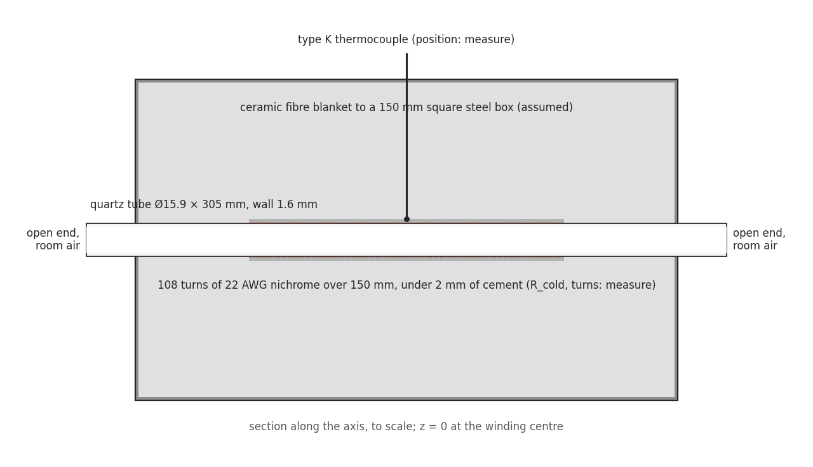
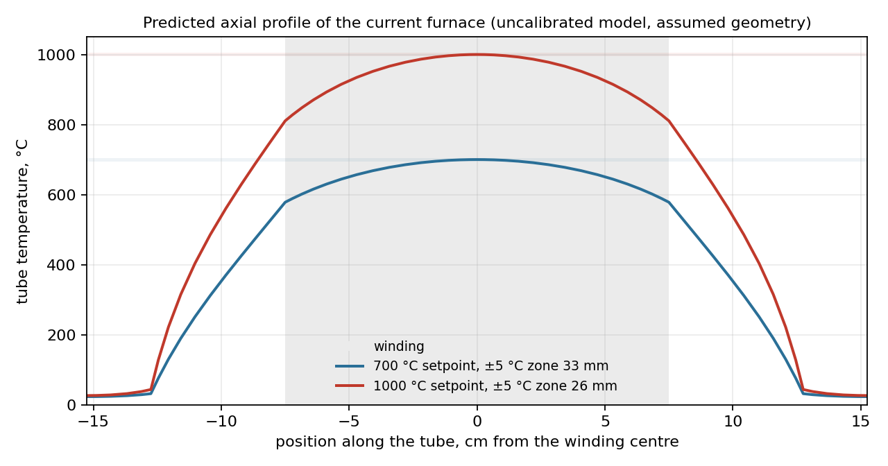
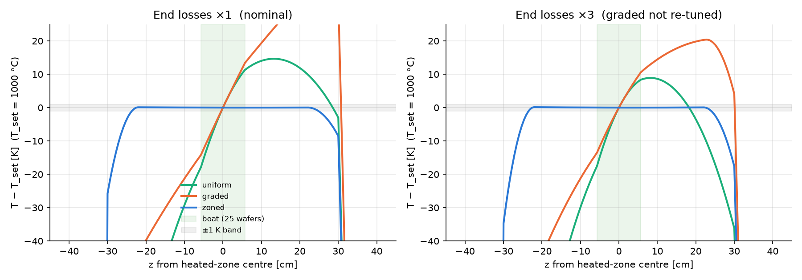

# Why

## A furnace nobody had characterised

Toronto Hacker Fab's tube furnace was built by three members from a build video. It reaches 1000 °C and glows. I took on the rework after it was built.

The audit found two things: mains wiring that can short to the case, and no one knew its temperature profile.

# What it is

## Predict it before measuring it

A 1-D simulator of the furnace as it stands. It predicts every number the first logged run will produce, each with a band from the dimensions I have not measured yet.

So the first run is a test, not a survey.

# The problem

## What the furnace is for

It grows oxide on silicon, and later diffuses dopants. Both rates are exponential in temperature.

So the questions are: where is the temperature flat, how well is it held, and what is the gas.

## What makes it hard

- Nichrome wound directly on a 5/8 in quartz tube, one thermocouple, both ends open.
- Eighteen inputs I have not measured.
- A relay that fails closed.

# The work

## Fix the hazard first

Sleeving, ceramic terminals, strain relief, an earth and insulation check. And an over-temperature limiter with its own sensor, independent of the controller.

## One length explains the profile

An end loss decays over about 7 to 9 cm. The winding is 15 cm. The two ends overlap, so there is no plateau, only the top of an arch.

## The flat zone is 26 mm

±5 °C at 1000 °C, with a band of 17 to 41 mm over the unmeasured inputs.

Checked by hand and by 230 tests against analytic limits and conservation.

## 48 seconds to the quartz limit

If the relay fails closed the furnace runs away at about 2 K/s. That is the number the limiter has to beat, and the fault test runs at 300 °C where a failure does no harm.

## The weather sets the oxide

Water oxidises silicon about 30 times faster than oxygen per atmosphere. Room air holds enough of it that the two contribute about equally.

A hygrometer reading per run is the cheapest valuable instrument on the list.

## Measure what narrows the bands most

A screening over the eighteen unmeasured inputs ranks the cold measurements. The list takes an hour with the furnace unplugged.

Then five experiments, each built to estimate named parameters, not to produce curves.

## It also picks the next furnace

The same model over 36 worst cases for three heater layouts. Only three independent zones stay within ±1 K across the boat.

## Ask me about

- Nothing is measured yet, and why I did it in that order
- How the model is verified
- Why the colour chart cannot check the oxide
- Why one sensor cannot flatten the profile
