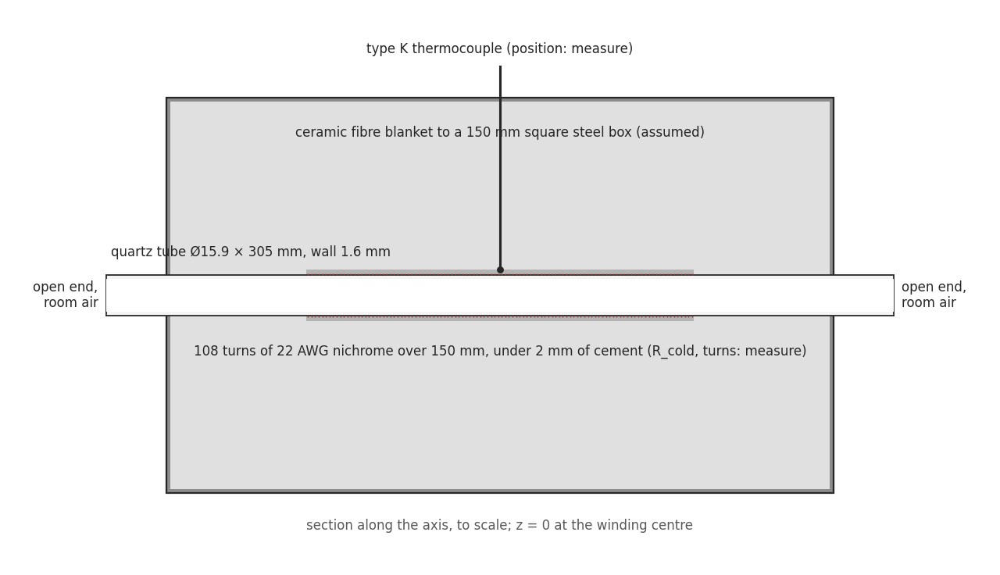
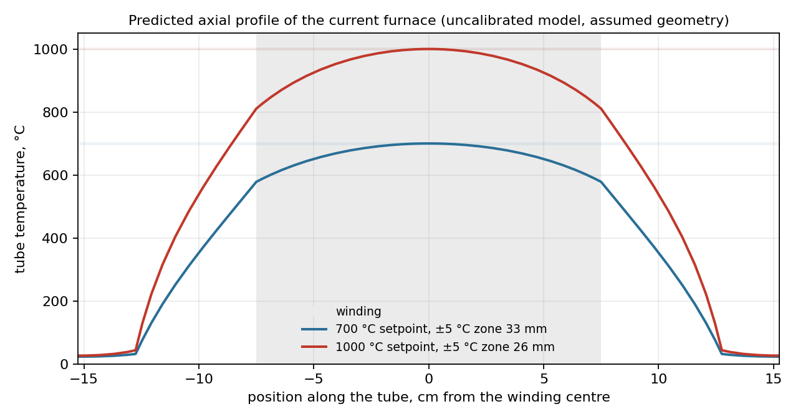
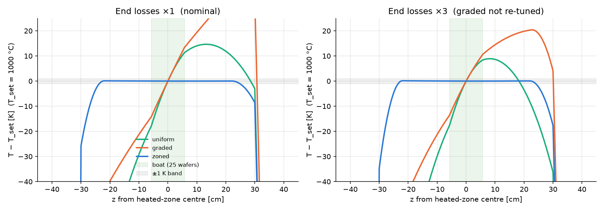

*Figure 1. The build as the model sees it, to scale. The dimensions marked "measure" are placeholders until a tape measure and a multimeter replace them.*

## Summary

Toronto Hacker Fab's first tube furnace was built by three members of the chapter from a build video: 22 AWG nichrome wound directly on a 5/8 in quartz tube, refractory cement over the wire, ceramic fibre blanket in a carbon steel box, one type K thermocouple and a ramp-and-soak PID switching a solid-state relay. It reaches 1000 °C and glows. I took on the rework after it was built. The audit found mains wiring running unsheathed inside the earthed case, and nobody knew the furnace's temperature profile, its ramp, its losses or its oxide rate. Before running it again I wrote a 1-D simulator of the build as it stands and made it predict every number the first logged runs will produce, with a band for each from the dimensions I have not yet measured. The model is verified against analytic limits and conservation by 230 tests and cross-checked by hand. It says the ±5 °C flat zone is about 26 mm, that the furnace runs away at 2 K/s and reaches the quartz limit 48 s after a relay fails closed, that the element sits near 1150 °C at full power, and that room humidity oxidises silicon in this furnace about as fast as the oxygen in the air does. A ranked measurement list and a designed set of five experiments follow from the model's own sensitivities. The same simulator, run over 36 worst cases, chooses the heater architecture for the furnace that comes after this one. There are no measurements yet. That is the point of the page: the runs will be a test, not a survey.

| Item | Detail |
| --- | --- |
| Organisation | Toronto Hacker Fab |
| Period | October 2026 to present |
| Role | Furnace rework lead: the hazard audit and fix, the specification, the simulator, the measurement plan |
| Deliverables | The `furnace` simulator (eight physics modules, parameter store with provenance, 230 verification tests, browser UI), the hand-calculation script that pins its numbers, the first-run prediction sheet, the measurement ranking, the experiment design, the v2 architecture study |
| Tools | Python, NumPy, SciPy, SALib, matplotlib, pytest, FastAPI, Plotly, Playwright |

## 1. The furnace as inherited

| Item | As built | Known or assumed |
| --- | --- | --- |
| Tube | Fused quartz, 5/8 in outside diameter, 12 in long | known |
| Heater | 22 AWG (0.65 mm) nichrome wound on the tube, under refractory cement | known; turns, pitch and wound length assumed (108, 1.4 mm, 150 mm) |
| Element resistance, supply | 18 Ω cold at 120 V, about 750 W hot | assumed. The build post says a 120 V outlet and lists a NEMA 6-15P cord, which is a 240 V plug |
| Insulation | Ceramic fibre blanket and board in a carbon steel box bonded to protective earth | known; box 150 mm square assumed |
| Control | Ramp-and-soak PID, type K thermocouple, 40 A solid-state relay at a 2 s cycle, 20 °C/min to 1000 °C, hold 30 min | known; thermocouple position unknown |
| Ends, ambient | Both tube ends open to the room, no gas system | known |

The furnace exists to grow oxide, and later to diffuse dopants. Both are Arrhenius rates, so what the wafer sees is the temperature at its position, held for a time, in an ambient. The questions a process tool has to answer are where that temperature is flat, how well it is held, and what the ambient is. The theory behind the oxide, from the flux balance to the Deal-Grove law and its activation energies, is worked through by hand in [the notebook entry on tube furnace theory](/EngineeringPortfolio/projects/tubefurnace/log/2026-10-10-tube-furnace-theory/).

## 2. The hazard and the fix

Inside the case, the mains conductors to the element run unsheathed past the steel. The case is bonded to protective earth, which turns a short into a tripped breaker rather than a live box, but it does not stop the short. The fix specified before the next run:

- sleeving rated above the temperature it sees on every conductor near the hot zone, ceramic terminal blocks, mains routed away from the tube;
- strain relief at every case exit, and a residual-current device at the plug;
- a resistance check from each mains conductor to the case with the furnace unplugged (anything under 1 MΩ is a fault) and from the case to the plug's earth pin (under 0.1 Ω);
- an over-temperature limiter with its own sensor driving a contactor, independent of the controller, because the solid-state relay fails closed. Section 5 gives the number it has to beat.

## 3. What the furnace has to do

These are the acceptance numbers I will hold the build to. Each is a furnace specification in the form a datasheet would state it, and each has a test.

| Requirement | Target | Test |
| --- | --- | --- |
| Flat zone at ±5 °C | long enough for a piece and its neighbour, stated as a length | traversing thermocouple scan at 700 and 1000 °C |
| Overshoot at the end of the ramp | reported; ≤ 2 °C for v2 | logged thermocouple |
| Ramp | 20 °C/min held by the controller, within the quartz tube's limit | logged ramp |
| Box surface at 1000 °C | below the accessible-surface limit of the lab equipment standard | infrared survey, six faces |
| Runaway on a failed relay | limiter trips before the quartz limit | fault injection at a 300 °C setpoint |
| Oxide at 1000 °C for 60 min in room air | predicted thickness, two runs, repeatability stated | colour chart against a bare reference, humidity logged |
| Oxide as thermometer | temperature backed out of thickness agrees with the thermocouple | pieces at five positions against the scan |

## 4. The model

The simulator is one-dimensional along the tube. Each axial cell carries the tube, the cement and the winding, with the insulation as a column of radial nodes out to the box, so the blanket's slow charging during a run is resolved rather than lumped. The square box enters through the conduction shape factor for a cylinder in a square, which replaces a 2-D solve. Bore radiation is a conductance that scales with the cube of the bore radius, small here because the bore is 12.7 mm. The wafer side (Deal-Grove with the oxidant fluxes of O₂ and H₂O in parallel, dopant diffusion, junction depth, sheet resistance) takes the furnace temperature at each position and runs separately.

Every physical value lives in a parameter file with its unit, source and a status: literature, assumed, or measure. Every relation has a test against an analytic limit or a conservation law, 230 in all. A script computes the hand estimates from the same parameter file, so the model is checked against arithmetic I can follow, and the differences are explained rather than hidden.

The one argument that shapes everything is the decay length. The tube obeys a fin equation with axial conductance $K$ and radial conductance $G$:

$$\frac{d}{dz}\left(K \frac{dT}{dz}\right) + q'(z) - G\,(T - T_\infty) = 0$$

An end deficit decays as $e^{-s/\ell}$ with $\ell = \sqrt{K/G}$. For this build $\ell$ is 6.6 cm from the tube and bore alone and 8.8 cm with the blanket's own axial conduction, against a wound length of 150 mm. The two end regions overlap completely. There is no plateau. The profile is a single arch, and the only flat zone is the top of it.

*Figure 2. The predicted profile at two setpoints. The grey band is the winding. At 1000 °C the winding ends sit 200 to 300 K below the centre, depending on where the open-bore radiation is taken to leave.*

## 5. Predictions for the first run

Each row is what the logged run will show, from the model at the assumed dimensions. The band is the minimum and maximum over a screening sample of every unmeasured input, not a confidence interval. The hand value is the same quantity by the closed-form estimate.

| Response at 1000 °C | Model | Band over the unmeasured inputs | Moved most by | Hand |
| --- | --- | --- | --- | --- |
| Steady relay duty | 8% | 5 to 34% | element cold resistance | 13% |
| Loss | 61 W | 51 to 163 W | blanket conductivity | 95 W |
| Box surface temperature | 80 °C | 42 to 212 °C | shell film coefficient | 64 to 88 °C |
| Time to 1000 °C from cold | 49 min | 49 to 63 min | the controller's own ramp | |
| Overshoot at the end of the ramp | 7 °C with a plain PID, 0.2 °C with ramp feed-forward | 0 to 2 °C | blanket participation | |
| Duty at the start and end of the 30 min hold | 12% falling to 9% | | the blanket is still charging | |
| Cool-down rate, heater off, at 900 and 700 °C | 35 and 17 °C/min | 6 to 59 at 1000 °C | box size | 18 at 1000 °C |
| Flat zone at ±5 °C | 26 mm | 17 to 41 mm | wound length | about 30 mm |
| Centre minus winding end | 190 K | 81 to 538 K | wound length | |
| Element temperature at full power | 1153 °C | 1040 to 1326 °C | element cold resistance | 1153 °C |
| Element surface load at full power | 6.9 W/cm² | 1.5 to 17 W/cm² | element cold resistance | 6.9 W/cm² |
| Runaway from 1000 °C to the quartz limit, relay failed closed | 48 s | 19 to 310 s | element cold resistance | 102 s to 1200 °C |
| Oxide at the centre, 60 min, room air at 50% RH | 44 nm | 39 to 55 nm | room humidity | |
| Oxide at the centre, 30 min | 35 nm | 33 to 41 nm | room humidity | |

Three of these are findings in their own right.

The relay fails closed and the heater is seven times the losses, so the furnace runs away at about 2 K/s. The limiter has to act within tens of seconds. The fault-injection test does this at a 300 °C setpoint, where a failure does no harm.

Room humidity matters as much as the oxygen. At 1000 °C the parabolic rate constant per atmosphere is about 30 times larger for water than for oxygen, and room air at 20 °C and 50% RH holds 0.012 atm of water against 0.21 atm of oxygen. The two contributions come out nearly equal, so a "dry" oxidation in this furnace depends on the weather, and a hygrometer reading per run is the cheapest valuable instrument on the list.

The colour chart cannot do what I wanted it to. Its 10 nm resolution is 7% at 150 nm, but the model predicts 35 to 44 nm oxides at 1000 °C, and the position-to-position differences that would make the pieces a thermometer are 1 to 9 nm. That check needs a reflectometer or holds of four hours. Both options are in the experiment design.

## 6. The measurements, ordered by what they buy

A Morris screening over the eighteen unmeasured inputs ranks the cold measurements by how much of each prediction's spread they remove. The whole list takes an hour with the furnace unplugged.

| Rank | Measurement | What it pins |
| --- | --- | --- |
| 1 | Wound length, turn count, start and end of the winding | the flat zone |
| 2 | Room temperature and humidity, at every run | the oxide thickness |
| 3 | Box inner dimensions and blanket thickness | the box temperature |
| 4 | Element cold resistance, lead resistance | the duty, the power, the element temperature |
| 5 | Blanket grade and density | the losses |
| 6 | Supply voltage and the plug actually used | everything dynamic, by a factor of four. It ranks sixth only because the resistance range is wider. It is the first thing to settle |

Then five experiments, each designed to estimate named parameters with a stated resolution rather than to produce curves.

| Experiment | Levels | Estimates | What the design showed |
| --- | --- | --- | --- |
| Logged ramp, hold and free cool-down | 700, 850 and 1000 °C, one repeat | losses against temperature, effective heat capacity, the controller's plant model | on its own it cannot separate the blanket conductivity from the shell film coefficient (correlation 0.98). Logging the heater power with a clamp meter to 0.5% instead of reading 2% off the controller is what separates them |
| Profile scan with a second thermocouple | 1 cm steps at 700 and 1000 °C, both directions | axial and radial conductance and the end losses separately | the scan points outside the winding are what make it work: without them the parameter uncertainty is three times larger |
| Oxidation of silicon pieces in room air | 1000 °C for 30 and 240 min, 900 °C for 240 min, plus a run at 5% RH behind a desiccant | rate constants and the thin-oxide offset at this ambient | the plan's original 30 and 60 min cells leave the parabolic constant unidentified with the colour chart; the long holds and the dry run fix that |
| Element life | cold resistance before and after every run | resistance drift against the model's element temperature | the element runs near its limit at full power |
| Safety verification | infrared survey of the box, earth continuity, insulation resistance, limiter fault injection at 300 °C | the box temperature and the limiter's response against the runaway time | |

Each of these rehearses a v2 acceptance test. When the next furnace is specified, every line of its sheet will have been measured once at this scale, with a known resolution.

## 7. What it feeds: choosing the next furnace

The same simulator, with the v2 geometry from the system specification (a 60 cm heated length, a 25-wafer boat, 2.4 kW), was run over 36 worst-case scenarios for three heater architectures. The criterion is the spread of junction depth and oxide thickness across the boat, which is what the process cares about.

| Design | Junction depth spread, goal 3% | Oxide spread, goal 2% | Flat zone at ±1 K with 2 slm of gas | Overshoot |
| --- | --- | --- | --- | --- |
| Uniform winding | 81% | 50% | 0.8 cm | 2.7 K |
| Graded winding | 79% | 48% | 0.8 cm | 24.8 K |
| Three zones | 0.9% | 0.5% | 48.5 cm | 3.1 K |

*Figure 3. The v2 geometry at 1000 °C with 2 slm of gas. Left, nominal end losses. Right, end losses tripled. Only independent zones stay within ±1 K across the boat.*

Three pieces of physics force the result. The insulation that keeps the shell touch-safe makes the decay length longer than the furnace, so the ends reach the centre. Process gas is a heat pump: 2 slm of nitrogen carries about 42 W from the inlet end to the outlet end and tilts the profile by 2.6 K/cm across the boat. And a controller can only null as many shapes as it has sensor-heater pairs: one sensor fixes the level, a graded winding cancels one symmetric droop, and only three zones correct the tilt as well. The conclusion holds whether the uncalibrated bore-radiation factor is halved or doubled. The same cheap experiments above, the scans at two flows and the pieces as a thermometer, are what calibrate it.

## 8. Status

As of 2026-10-11: the simulator and the plan exist, the hazard fix is specified, and no run has been logged. Next, in order: the cold measurements, the wiring fix and the earth and insulation checks, the limiter and its fault-injection test, then the logged ramp and the scans. The oxide runs wait on silicon pieces and on a reflectometer or the long holds.

Open items only the hardware can settle: the supply voltage, where the thermocouple sits (against the winding it reads the element, in the bore it reads the process, and the oxide runs will tell which), and whether the 2 W/cm² surface-load limit I am using for the nichrome is the right vendor number. The build cost, parts list and a comparison against a commercial tube furnace's datasheet are to come with the measurements.
